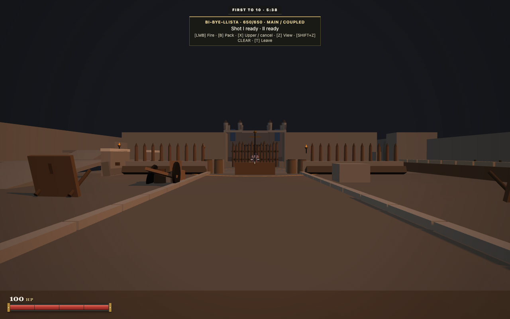
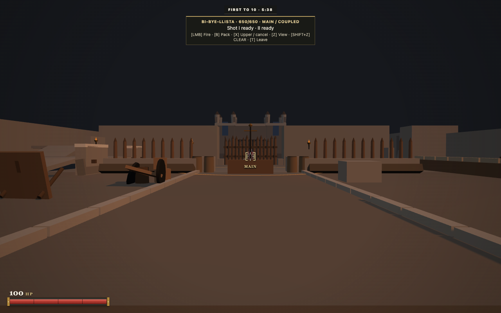
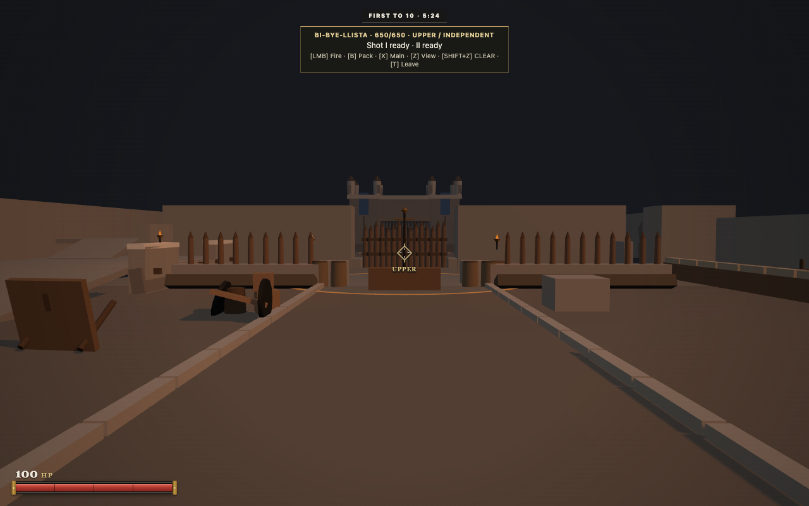
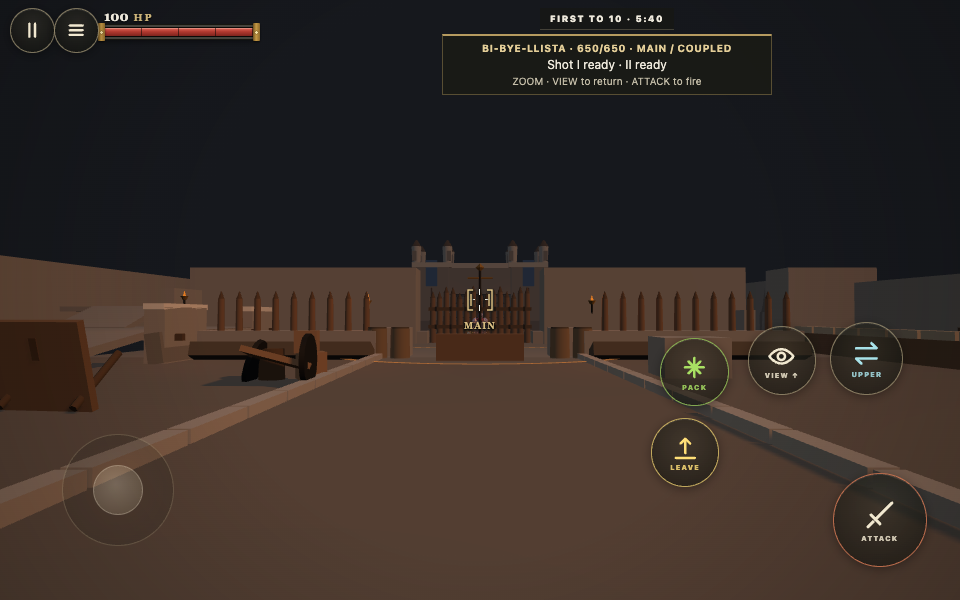
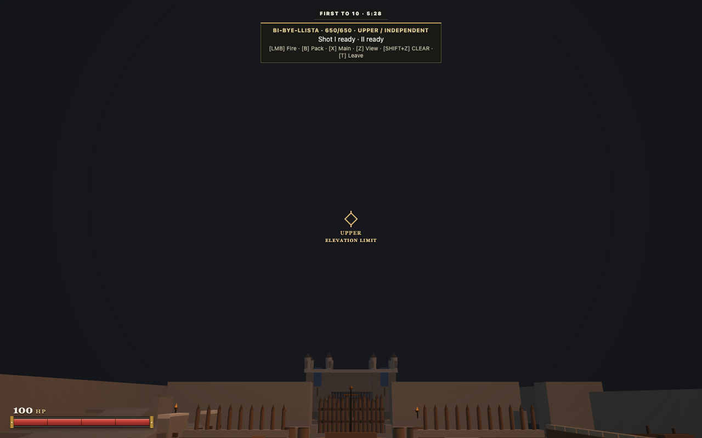
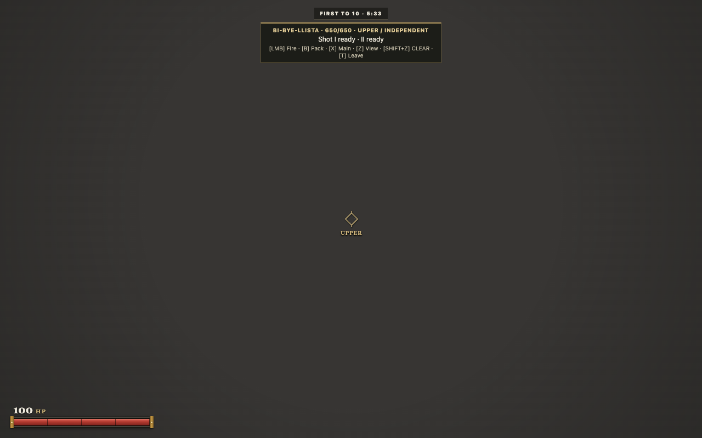
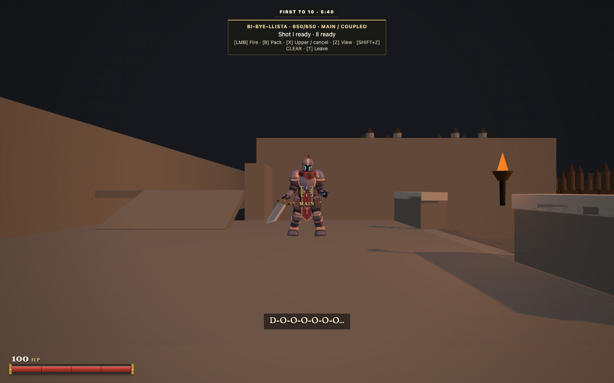
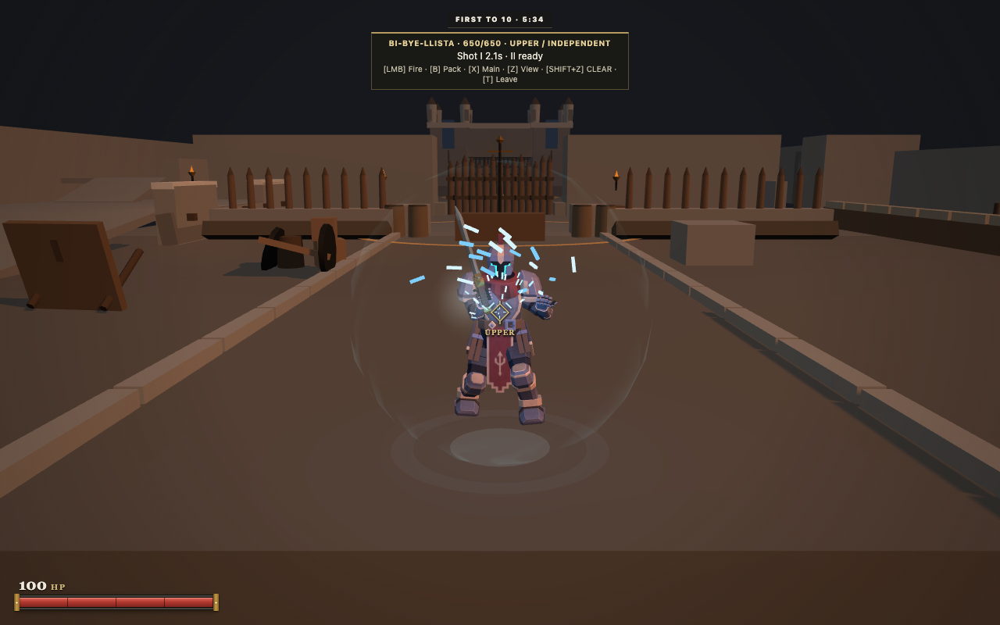

# Bi-Bye-llista CLEAR aiming

CLEAR now uses a consistent perspective magnification of 1.82, with a short exponential transition and angular input scaled with the zoom. MAIN has brass double brackets; UPPER has a diamond. Small labels identify the active assembly and real traverse/elevation limits. Existing hit, Frostfire and parry confirmations remain visible.

## Matched views

Both captures use the same Outerworks fixture, browser, 1280 × 800 viewport, 78° player FOV and target about 41 m from the carriage.

| Previous CLEAR | Revised CLEAR |
| --- | --- |
|  |  |

[Previous firing and reload](before-volley-reload.webm) · [Revised impact, reload and weapon switch](after-volley-reload.webm)

## Measurements

| Player FOV | Previous CLEAR | Revised CLEAR |
| --- | --- | --- |
| 65° | 45.5° | 38.61° |
| 78° | 54.6° | 48° |
| 100° | 70° | 66.47° |

At 78°, the same 10 px mouse motion changed yaw by 0.0235 radians before and 0.012921 afterward. Emulated touch changed from 0.058 to 0.031889 radians. This preserves fine screen movement at increased magnification. The recorded largest FOV entry step fell from 23.4° to 5.43° at the capture cadence. These are input and transition measurements, not a claimed frame rate improvement.

Fresh authoritative fixtures exercised MAIN and UPPER at approximately 9, 20 and 41 m, plus 65° and 100° player FOV. Every measured spawned projectile axis passed within 0.001 m of the host aim target and produced an actual player impact. MAIN remained 85 damage and UPPER 18; coupled fire still released both. No projectile damage, cadence, velocity, straight trajectory or aim solver changed. See [recorded authority events and optics samples](browser-summary.json).

The principal sight projects the actual selected muzzle ray against the camera aim surface and world obstruction. A secondary chevron represents the upper ray only during coupled alignment and only when visibly separated by 10–90 px. Coincident rays share the principal sight. Offscreen axes hide their marker while retaining the weapon/limit label. No drop ticks, leading or target snapping are added. Existing authored weapon recoil remains; extra camera kick was omitted to keep precision aim steady.

## Verification

Actual desktop keyboard/mouse and emulated touch covered mount, deploy, mobile UPPER, coupled MAIN, View/Shift+View and touch View gestures, zoom entry/exit, turning, independent weapon switching, complete reload, dismount/remount, Escape, destruction and pointer cancellation. A second connected browser observed the real authored reload: the late loaded bolt remained visible in every sampled observer frame, while CLEAR hid it locally.

The final interpolated CLEAR camera is clipped from the inclined operator anchor as well as at its destination. Rearward fire hit the actual camp wall instead of passing through it. A 6.84° ramp fixture preserved the inclined muzzle alignment. A real timed Guard parry in CLEAR dealt zero health and stamina damage.

| Emulated touch | Actual elevation limit |
| --- | --- |
|  |  |

| Wall obstruction | Inclined carriage |
| --- | --- |
|  |  |

The extracted HTML5 build also passed actual Practice construction, walking/joystick approach, mounting, deployment, zoom, full reload, MAIN traverse limit, touch cancellation, return to 78° and exit. Physical phones and the hosted itch iframe were not tested.

Gameplay was recorded at `11eef78`, with subsequent extracted build verification at `7bae276`. The final local bolt near-lens cleanup prevents the operator's own flying bolt tail from covering the camera briefly. It is render-only, restores visibility after the local pass, and preserves distant bolts and observers. This last cleanup and the rebase onto main `5e454e0` were verified through focused tests and the full suite. Further play sessions were explicitly waived by the creator; these clips are not presented as fresh recordings of the final commit.

Final runtime revision: `9a6712bf365be825c3d166cf3fb3477738a47a85`.

Final verification: 1,827 repository tests, 19 HTML5/release tests and HTTP/WebSocket smoke checks. ZIP integrity passed. The export contains 994 files, 49,685,730 compressed bytes and 67,321,160 extracted bytes. SHA256: `e11650525e8e71945e7a36c5e94f3be802f57c127c779739197ae1e77054d542`. Only six runtime file slots remain under the existing 1,000 file packaging limit; this task adds one runtime module and no art assets. Evidence stays outside the release archive.

Nothing has been merged or deployed.
