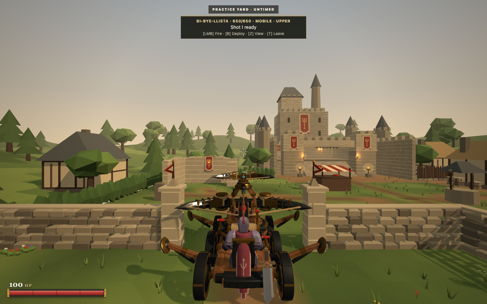
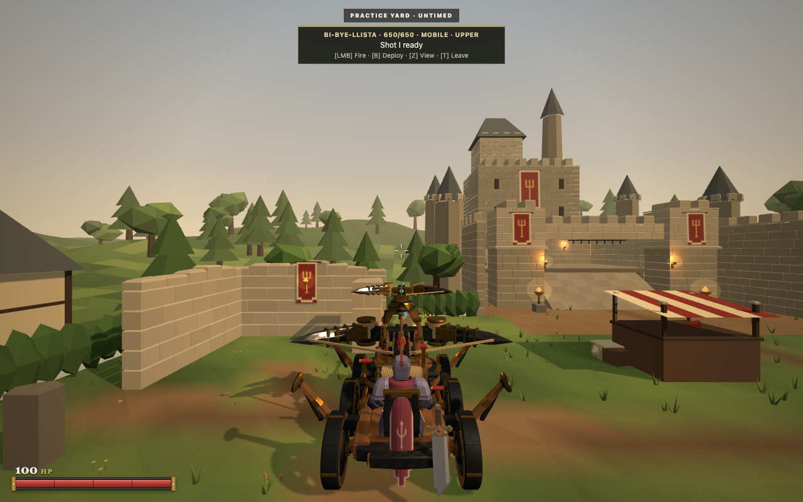
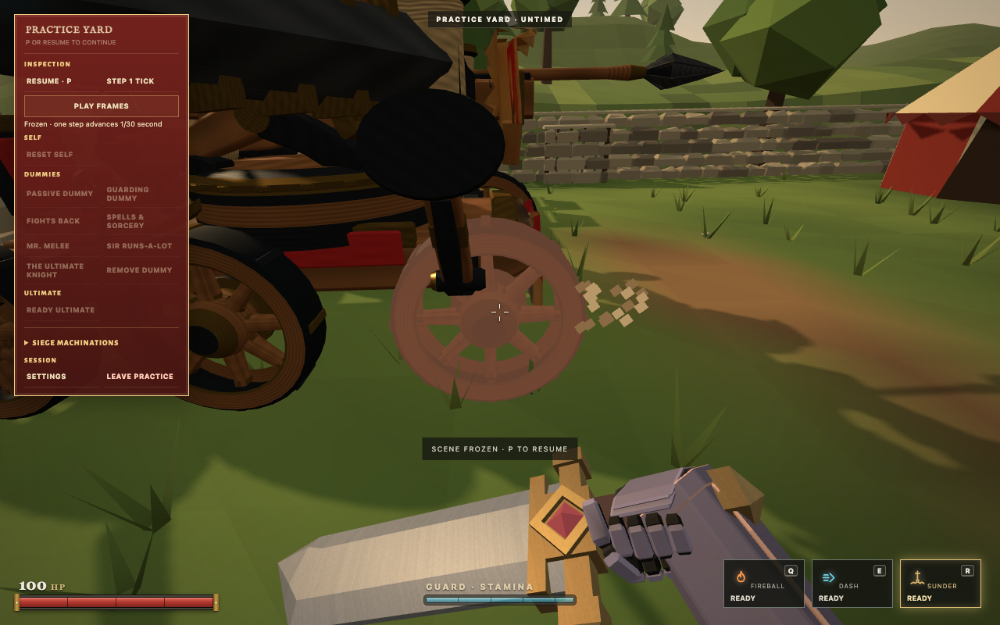
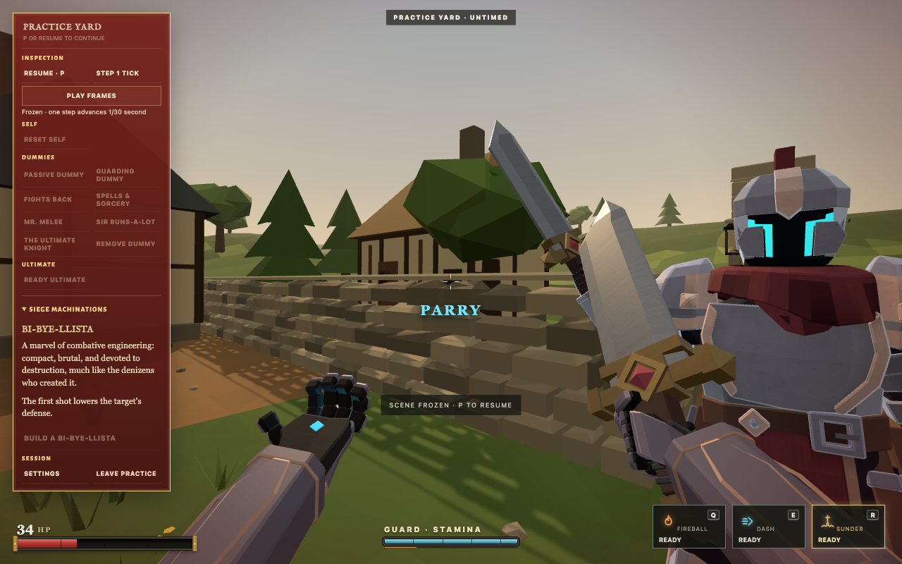
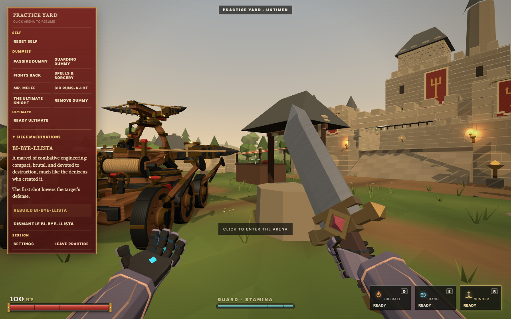
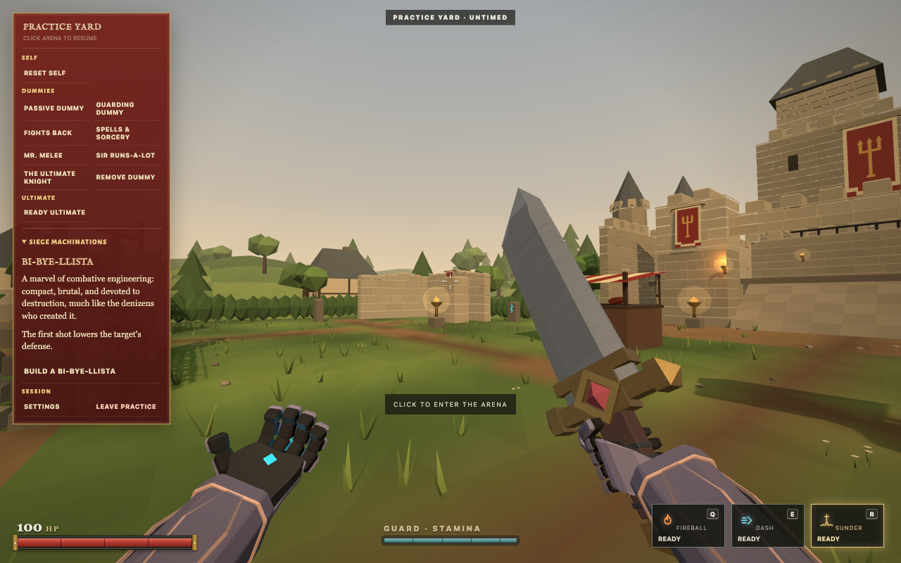
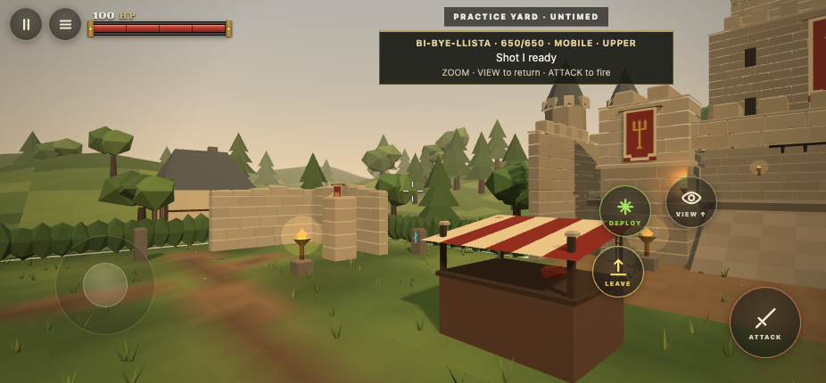

# BiBye clearance, hits and Practice lifecycle

This followup starts at merged PR220, d779c9e. No source GLB, character binary or rollback asset changed.

## Visible changes

The original Tourney gate stopped the machine at z = -8.591. Its 4.9m opening was smaller than the approximately 5.3m main bow. Shortening the stabilizers alone could not solve that. The opening is now physically 6.3m wide, with matching posts, adjoining walls and pennants. Occupied collision remains active, including the supports. An off centre approach still hits a post. The browser fixture drove forward through the gate and reversed back through it.

The original stabilizer construction is reused with 70 percent outward scale and a 105 degree travel fold. Actual measured mobile width falls from 4.574m to 3.765m; deployed width is 3.669m. Hinge heights, hit geometry, damaged alternatives and terrain shoe footprints agree with that change.

Upper aim reaches approximately 20 degrees downward forward and 17 degrees sideways with the main bow level. Raising the main weapon reduces the available depression. The main weapon retains its previous limit. A native Blender mesh sweep sampled 216 configurations without upper/main or upper/operator triangle overlap. A deeper 26 degree rearward projectile ray struck the operator, so that limit was rejected. Shared occupied geometry rays also clear at 1,728 sampled yaw/elevation combinations. These bounded samples do not prove clearance at every possible pose or recoil instant.

A 220ms terracotta pulse marks the actual hull, wheel or stabilizer hit. It decays once and preserves the existing damaged appearance. An ordinary sword hit confirmed only Wheel_FL changed material emission, followed by full pulse expiry. No extra lights or per frame material allocation.

The blue parry camera object, outlined reticle and ground ring are removed. A genuine Mr Melee parry retained recoil, sparks, sound and PARRY text, with zero camera symbol objects.

## Practice tools and safety

Practice starts with no machine. Siege Machinations contains the exact creator copy and contextual Build, Rebuild and Dismantle actions. The panel wraps on desktop and touch and collapses to its small focus hint during play.

Build searches checked sites about 5 to 7m ahead using the authoritative player pose. It validates six wheel support, full occupied clearance, actors, line of sight, deployment grade and shoes, and safe access/exit. Rebuild prefers the existing site. Invalid placement or unsafe operator exit leaves the old machine untouched. Another human's occupied machine cannot be administered.

Rebuild and Dismantle retire the old instance atomically, cancel even a heavy release already committed after Shot I, and remove only that instance's active projectiles. Ordinary combat dismount rules are unchanged. Rebuild restores 650 hull, 120 per wheel and 150 per stabilizer, loaded weapons, uncoupled upper aim and zero movement, while preserving personal health, spells, prowess and dummy state. Reset Self returns the Spellblade to spawn and preserves the machine's damage, location and reload clocks.

Per room revisions and unique machine IDs reject old snapshots/events. Delaying the real GLB until after dismantling did not restore the old vehicle. A replacement started with fresh animation, camera, interpolation and audio state. Its short assembly settle is cosmetic and never delays authority.

## Input and projectile verification

Swiping View upward at least 32 pixels selects a clear camera 40cm ahead of the active muzzle, with modest zoom. The next tap returns to the exact prior third person or sight view. Ordinary taps retain the existing toggle. Cancellation, reset and death do not generate accidental taps.

The 926 by 430 CDP touch run measured 0.400m ahead and FOV54.6 from78. It exercised both return paths, firing and dismantling. The extracted HTML5 ZIP passed the same production touch route with zero page errors.

The reported bolt miss was reproduced with a target crossing the projectile path between host ticks. Collision previously checked the target only at its final position. Both ballista projectile types now sweep relative target movement over the actual flight interval and use the ordinary crouched height. Regression tests preserve wall precedence and genuine near misses and exclude teleport/reset discontinuities. Damage, projectile speeds, recock and committed release timing are unchanged.

Ordinary desktop input passed build, approach, mount, low upper fire, deployment, occupied rebuild, removal and Reset Self. Real WebSocket tests cover independent/coupled releases and the explicit lifecycle. Authority tests cover blocked sites, unsafe exits, foreign operators, pending heavy cancellation and unrelated Practice state.

## Reproduce and limits

Run a local server, supply Playwright's chromium to scripts/bibye-clearance-browser.mjs, and call clearanceBrowser(chromium,{url,folder,only}). Cases are current, touch, gate, damage, late-load and parry. Gate and damage alter only initial served spawn fixtures. Gameplay uses ordinary UI input. The late-load case deliberately submits an old snapshot to test rejection. Raw captures and recordings remain under output/playwright/bibye-clearance.

Chrome captures used headless execution on this Mac. Touch is CDP emulation, rather than a physical phone. Native mouse feel, prolonged internet play and the live itch iframe remain unverified. No new frame pacing gain is claimed. Earlier matched terrain measurements are preserved in the adjacent bibye-terrain evidence.

Final local verification: npm run verify passed 1714 repository tests, 19 release tests, syntax and Smoke OK. The HTML5 archive contains 978 files and is approximately 43.29MB. No merge, deployment or publication.
