# Frost Bolt, directional Guard and CLEAR view

Shot I now produces one blue Frostfire burst at the authoritative impact point and radius. Its ordinary frontal block takes five health and 22 stamina at full exposure, with reduced chill. A properly timed direct contact against the frontal Guard region takes neither health nor stamina and applies no chill. Side and rear hits receive ordinary damage. The heavy second bolt retains its existing rules.

The existing melee implementation supplies the 180 ms parry window and a facing cone, rather than a shared geometric sword parry mesh. Shot I therefore checks a posture relative frontal torso volume as well as its independently tunable 90 degree Guard arc. A low direct contact outside that volume can be blocked but cannot be perfectly parried. Radial splash uses its actual origin and exposure; timing Guard does not parry a nearby explosion.

The frost blast event alone owns the explosion. The existing bolt impact event retains its icy audio through BiByeSound's duplicate protection. One authoritative contact outcome owns each affected defender's reticle confirmation and reaction. Generic conditioning damage does not produce an additional hit marker or flinch. The operator's parry reticle uses two small pale blue streaks. The former parry shield emblem remains absent. Frost confirmations retain their full duration after the impact frame is drawn.

A related resource defect was corrected: unguarded conditioning previously wrote an unused `sprintStamina` field. It now drains the actual shared Guard and Sprint resource and starts its ordinary recovery delay. Steel still reduces health damage through the established mitigation function.

## Actual projectile results

Two networked Chrome clients used ordinary mouse and keyboard inputs. Fixtures set initial room, machine and player placement, plus the Steel loadout in that case. Aim, Guard, casting and firing used real input; no damage, collision result or combat outcome was injected. The timed test observes actual flight to time a normal Guard key press.

| Encounter | Health damage | Stamina cost | Result |
| :--- | ---: | ---: | :--- |
| Unguarded | 18 | 22 | Normal chill, hit confirmation |
| Ordinary frontal Guard | 5 | 22 | Reduced chill, block confirmation |
| Guard turned 90 degrees | 18 | 22 | Normal chill, hit confirmation |
| Guard facing away | 18 | 22 | Normal chill, hit confirmation |
| Timed direct frontal parry | 0 | 0 | No chill, parry confirmation |
| Early Guard outside the parry window | 5 | 22 | Ordinary block |
| Indirect ground splash at 4.27% exposure | 0 after rounding | 1 | Reduced chill, block; never parry |
| Sheathe in Steel | 12 | 22 | Established health mitigation |
| Siege machinery | 18 | component damage | Frost burst at the accepted hull contact |
| Limestone wall | world contact | none | Frost burst at the actual wall point |

The table reports contact event deltas. Subsequent client snapshots can already show stamina recovery or an expired short chill by the time a screenshot is collected. Full events and snapshots are retained in the individual `after-*.json` files. Actual hit, block and parry calls, CSS classes and the first rendered confirmation are recorded there as well.

Regression tests also cover a parrying defender beside another enemy, Guard exhaustion, a low bolt outside the parry region, directional splash, spawn protection, crouching, moving targets, walls before targets, and the existing heavy shot behavior.

| Previous blocked impact | Current blocked impact |
| :--- | :--- |
| 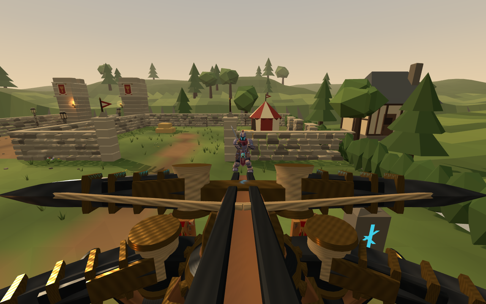 | 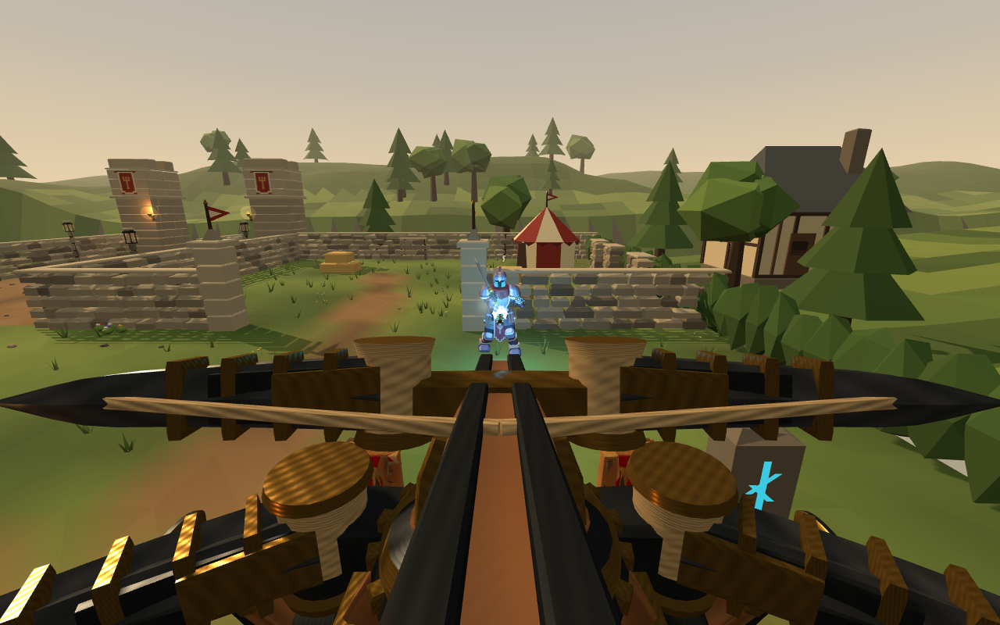 |

These impact frame captures come directly from the rendered game canvas and omit the separate HTML HUD. The accompanying UI screenshot shows the actual parry reticle.

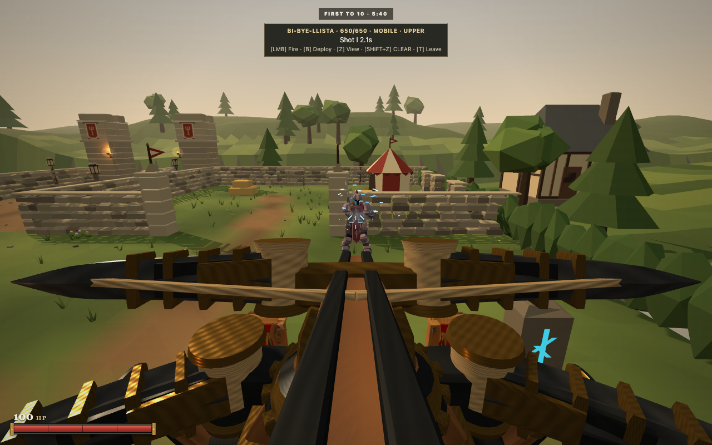

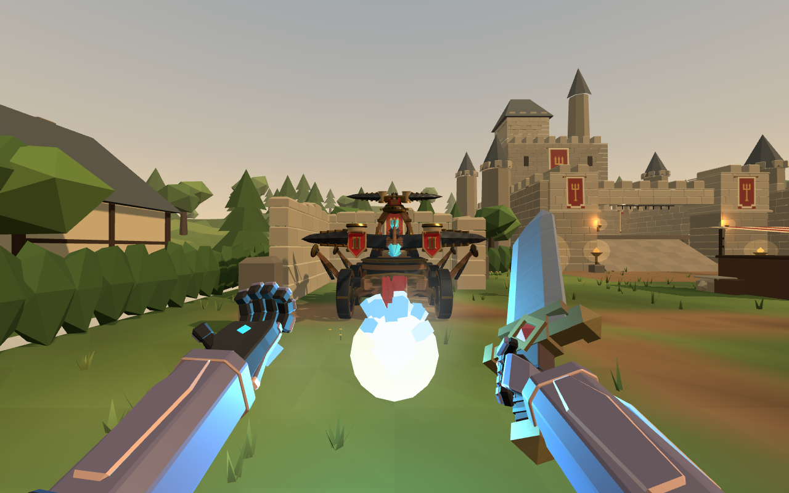

## CLEAR reload

The authored main bolt passed through the original camera. Moving the eye farther forward would also risk peeking through scenery. CLEAR now temporarily hides only that local machine's loaded main bolt during the operator's world render. A `finally` block restores its authored visibility. Ordinary views, other clients and flying projectiles retain the full geometry and animation. Forward camera travel is clipped against world solids from the inclined operator frame.

Desktop uses Shift with the bound mounted view key, normally Shift+Z, to enter CLEAR. Touch retains the upward VIEW swipe. Tapping VIEW returns to the preceding view.

| Complete cycle | Previous desktop | Current desktop | Current touch |
| :--- | ---: | ---: | ---: |
| Recorded frames | 414 | 413 | 416 |
| Reload frames | 269 | 270 | 270 |
| Center ray obstructed by the main bolt | 114 | 0 | 0 |
| Frame time p95 | 17.7 ms | 18.6 ms | 17.6 ms |
| Largest frame time | 20.0 ms | 21.5 ms | 20.5 ms |
| Frames above 33.5 ms | 0 | 0 | 0 |

Chrome155, M1 Metal, Sharp quality, desktop1280×800 and emulated touch960×600. The largest stationary camera step remained below one millimetre. This short sample establishes usable presentation through the cycle; it does not establish an FPS improvement. The baseline uses commit58325ee's unchanged ballista renderer and asset. Only the current keyboard shortcut was supplied to access its already existing CLEAR action. Final candidate gameplay is based on mainaa1580f.

| Previous reload | Current reload |
| :--- | :--- |
| 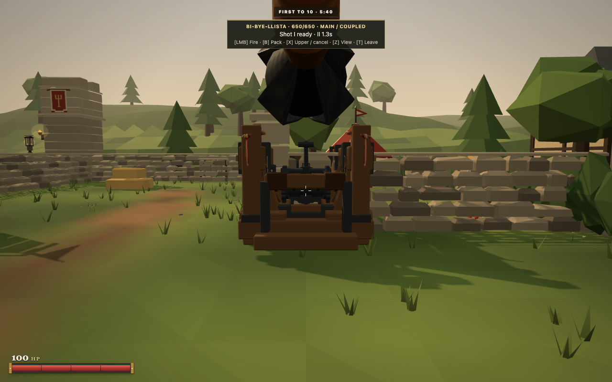 | 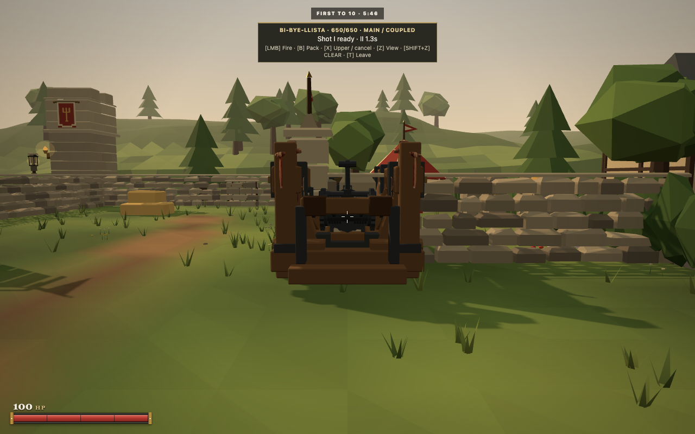 |

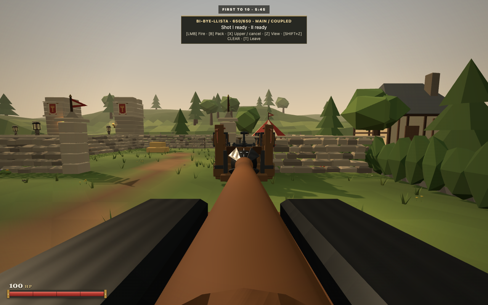

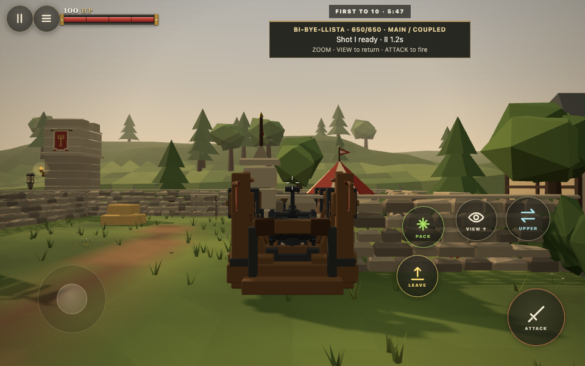

The same input driven run fired the independent upper bow into the chapel wall. Authority reported `chapel-east-wall` at `[20.925, 2.031, 4.054]`; the CLEAR camera remained on the near side at `[19.004, 2.635, 2.652]`. The wall remained opaque.

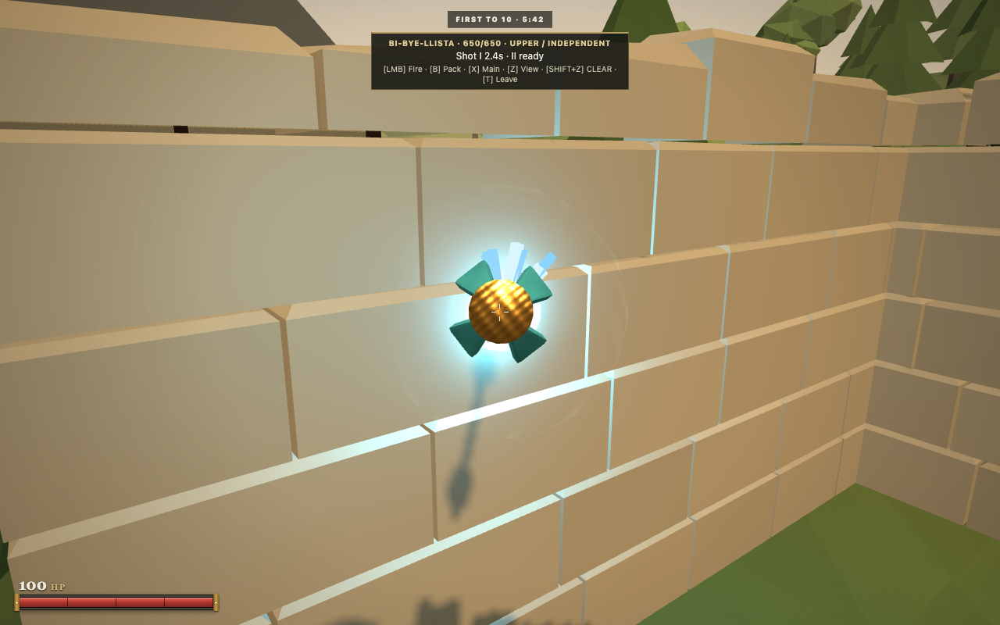

## Packaging and reproduction

`npm run verify` passed1796 repository tests,19 HTML5/release tests, syntax and HTTP/WebSocket smoke checks. The extracted final HTML5 game passed actual Practice construction, approach, mounting, deployment, a complete desktop CLEAR reload, return to ordinary view, and emulated touch aiming, firing, zoom and view restoration. Physical mobile hardware and a deployed itch iframe were outside this local verification.

Export revision `b303249`,992 files,47.37MB zipped,64.16MB extracted. ZIP SHA256: `e7fa6d50a69c5b504035bd5b6d785f5d0a3167852744a9994aba7ed825ec026e`. No new art or audio asset was added.

Use an installed Playwright module through `PLAYWRIGHT_MODULE`. The browser scripts start isolated local servers and close their own browser contexts. Set `FROST_BASELINE_REPO` to an isolated checkout of the previous source for comparisons.

```sh
node scripts/bibye-frost-browser.mjs
FROST_VERSION=before FROST_CASE=front-block node scripts/bibye-frost-browser.mjs
node scripts/bibye-clear-reload.mjs
CLEAR_BEFORE=1 node scripts/bibye-clear-reload.mjs
CLEAR_TOUCH=1 node scripts/bibye-clear-reload.mjs
CLEAR_WALL=1 node scripts/bibye-clear-reload.mjs
npm run verify
npm run export:html5
```

Short clips: [previous CLEAR cycle](before-clear.webm), [current CLEAR cycle and wall shot](after-clear.webm), [touch cycle](touch-clear.webm), [actual frontal block](after-front-block.webm). Trimming metadata is in [clips.json](clips.json); full original browser recordings remain preserved locally. Contact and frame measurements are in [summary.json](summary.json).

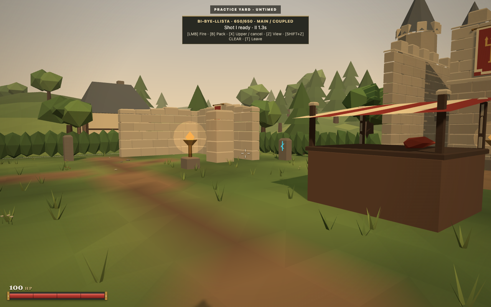

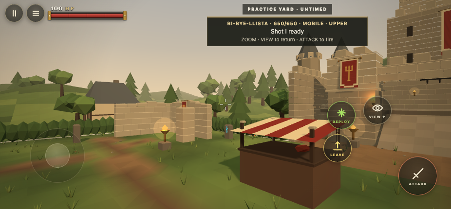
