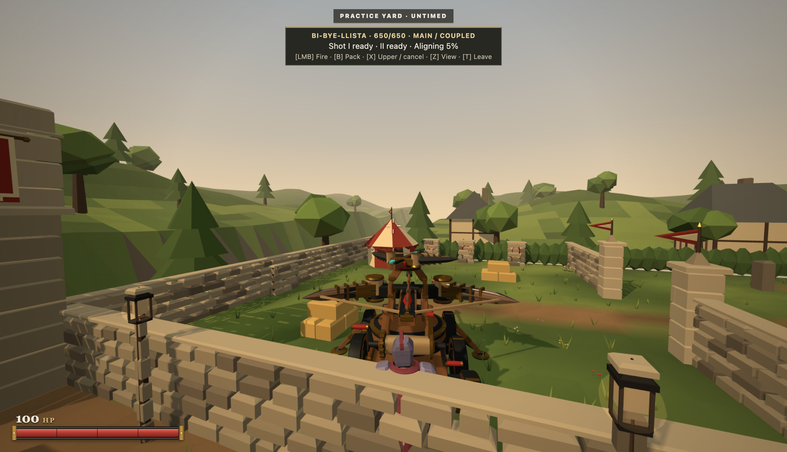
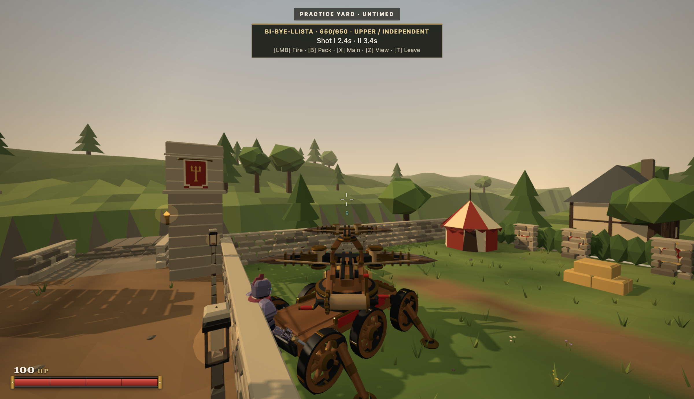
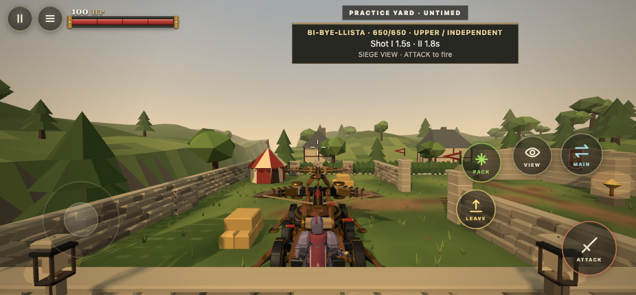
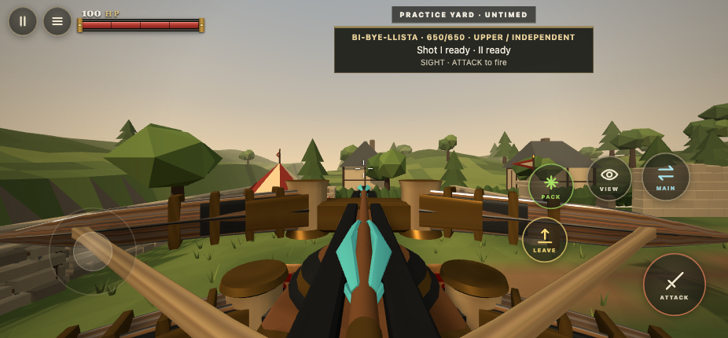

# Independent BiBye controller evidence

Historical controller baseline at730ca86. The subsequent [v4.1 integration evidence](../bibye-v41/README.md) supersedes its pending asset and seating limitations.

This is the controller and presentation preparation pass authorized while Argon's new machine is being authored. It is a followup to merged PR 218. The current GLB and standing station are retained. Actual seated fitting, final turret clearance and physical coupling animation await the revised asset.

## Verified behavior

The desktop journey uses normal keyboard and mouse input to enter Practice, walk to the machine, mount, aim backward, fire independently, reverse while steering, deploy, cancel alignment, commit a coupled volley, switch to the upper weapon and fire during the heavy reload. It also checks the upper sight camera. Browser evaluation observes state and never edits simulation, input methods, hit results or actors.

The static HTML5 export was unpacked and served independently at port 3232. A 926 by 430 touch emulation context walks the route using native touch drags, operates the actual contextual buttons, fires independently, couples, fires again during heavy reload and switches to the sight camera. All visible control rectangles fit in the viewport. The page recorded zero JavaScript errors. This is desktop touch emulation, not physical phone or itch iframe verification.

The real WebSocket integration test uses a positioned fixture on a local network host. It mounts and deploys through the protocol, dismounts between releases, observes the automatic heavy release, remounts and fires the upper weapon during heavy reload. This is separate from simultaneous human operation in a shared public room.

## Measurements

Final desktop and exported touch snapshots record upper release at commitment plus 0.45 seconds and heavy release at plus 0.65 seconds. Upper readiness is its discharge plus 2.5 seconds. Heavy readiness remains commitment plus 6.7 seconds, including when the upper weapon is spent again during reload. Host and display delivery remain quantized; the mechanism retains exact event deadlines and fractional first flight.

An 18 second visible desktop sample recorded 1,082 animation frames: median 16.7 ms, 95th percentile 18.2 ms, zero frames over 50 ms. It included a coupled volley and independent upper fire during heavy reload. This is a bounded pacing observation, not a comparative performance improvement claim.

`npm run verify` passed: 1,665 repository tests, 19 HTML5/release tests, syntax checks and HTTP/WebSocket smoke. The focused tests include full circle world direction under an elevated main cradle, exact release deadlines on late ticks, independent clocks, focus ownership, cancellation, support failure, operator interruption, reset, source assembly collision and ordinary target impacts at 10, 20, 35 and 50 metres. No damage or speed retuning was used.

## Captures

[Desktop journey](desktop-journey.json) records the complete control sequence. [Frame sample](desktop-frame-sample.json) records the concurrent main and upper clip names. [Exported touch proof](touch-export-proof.json) includes button bounds, camera state and actual release clocks.

The operator visible in these captures uses the current standing station. These images do not constitute acceptance of the commissioned seated mechanism or full circle mesh clearance.

## Reproduction

Use an isolated visible Playwright session. Start the ordinary development server at port 3231, create `output/playwright/bibye-independent`, then run `playwright-cli run-code --filename scripts/bibye-independent-desktop.js`.

For touch, export the actual HTML5 ZIP with `npm run export:html5`, unpack it into `output/playwright/bibye-independent/html5`, serve that folder on port 3232, then run `playwright-cli run-code --filename scripts/bibye-independent-touch.js`. The touch harness closes other contexts in its owned test browser before creating its emulated device.

The asset contract and remaining Argon delivery requirements are in [the independent mechanism contract](../../art/bi-bye-independent-contract.md). Supplied v3.3 damaged meshes and recorded cue selection remain deferred to that final integration. Current added coupling and turning sounds use the existing synthesizer, with deduplication tests.
