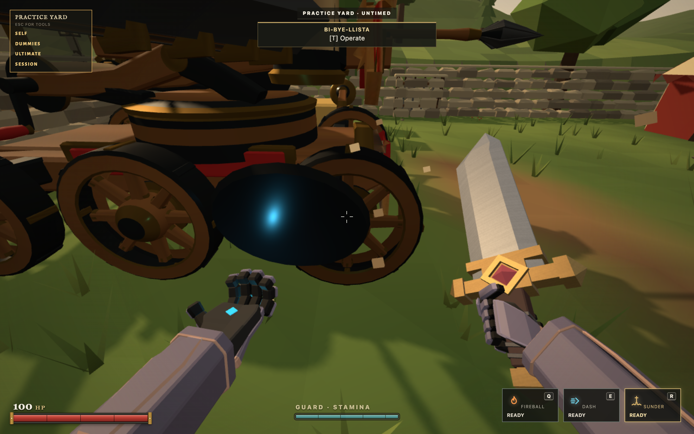
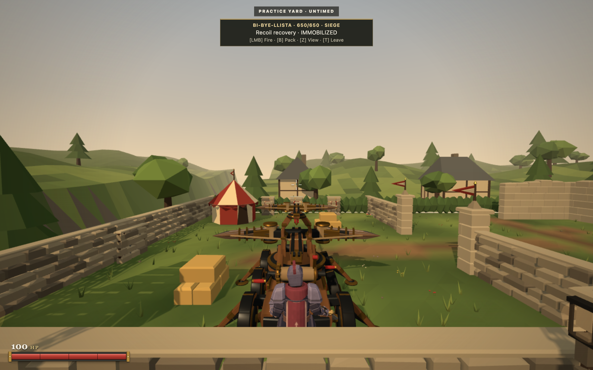
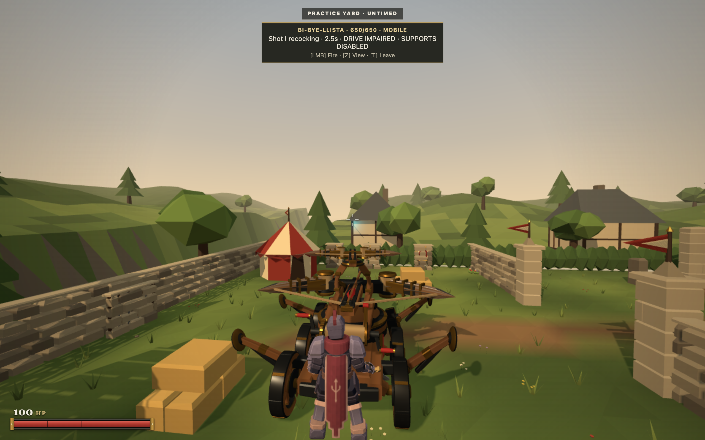
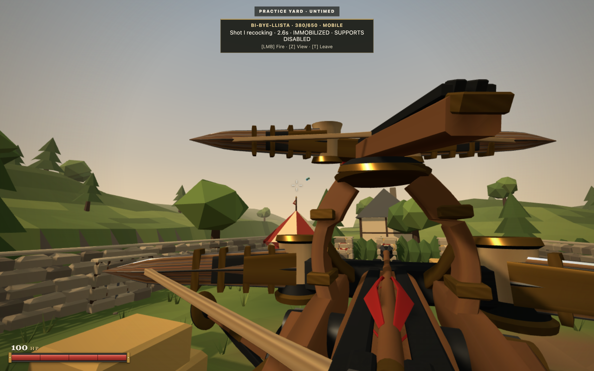
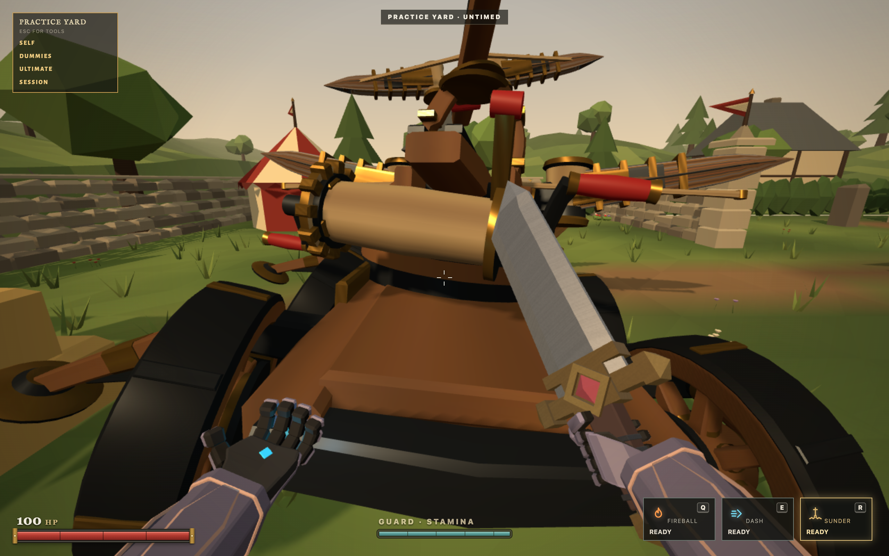
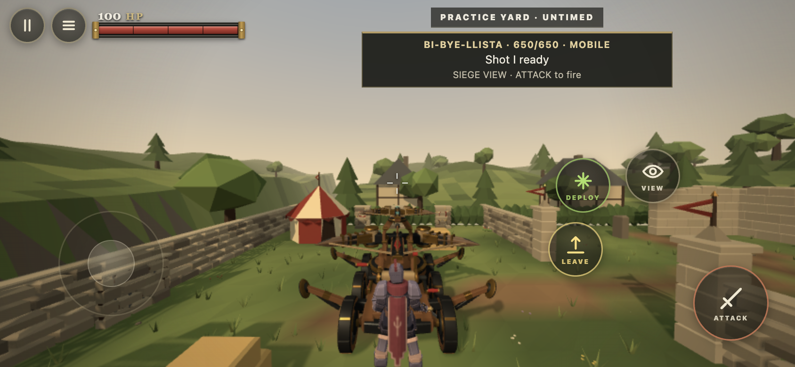
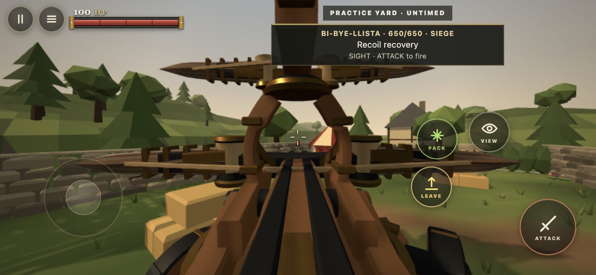
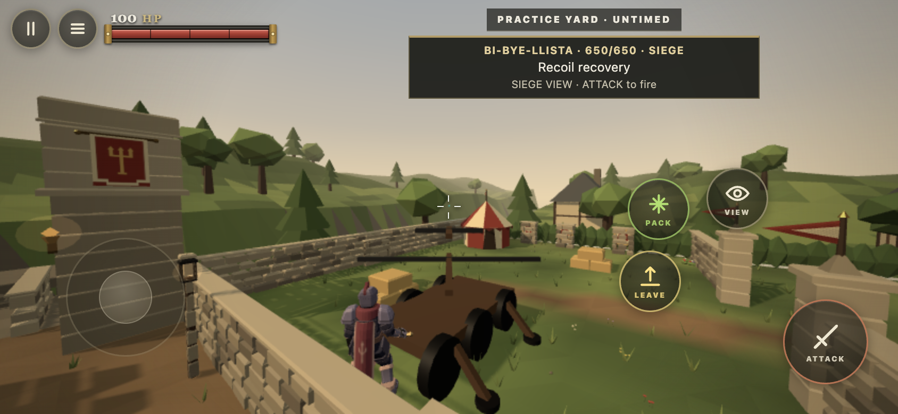

# Bi Bye llista refinement evidence

This extends PR 218 after its original `5f5fa6c` candidate. The corrected GLB is active, with independent hull, wheel and stabilizer durability, localized authoritative contacts, snapshot interpolation, a more distant camera and siege sound. Shot I and Shot II combat values remain unchanged.

## Actual gameplay

All damage below came from ordinary keyboard or touch sword attacks. Evaluation observed the real runtime and snapshots. No health setters, manufactured contacts, input handler replacements or rendered snapshot fixtures were used.

| Configuration | Observed result |
| :--- | :--- |
| Healthy | Normal driving, deployment, both releases, reload, packing and view changes |
| Two wheels failed on the same side | Holding forward left the carriage position unchanged; deployment and the full volley still worked |
| Two supports failed | Folded automatically from deployment, drove 2.16 m with one damaged wheel, fired mobile Shot I; main bolt remained loaded and deployment was unavailable |
| Wheels and supports failed | Remained stationary under forward and steering input; upper aim, sight view and mobile Shot I remained available |
| Hull at zero | Persistent authored wreck settled, remained at the same position, and exposed no mounted operator |

The fresh support damage run preserved hull health at 650 throughout component attacks. The earlier combined damage run began with a separately damaged hull, so its 380 HP is not evidence of component damage spilling into the hull. Readback is retained in [support proof](supports-proof.json), [combined failure proof](crippled-proof.json), and [wreck proof](wreck-proof.json).

## Touch, export and network

At 844 by 390 in Chrome touch emulation, native touch gestures approached the emplacement, mounted, drove, fired Shot I, changed view, deployed, fired the volley, waited through reload, packed and left. Personal controls returned and the mounted View control disappeared after the authoritative leave snapshot. Reload returned to the normal menu. This was desktop emulation, not a physical phone.

The real HTML5 ZIP was extracted and served at `/html/verified/` on a separate local HTTP origin. Normal local Practice, touch mounting, sight view, deployment and both releases worked. The archive contained 971 files, about 41.30 MB zipped and 55.03 MB extracted. This establishes static export behavior; the actual itch.io iframe remains untested in this pass.

A real WebSocket hosted queue Practice session carried component health in server snapshots. A normal sword attack destroyed Wheel_FL while hull health remained 650. Another server hosted session mounted, deployed and fired the full volley. A second browser client then entered matchmaking; both clients entered the same DUEL, with no ballista or stale operating reference in either snapshot. See [network volley](network-volley-proof.json) and [transition](network-transition.json).

Aborting the GLB request exercised the simpler visible fallback. Touch mounting, deployment and firing remained operational without an uncaught exception.

## Frame comparison

Three 30 second runs per build used the same Chrome, 844 by 390 viewport, DPR 1, Balanced quality and active audio. Each used native touch input for forward/reverse travel, mobile Shot I, deployment, two deployed volleys with reload, and packing. Each build used its intended third person camera. The candidate began about 2.2 m farther down the same lane after its touch acceptance loop; this is a representative audiovisual regression comparison, rather than a deterministic renderer benchmark.

| Build | Median frame time | 95th percentile, each repeat | Frames above 50 ms |
| :--- | :--- | :--- | :--- |
| Previous PR candidate `5f5fa6c` | 16.7 ms | 18.2, 18.5, 18.2 ms | 0 |
| Refined candidate | 16.7 ms | 18.5, 18.6, 18.4 ms | 0 |

Snapshot delivery medians were approximately 33 ms and 95th percentiles about 35 ms in both builds. The refined runs contained 2, 5 and 2 intervals above 50 ms, with a worst interval of 131.2 ms; the baseline contained 5, 2 and 2, with a worst interval of 68.3 ms. These are observed snapshot intervals, not isolated simulation execution times. Frame distributions were similar. This evidence supports no material frame pacing regression on this desktop configuration, and does not establish a physical mobile performance gain. [Full measurements](mobile-frame-comparison.json).

## Focused verification

The focused tests cover durability pools, threshold derivation, all degraded configurations, shared oriented hinges, sword and projectile first contact, world/component cover, bounded blast budgets, team protection, failed part rejection, mid deployment failure, cancellation between releases, composed upper launch direction during folding, reset copies, jammed wheel rotation, interpolation and sound lifecycle.

`npm run verify` passed with 1,640 game tests, 19 HTML5/release tests, syntax checks across 470 modules and the HTTP/WebSocket smoke check. The final component repair regression was observed failing before its fix and passing afterward. Sound recipes were also rendered through the real SoundEngine in OfflineAudioContext: all samples finite, peak about 0.638 and RMS about 0.036. This verifies bounded output; subjective sound quality remains open to creator listening.

## Remaining limits

The machine remains available in Practice only. Queue Practice is server authoritative but cannot accept another player, so two clients cannot demonstrate simultaneous ownership contention or vehicle projectile replication in one shared room without expanding gameplay availability. This pass preserves that policy.

Movement collision remains a conservative chassis footprint, rather than wheel suspension or mesh collision. Authored folded outriggers can extend beyond that footprint. Damage volumes follow their actual geometry. Destroyed wheels and supports use deterministic bends and jammed motion; bespoke cracked meshes would require an additional authored asset revision. No additional mesh or clip was required for this implementation.

Physical phones, Safari, deployed Render behavior and an actual itch.io iframe remain unverified. No merge, deployment or publication was performed.
