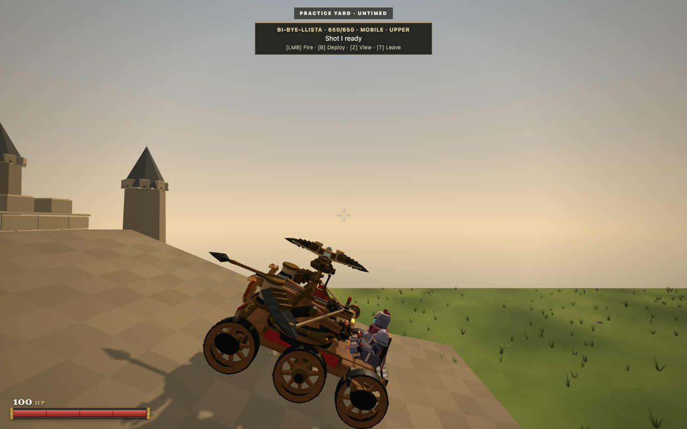
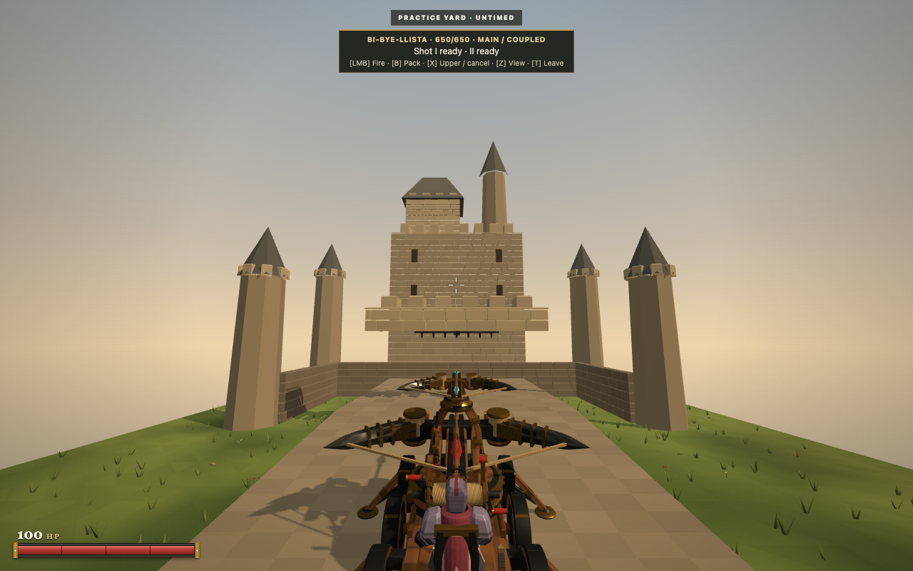
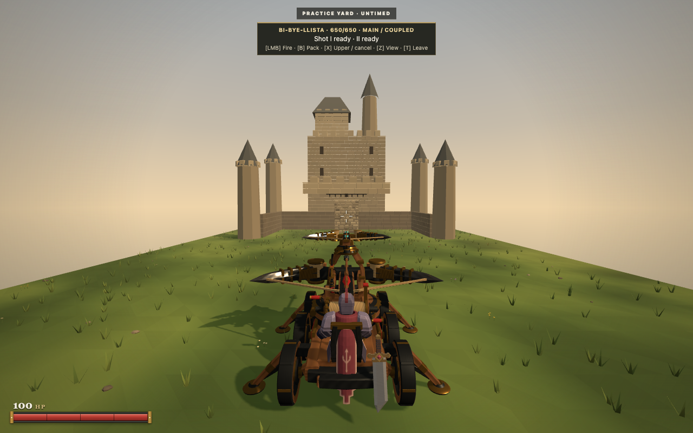
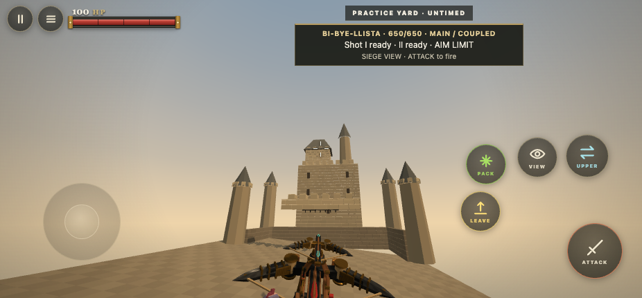

# BiBye terrain and mounted aiming

This follows the merged PR #219. Its merge commit ae58897 has the same tree as the e901924 baseline. The new work lives on feat/ballista-terrain. Argon's v4.1 GLB, character binary and rollback assets remain unchanged.

## Driving and planting

The host fits carriage height, pitch and roll from the six actual wheel pivots. A .55m tire circle rolls continuously over support edges, with at most .125m of contact adjustment. Travel uses short substeps and occupied geometry collision. Uphill speed reduction combines with the existing damaged wheel penalties and Ackermann steering.

The browser course covers a 22° grade with a gradual entrance, reversing downhill, a 14° cross slope, a .25m curb, rejected steep deployment, and supported deployment and firing on 6° ground. Unit scenarios additionally cover .15m and .35m curbs, walls, narrow rocks, steep grades, unsupported drops, wheel failure, repeatability and loss of planted support. Sharp transitions can remain impassable because of wheel travel or belly clearance. The grade target does not guarantee passage over every ramp entrance.

Deployment has a separate 8° ceiling and checks the footprint and reachable hinge adjustment of each functioning stabilizer. Rejection appears briefly in the HUD. Support loss retracts the machine and prevents the heavy release. Root inclination propagates through hit geometry, muzzles, cameras, the seated operator and interpolated presentation.

## Controls and firing

Mounted touch movement uses a .06 radial dead zone, compared with the unchanged .14 on foot. Mounted network input uses finer angular and steering transitions. Input stops accumulating beyond the mechanical aim limits. In the touch replay, a five pixel stick displacement moved the carriage approximately .097m; reversing a two pixel look gesture immediately reduced aim elevation by .0096 radians.

Main focus tracks both bows during aiming, with clutch engagement beginning during deployment. Fire commits the aligned weapons rather than starting another turning sequence. The .45s upper and .65s heavy releases remain intact. Switching to Upper during clutch release retains one fire press until the clutch clears. Leaving, packing or changing focus cancels that queued intent.

The host solves from each actual muzzle to the camera reticle target, within the physical joint limits. The HUD identifies an aim limit. In the browser wall test, both real projectile lines intersected the reticle target within .01m. [Recorded projectile geometry](reticle-calibration.json) includes the actual origins and velocities. Independent upper aim and fire remain available during heavy reload.

The conditioning bolt stays hidden through recocking, then appears in its authored rail pose. Its loading translation and scale tracks no longer move a visible bolt through the view.

## Browser evidence and frame pacing

Ordinary keyboard, mouse and CDP touch events drove the checks. Browser evaluation observed state and geometry. The explicitly labelled terrain fixture replaces served world and spawn configuration; production combat and input implementations remain active. Touch geometry measurements found the seated origin within floating point tolerance of its carriage anchor, matching operator and chassis up axes, and intact wheel contact within about 7mm of the plane. The original tire mesh extends approximately 6mm past the configured radius.

The matched 60 second Chrome samples used 1280 by 800, DPR 1, the same flat course and sustained driving and turning. Median frame time was 16.7 ms and p95 was 16.7 ms for both baseline and candidate. Each recorded zero long tasks. This bounded comparison shows no measured frame pacing regression. It does not establish a general speed gain. [Measurements](frame-comparison.json).

These captures used Chrome on the Mac through Playwright. A headed attempt lost focus, so the repeatable captures use headless Chrome. Physical phone handling, native mouse feel, prolonged internet play and this candidate in the live itch iframe remain outside the verified scope.

Reproduce the course with scripts/bibye-terrain-browser.mjs using an owned Playwright Chrome instance and a local server. Full observations and source video are retained locally under output/playwright/bibye-terrain. The exported client replay uses the actual HTML5 ZIP and the ordinary production Practice route, separate from the course fixture.

## Verification

The final implementation passed npm run verify:1693 repository tests, 19 HTML5 and release tests, syntax and Smoke OK. The exported ZIP contains 977 files and is 43.28 MB. Its dependency closure includes the new shared terrain module. The production HTML5 touch replay at 926 by 430 passed the ordinary Practice approach, mount, deployment, independent shot, coupled volley, upper fire during heavy reload, sight and visible control bounds with zero page errors. [Export observations](exported-production-touch.json).

A first exported replay exposed the discarded tap during clutch release; the new queue regression reproduced it and the implementation resolves it. A later concurrent browser run hit a route timeout under resource pressure. Serial execution passed. The course helper also avoids waiting for navigation after a canvas click, because that click only requests input focus.
