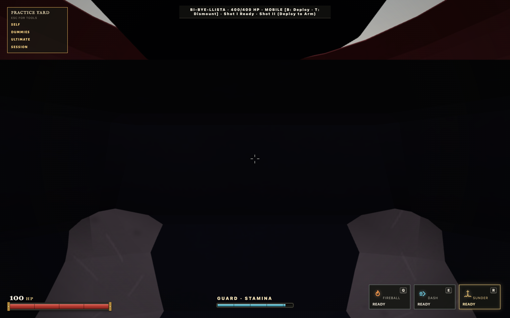
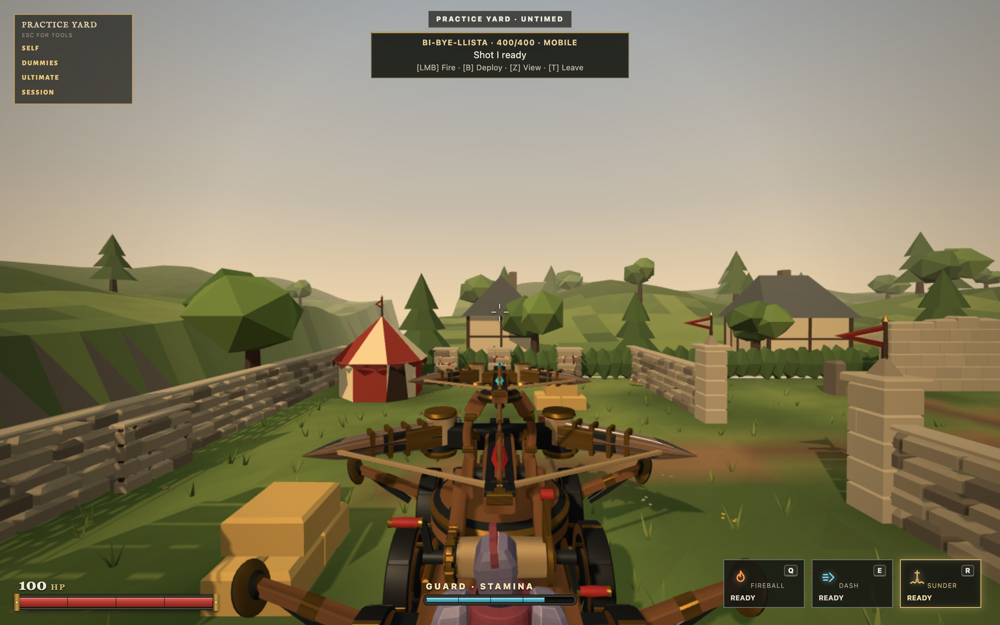
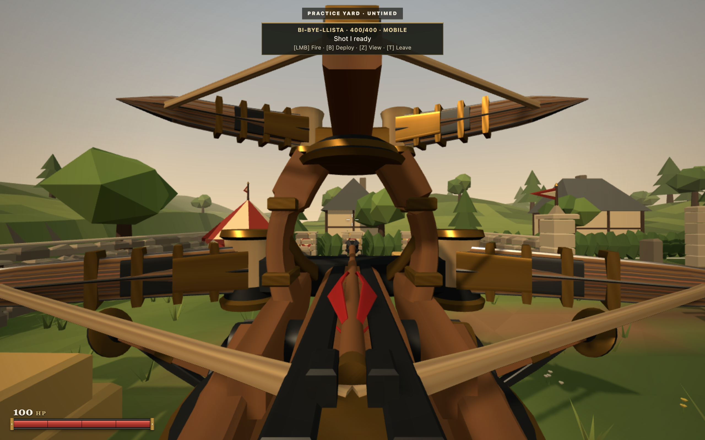
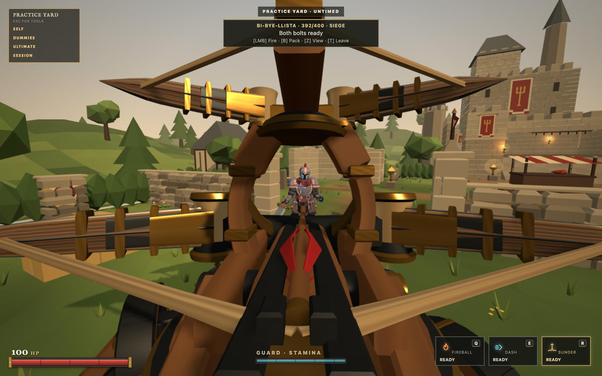
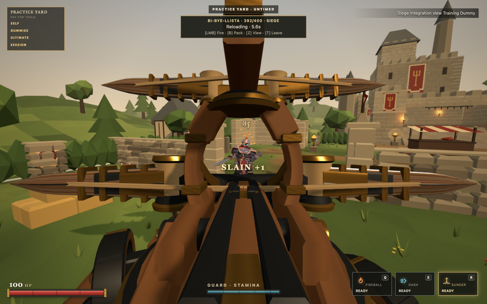
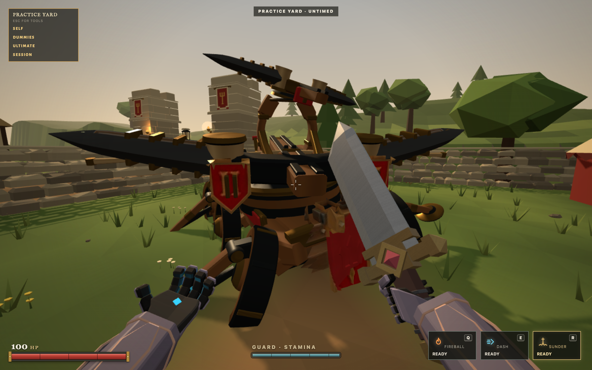
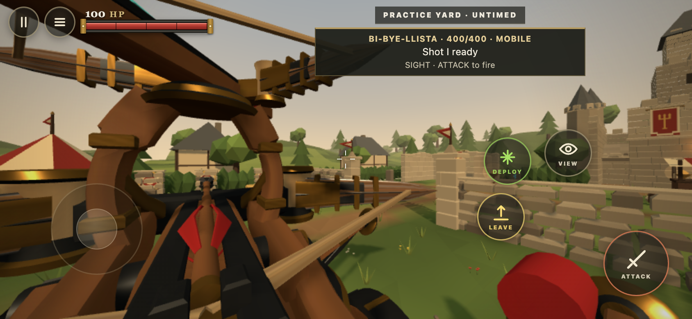

# BiBye v3.2 integration evidence

This pass uses the real Castleward runtime and normal keyboard, mouse, Pointer Lock and browser touch events. It never replaces input methods, injects rendered snapshots, manufactures hits or invokes a damage fixture. State readback and event listeners observe the real simulation.

## Result

The previous mounted camera sat inside the operator. The current camera uses the exported third person and sight locators, with eased entry, view changes and exit. The sight view excludes the operator and first person arms. The third person view retains the operator. Z changes view and is rebindable. T operates/leaves, B deploys/packs, and the configured attack binding fires. Contextual labels use current bindings. Touch exposes Mount/Leave, Deploy/Pack, View and Attack only while appropriate.

## Checks performed

1. Entered normal Practice from Solo, walked through Castleward to the emplacement and mounted through the actual interaction control.
2. Drove forward, reversed, steered both directions, fired Shot I while mobile and completed recocking. Independent wheel travel and front/rear steering were inspected in the rendered game.
3. Changed both mounted views and inspected neutral aim, maximum traverse, elevation and depression. Rendered locator positions agreed with shared geometry to about 0.00000003 m at rest. Observed release frame differences were under 2 mm in the saved alignment capture; direction dot products exceeded 0.9999997. Shared tests independently evaluate the exported hierarchy over eight headings, both modes and all aiming extrema.
4. Deployed, brought a responding Practice bot through the field gateway, switched it to Passive through the Practice controls, aimed and fired the full volley. The previously full health target died through normal damage. Reload completed and both bolts became available again.
5. Observed the authored recoil through SPENT and into mechanical reload. Outriggers retained their deployed pose through firing/reloading. Packing and dismounting restored normal movement.
6. A responding bot killed the mounted operator. Ownership and the player's operating reference cleared. After respawn, ordinary Fireballs destroyed the already damaged machine. Its animation reached 1.79999995 s and held the identical chassis position over a further 1.7 s observation.
7. Walked to the machine with native browser touch joystick events at 844 by 390. Mounted, drove/steered, fired, switched view, deployed, fired a volley, reloaded, packed and left through touch controls. Normal personal controls returned and the mounted View control disappeared. This is touch emulation, not a physical phone test.
8. Operated the machine through a real local WebSocket host while waiting for matchmaking. Server snapshots confirmed driving, deployment and the two releases. A second real browser client matched into a duel; both clients entered DUEL and the former mounted reference was cleared.
9. Opened the actual static HTML5 export on a separate HTTP origin, entered local Practice and mounted/switched views with touch input. This establishes exported client behavior, not itch.io iframe compatibility.
10. Aborted the authored GLB request. The visible carriage/launcher fallback remained operable, its camera toggle and mobile firing worked, and no browser exception occurred.

## Timing

The shared simulation schedules Shot I at commitment plus 0.450 s and Shot II at plus 0.650 s. The logical separation is 0.200 s. Actual event delivery is quantized by the existing 30 Hz simulation and browser/server scheduling.

After removing a runtime light-count change that caused shader compilation during firing, a fresh local volley delivered at approximately 0.473 s and 0.672 s, separated by 0.1993 s. A network hosted volley delivered at approximately 0.476 s and 0.685 s, separated by 0.2096 s. These observations stay within one simulation tick of the scheduled deadlines. The supplied alignment JSON records another local volley and actual rendered locator comparisons.

The 3.2 s firing clip contains recovery_complete at 2.2 s. Mechanical recovery and reload retain the existing 2.2 s plus 6.0 s schedule. Mobile recoil completes at its authored 0.85 s event, and the remaining recock animation fits the existing three second cooldown.

## Scope and limitations

The machine is currently instantiated only in Practice. Queue Practice is remotely authoritative but cannot be joined by a second player. Two clients therefore verified matchmaking exit/cleanup; simultaneous vehicle ownership and projectile replication in a shared public/private match were not demonstrated. This pass preserves that availability policy.

Collision remains a conservative chassis approximation rather than triangle collision or wheel suspension. Body blocking and ordinary floor support were added; existing wall, projectile, team safety, damage, durability and disconnect regression tests pass. Live wall/terrain behavior was observed during travel through Castleward, rather than exhaustively tested against every prop and surface.

Physical phones, Safari, deployed Render compatibility and an actual itch.io iframe were not tested. No deployment or publication was performed. The source fallback is deliberately simpler than the authored machine.

## Repeat the desktop input loop

Start the local game server, then run `node scripts/test-bibye-v32-gameplay.mjs` with Playwright available locally. `PLAYWRIGHT_MODULE` can point to an installed Playwright or Playwright Core package. `BALLISTA_TEST_URL` selects the local candidate URL. Chrome is opened visibly. The script writes captures and readback JSON under `output/playwright/bi-bye-v32`.

The repeatable script covers approach, mounting, driving, reverse, steering, mobile fire, both views, aiming extrema, deployed volley/recovery/reload, packing, leaving and restored movement. The responding target, destruction, touch and network checks above were additional live browser passes.

## Repository verification

`npm run verify` passed: syntax checks across 463 modules, 1,607 repository tests, 19 HTML5/release tests, and the HTTP/WebSocket smoke check. The repeatable visible Chrome input loop also passed on the delivery candidate with no uncaught browser exception.

The static export contains 967 files, approximately 41.30 MB zipped and 55.03 MB extracted. The v3.2 GLB checksum was checked again before source control handoff.
