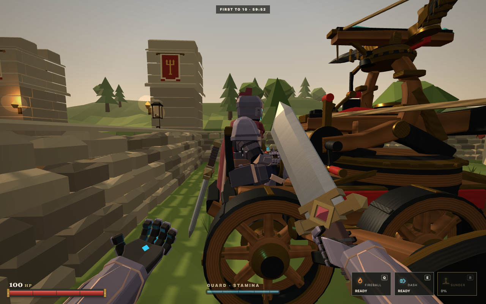
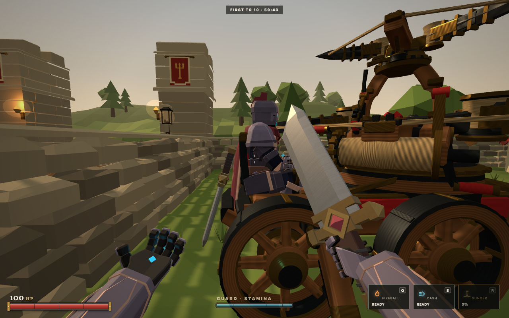
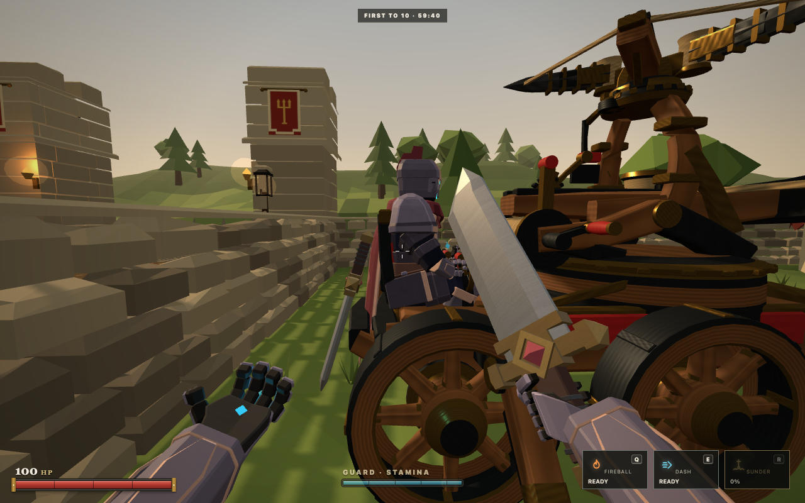
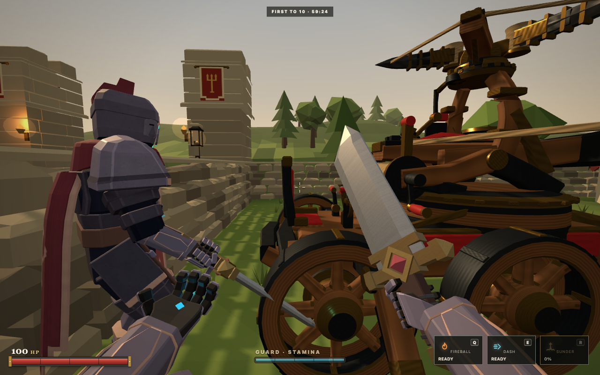
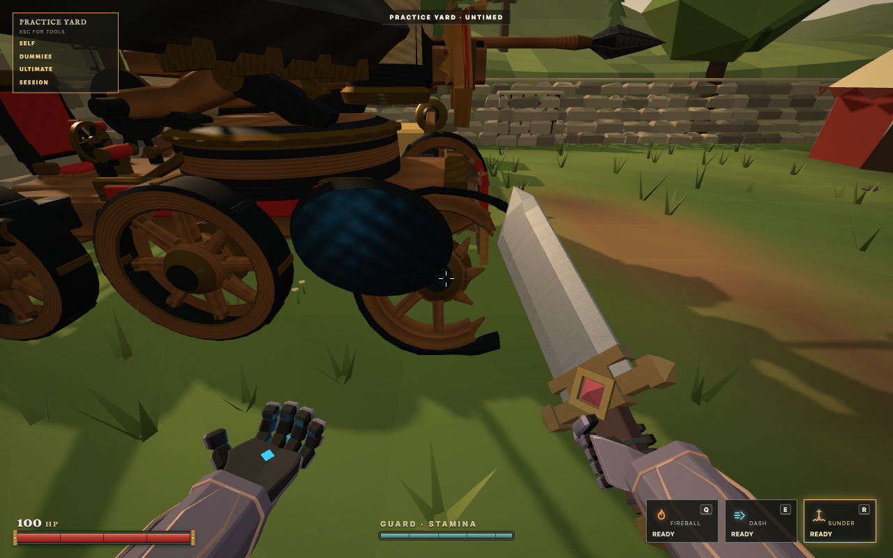
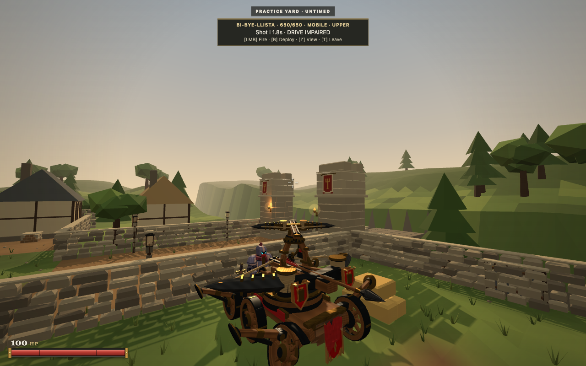
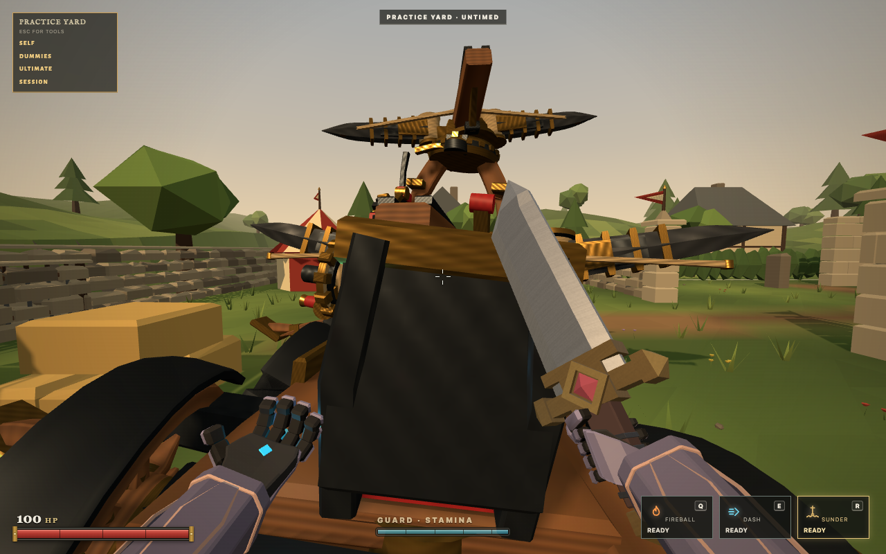
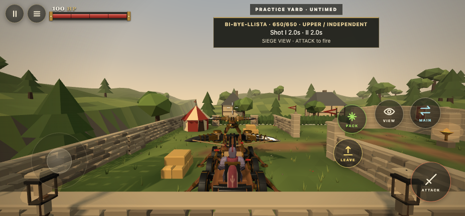

# BiBye v4.1 integration evidence

The exact Argon v4.1 GLB is active. Its checksum, 65 nodes, 46 meshes and 21 clips are verified directly against the delivered binary. The previous v3.2 and original files remain rollback resources. This continues draft PR #219 from 730ca86.

## Actual game checks

The visible desktop journey used ordinary keyboard and mouse controls to walk into Practice, mount, drive, reverse and steer, aim backward and sideways, fire Shot I independently, deploy, align from a backward direction, cancel alignment, commit a coupled volley, fire the upper weapon during main reload and switch to its sight. The loaded scene was BiBye_Authored_Asset_v4_1. [Desktop observations](desktop-journey.json) preserve the snapshots. Browser evaluation observed state and recorded events; it never changed simulation or hit results.

A separate ordinary input damage run broke Wheel_FL through real sword sweeps. Hull health remained 650 and every other component stayed intact. The authored damaged wheel became visible at scale 1, while the intact mesh was hidden. The operator then mounted and fired the surviving upper weapon. Dismount left the player alive on safe ground, released the seated pose, restored the original sword and hid the stowed copy. Further ordinary sword attacks reduced the hull to 0. The wreck and its empty ownership persisted through an additional three seconds. [Damage observations](damage-input-proof.json) include all hit events and zero page errors.

Two real browser clients also created and joined a private room on a temporary localhost observer fixture. The fixture supplies the vehicle and initial positions near it because production vehicle availability remains Practice only. Commands, simulation, WebSocket events and character rendering remain the ordinary implementation. The observer saw the production GLB seated, the stowed sword, coupling and reload motion, and a normal living pose with its sword after dismount. [Remote observations](remote-observer-proof.json) retain both release events exactly 0.20 seconds apart. Its later independent shot happened after heavy reload; independent fire during reload is separately verified by the desktop run, exported touch run and real protocol test.

The static HTML5 ZIP was extracted and served separately. Chrome touch emulation at 926 by 430 used real touch drags and taps to walk, mount, deploy, select weapon focus, fire independently, commit the volley, fire the upper during heavy reload and switch sight. All visible control bounds fit the viewport and the page recorded zero errors. [Touch observations](touch-export-proof.json) preserve the clocks and controls. This is desktop emulation rather than a physical phone test.

## Mechanism and fitting

The server and renderer use the upper pivot under Traverse_Mount, independently of main pitch. Both muzzles match the real exported hierarchy across heading, main traverse, main elevation and full upper yaw. Ordinary target tests at 10, 20, 35 and 50 metres preserve the established ballistic solver and combat values.

The clutch engages and releases over its authored 0.60 seconds. A partial cancellation reverses the collar from its current position. Independent rotation and discharge wait until it clears. The main uses clip 19 for 4.5 seconds while the upper retains its own recoil, recock and aim. Commitment still releases Shot I at 0.45 seconds, Shot II at 0.65 seconds, recocks I 2.5 seconds after discharge and reloads II at commitment plus 6.7 seconds.

The production Spellblade rig differs from the supplied pose candidate. It was fitted in Blender, preserving limb lengths and converting the result into the original glTF bone bases. Pelvis, boot soles and control contacts were inspected in the model and game. The rear cloth anchor moves 55 mm to clear the backrest. Runtime arm IK follows the moving controls. The sword has two material primitives and loads as a Group; both real production pieces are baked into one mounted rigid group and stowed outside the seat. Normal character meshes, rig and clips remain byte unchanged.

A Blender triangle sweep sampled 225 combinations: full yaw in 15 degree steps at three main pitches and three upper pitches. It found zero triangle overlaps between the upper assembly and main assembly or seated operator. [Raw sweep](clearance.json). Sampled nearest vertex distances were 0.105 m to the main and 0.951 m to the operator. These are sampled distances rather than guaranteed global minima. The sweep covers static aim; actual recoil was separately inspected during the browser volley.

## Matched frame sample

The exact 730ca86 baseline and candidate each ran the same 30 second driving, turning, deployment, volley and independent upper scenario in visible Chrome. Both used 1280 by 800, DPR 1 and matching visual settings.

| Version | Frames | Median | p95 | p99 | Maximum | Over 33.4 ms |
| :--- | ---: | ---: | ---: | ---: | ---: | ---: |
| Baseline 730ca86 | 1800 | 16.7ms | 18.6ms | 18.7ms | 18.8ms | 0 |
| v4.1 candidate | 1801 | 16.7ms | 18.6ms | 18.7ms | 18.8ms | 0 |

[Measurement data](frame-comparison.json). This bounded comparison found the same frame pacing. It measures animation frame intervals rather than GPU execution time and does not establish phone performance or prolonged session behavior.

## Repository verification

`npm run verify` passed 1675 repository tests, 19 HTML5/release tests, syntax checks and HTTP/WebSocket smoke. Focused coverage includes binary identity, hierarchy, muzzle transforms, clip ownership, engagement/release, late ticks, cancellation, support loss, independent clocks, components, safe egress, persistent wrecks, production pose identity and audio deduplication.

A deliberate 500 ms host stall reproduced an old test consumption error: both releases can share an event packet, and the test formerly discarded Shot II while reading Shot I. The test now consumes individual events and awaits the dismount acknowledgement. The controlled reproducer passes with exact release deadlines. Production event delivery and combat timing were unchanged.

## Captures

## Reproduction and limits

Use `scripts/bibye-independent-desktop.js` in a separate visible Playwright browser pointed at the current development server. For touch, export with `npm run export:html5`, extract and serve the ZIP, then run `scripts/bibye-independent-touch.js` against that extracted client. The harness closes only other contexts in its owned test browser. The WebSocket regression is `server/tests/bi-bye-weapons-network.test.mjs`.

`tools/blender/siege/bibyellista/fit-production-operator.py` fits the active production rig in the comparison scene and regenerates the pose module. `check-clearance.py` samples the named assemblies in that same saved scene. The source archive, original scene backup and fitted Blender file are retained in the local handoff artifact directory. Source provenance and source pose differences are in the asset directory README.

Physical phone behavior, a live itch.io iframe with this candidate, internet latency and prolonged remote operation remain unverified. The observer fixture introduces no production room availability. This remains a draft candidate with no merge, deployment or publication.
