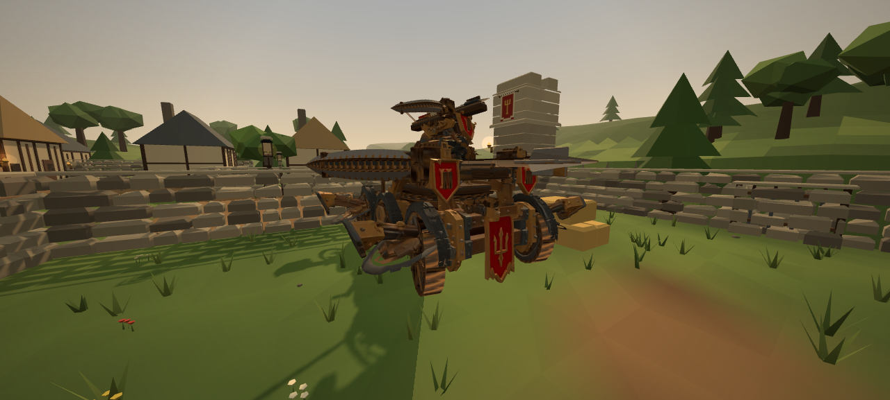
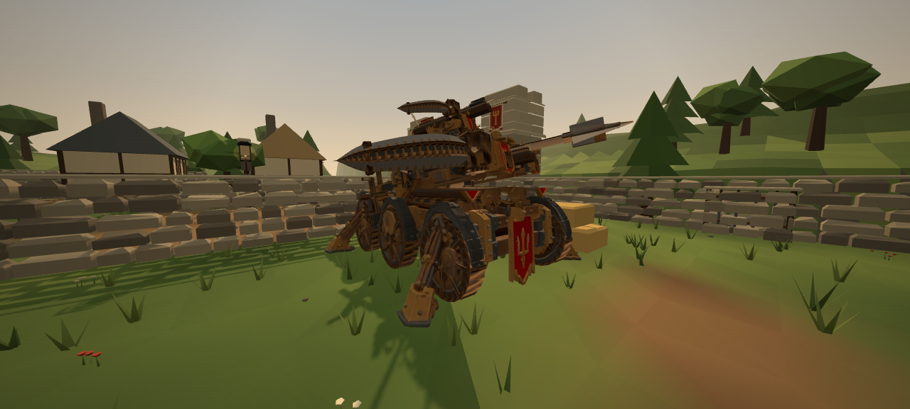
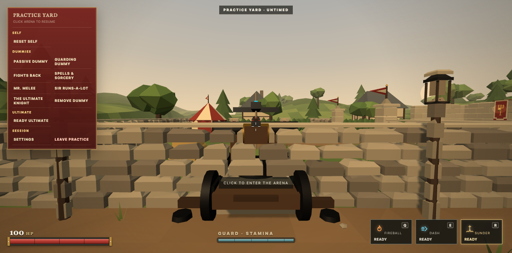
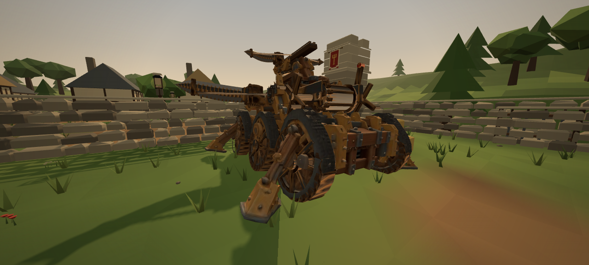

# Bi-Bye-llista Mobile Siege Engine & Combat Redesign — Visual Evidence & Architecture

Current v3.2 integration and real input evidence: [v3.2 gameplay report](../bibye-v32/README.md).

The four original presentation captures below use renderer snapshot overrides from `scripts/capture-bibye-evidence.mjs`. They document appearance only. The original acceptance script also uses injected navigation and a destruction fixture. See the v3.2 report for checks performed using actual keyboard, mouse and touch input.

This document presents the authoritative architecture, gameplay mechanics, combat redesign, and in-engine visual evidence for the **Bi-Bye-llista** mobile siege engine prototype in Castleward Practice Yard.

---

## 1. Executive Summary & Core Redesign

The Bi-Bye-llista prototype has been advanced from a stationary turret into an authoritative **6-wheeled mobile siege engine** with two operational modes, authentic physical projectiles, and a universal correction to Sheathe in Steel damage mitigation.

### Key Architectural Improvements

1. **Frost Conditioning Bolt (Shot I)**:
   - Permanently eliminates arbitrary `bibyeVulnerable` status and artificial multipliers (1.5×).
   - Detonates a 2.0 m radial frost blast dealing light radial health damage (18 direct/center, 12 edge).
   - Drains Guard/Sprint stamina scaled with blast exposure (baseline 22 stamina at blast center, equivalent to a solid sword strike absorbed by Guard).
   - Applies a Frostfire-style fading chill with gentle initial slow (0.40) and long thaw duration (5.0 s) via shared `strongerChill`.
   - Respects line of sight through solid stone walls.
   - Operates independently on the move with a 3.0 s mobile recock timer.

2. **Main Physical Siege Bolt (Shot II)**:
   - Enormous 55 m/s physical projectile with continuous swept collision.
   - Stops decisively against solid stone walls and terrain without frame tunneling.
   - Pierces up to 2 light targets (direct damage: 85 base, 60 on secondary pierce).
   - Violent physical knockback (`shove: 8.5`) and heavy balance compromise (`staggerGain: 45`).
   - Detonates a 3.5 m radial shockwave (35 center, 10 edge, push 7.0) with smooth falloff.
   - **Double-count prevention**: Victims pierced directly by the bolt shaft are explicitly excluded from the radial shockwave.
   - **Lethality**: Two direct hits (18 + 85 = 103) defeat an unprotected 100 HP Spellblade without requiring any artificial damage multipliers.

3. **Dual Operational Modes**:
   - **Travel / Mobile Mode**: 6-wheeled carriage drives forward/backward (3.2/2.0 m/s), steers (1.6 rad/s), and climbs slopes with terrain height conforming and wall sliding. Operator can aim the upper launcher ($\pm 36^\circ$ traverse) and fire Shot I on the move.
   - **Deployed Mode**: Stabilizers and outriggers plant into the turf over a 1.200 s transition. Movement locked. Turntable swivels ($\pm 45^\circ$ traverse, $-8.6^\circ$ to $+20.0^\circ$ pitch). Unlocks the full two-stage volley with exact 0.200 s string release interval (Shot I at $t = +0.450$ s, Shot II at $t = +0.650$ s).
   - **Reload Cycle**: `SPENT` (1.55 s, completing the 2.20 s recoil recovery) $\to$ 6.0 s mechanical reload $\to$ `LOADED`. Retracts in 1.200 s.

4. **Siege Engine Durability**:
   - 400 HP destructible siege machine. Takes damage from enemy weapons, siege bolts, and spell blasts.
   - At 0 HP: disabled, becomes a smoking wreckage, and forcibly dismounts the operator safely.
   - Restored to pristine mobile loaded state on Practice Yard reset.

5. **Universal Sheathe in Steel Mitigation Rule**:
   - Global combat rule: Sheathe in Steel reduces health damage of valid damaging contacts toward the MINIMUM of that source's legitimate range proportional to remaining Steel strength ($S \in [0, 1]$).
   - Defined ranges in `STEEL_DAMAGE_RANGES`: sword (19–30), gauntlet (6–9), ram (6–12), fireball (13–18), frostfire (11–16), gale (1–8), burn (1–2), vortex (20–30), rupture (5–12), bibye-conditioning (12–18), bibye-siege (55–85), bibye-shockwave (10–35).
   - Physical consequences (cold, shove, stagger, Guard drain) remain distinct. Misses stay 0. Double reduction prevented.

---

## 2. In-Engine Visual Evidence

### Viewpoint 1: Travel / Mobile Mode (6-Wheeled Chassis)
*Carriage maneuvering across the Tourney Field with 6 timber-and-iron rolling wheels, chassis suspension, and aimable upper launcher.*

### Viewpoint 2: Deployed Mode (Outriggers Planted)
*Outriggers deployed and spiked into the turf, locking movement and enabling the turntable traverse and full two-bolt volley.*

### Viewpoint 3: Two-Stage Volley Discharge
*Enchanted cyan frost conditioning dart discharging at $t = +0.450$ s followed by the massive steel siege bolt at $t = +0.650$ s.*

### Viewpoint 4: Destroyed Wreckage State
*Siege engine reduced to 0 HP: structural failure, dismantled launchers, collapsed suspension, and operator safely dismounted.*

---

## 3. Verification Summary

- **Bi-Bye-llista Test Suite**: `node --test server/tests/bi-bye-llista.test.mjs` — **15/15 passing** (including Ackermann kinematics, 30/60/10 Hz continuous swept collisions, stone wall occlusion, friendly-fire immunity, and obstacle-aware dismount)
- **Sheathe in Steel Regression Suite**: `node --test server/tests/steel-mitigation.test.mjs` — **4/4 passing**
- **Sunder Regression Suite**: `node --test server/tests/sunder.test.mjs` — **47/47 passing**
- **Full Unit Test Suite**: `npm test` — **1,568/1,568 passing**
- **Syntax Verification**: `npm run check` — **Syntax OK (451 modules)**
- **HTML5 Candidate Package**: `npm run test:html5` — **19/19 passing**
- **Live Smoke Test**: `npm run smoke` — **Smoke OK**

---

## 4. Production Asset Integration (Argon v3.0 Deliverables)

- **Authored Asset**: `client/assets/props/bibye-ballista/bi-bye-llista.glb` (SHA-256 `647a4ab490b5292fc1b67b5356705ae4bea743f87eab046863cff141eedad9d1`)
- **Scene Graph Hierarchy**: 37 nodes (1 root, 29 articulated mechanical mesh nodes, 7 named gameplay locators)
- **Animation Mixer**: 12 animation clips with retimed deploy/retract transitions ($1.3333\times$ speedup) synchronized to authoritative 1.200 s server transitions
- **Locomotion Kinematics**: Composed 6-wheel rolling ($R_{\text{wheel}} = 0.550\text{ m}$) with front $\pm 18^\circ$ steering and rear $\mp 10^\circ$ counter-steering
- **Touchscreen Readiness**: Dedicated mobile touch actions for mount/dismount and deploy/pack modes along with analog thumbstick driving
