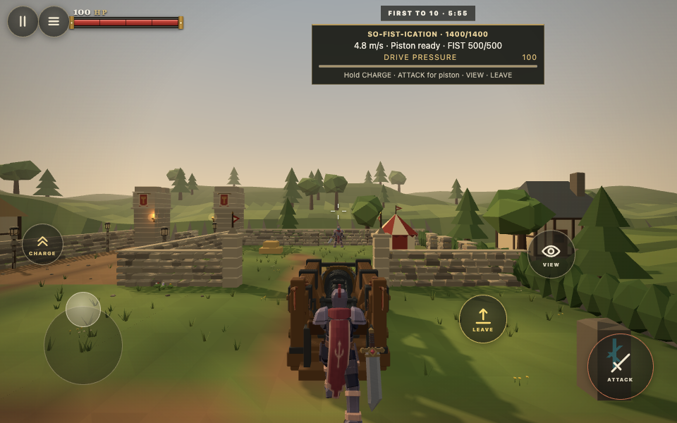
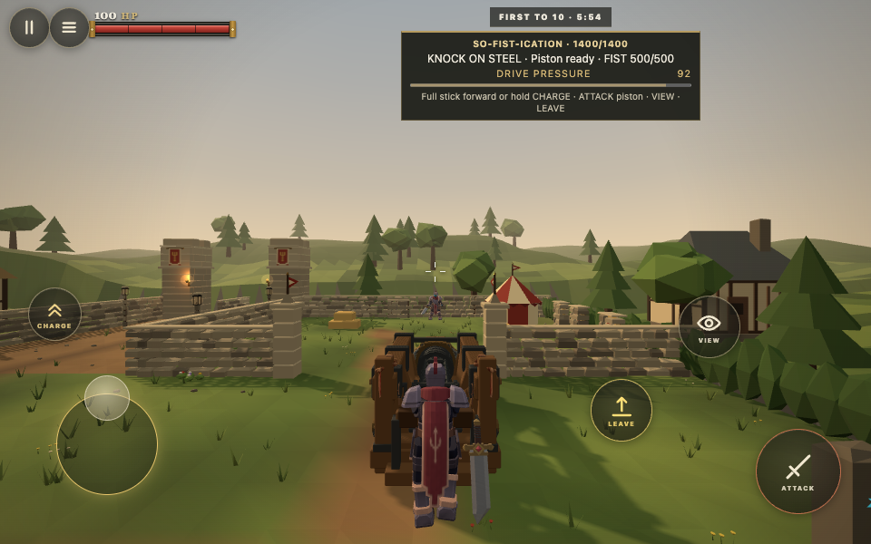

# So-Fist-ication Charge and body contacts

The mobile stick and held CHARGE button now act independently. Entry uses the established 92% stick radius and 75% forward direction; mounted Charge retains the request until the stick eases below 84% radius or 68% forward. Ordinary Sprint keeps its existing threshold. Mount transitions, death, cancellation and orientation changes clear old gestures. The touch HUD explains both choices.

Body damage now follows normal closing energy above 3.5 m/s, with the existing 90 HP frontal ceiling and a 35 HP side ceiling. Sweeps use component surface motion and victim motion. Tangential velocity contributes no impact energy. A spent body episode requires clearance plus about 1.27 m of carriage withdrawal or 2.45 m of lateral repositioning. The forward anchor follows the carriage, so chasing a launched victim cannot rearm the same collision. Piston strokes retain their independent damage and short overlap deduplication.

A related pressure defect appeared during browser testing: machinery could push a victim through masonry. The carriage now stops when its proposed player displacement conflicts with world collision. This uses existing oriented movement solids and player posture. It changes neither character movement nor machine acceleration and steering.

## Verification

Regression reproduction before the fix: 22 HP at 2.1 m/s, 40 HP at 4.8 m/s, and five successive hits after simulated knockback separation. The revised tests produce zero, about 7 HP, and one spent episode respectively; genuine withdrawal permits a new impact. Full simulation tests cover gentle displacement, blocked pressure, relative moving victims, glancing contact, Charge, Guard, Steel, walls and both piston forms.

Real Chrome inputs against two WebSocket clients verified Charge at 88 HP, Guard at 48 HP plus a separate 30 HP wall impact, Steel at 56 HP plus 19 HP against the wall, and an ordinary powered piston at 108 HP. The live low speed wall fixture reproduced pressure through masonry and an abyss death before the fix, rather than repeated low speed damage. Afterward the same input pulses leave the target at 100 HP against the near wall. This distinction is intentional: the repeated damage exploit is reproduced deterministically in the contact tests, while browser play verifies the resulting physical behavior.

Browser harness: `scripts/so-fist-contacts-browser.mjs`. Set PLAYWRIGHT_MODULE to an installed Playwright module path. RAM_VERSION=before selects the baseline source checkout, configurable through RAM_BASELINE_REPO. RAM_CASE selects comma separated scenarios. Fixtures supply only initial placement and a Steel loadout. Driving, firing, Guard, Steel and gestures use keyboard, mouse or CDP touch events. No damage or hit results are injected. Full raw recordings remain in ignored output/playwright/ram-contacts.

Final browser checks passed for the ordinary touch layout and both sideways layouts, including orientation cancellation and fresh dismount input. `npm run verify` passed 509 syntax modules, 1,806 repository tests, 19 HTML5 tests and HTTP/WebSocket smoke checks. The exported ZIP contains 992 runtime files, 47.37 MB compressed and 64.17 MB extracted. Its SHA256 is `8f730d9089e976790c98074bd741fc8b94fbc988aaf12f3f95f3f484dcf33004`; runtime revision is `e88ea8273ba48577b146f2563c6b500b802386a2`. Later commits change this harness or documentation only.

## Short visual comparison

Both recordings use Chrome, a 960 by 600 viewport, the same initial carriage position, and the same touch gesture sequence. The baseline runs at ordinary 4.8 m/s with full Drive Pressure when the stick is pushed forward; the candidate shows KNOCK ON STEEL and spends Drive Pressure. The clips also demonstrate independent source releases and cancellation.

| Before | After |
| :--- | :--- |
|  |  |
| [7 second recording](before-touch.webm) | [8 second recording](after-touch.webm) |

[Authoritative browser events and gesture results](browser-summary.json) record all eight candidate scenarios. No frame rate improvement is claimed. Physical phone and deployed itch.io iframe are outside this local verification. No release, deployment or merge is authorized.
