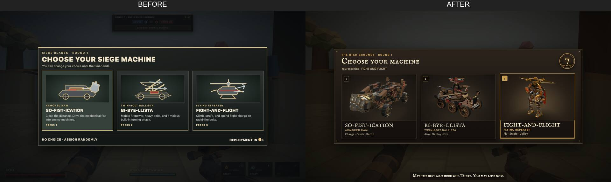
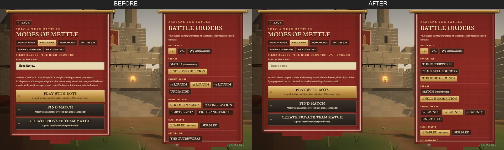
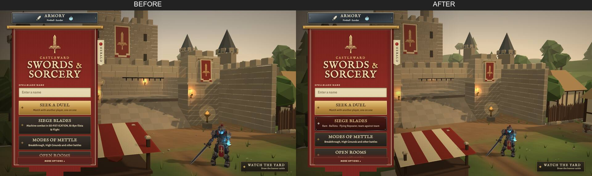
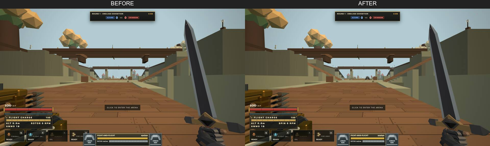
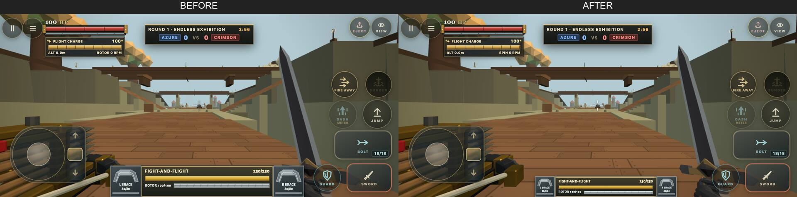
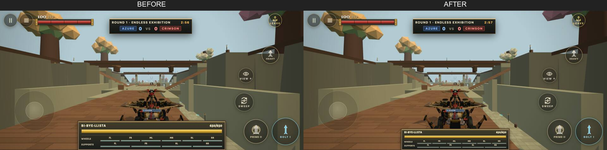

# Siege Blades polish: evidence

Before is `main` at `15e8c414`. After is `feat/siege-blades-polish`. Both were captured in headless Chrome at 1280×720 (desktop) and 844×390 with touch (phone landscape).

| | |
|---|---|
| Machine draft |  |
| Siege setup |  |
| Main menu |  |
| Flier HUD, desktop |  |
| Flier HUD, phone |  |
| Ballista HUD, phone |  |

## Simulation cost per tick

Bots only, same machine, same session, main versus branch. Times are ms per authoritative tick (mean / p99).

| Battlefield, size | main | branch |
|---|---|---|
| High Grounds 1v1 | 15.3 / 26.3 | 3.2 / 6.7 |
| High Grounds 3v3 | 40.5 / 79.3 | 9.0 / 13.9 |
| Outerworks 3v3 | 22.6 / 40.9 | 6.0 / 10.5 |
| Blackbell Foundry 3v3 | 10.4 / 17.4 | 4.5 / 6.2 |

- **Cause.** The separating-axis box test in the machine clearance checks took 67 % of the tick.
- **Fix.** Exact early rejects now run first: world-axis separation for axis-aligned solids, and bounding spheres for rotated ones. The full test still runs whenever those can't decide.
- **Check.** Collision results match `main` exactly. With `Math.random` seeded, a deterministic tick-hash comparison is identical.
- **In the browser (High Grounds 3v3, headless):** the in-page host tick fell from 60.6 to 25.2 ms (p99 142 → 51), and 12 s of play drew 312 frames instead of 204.

**Still costly:** rendering.
- About 2,000 scene objects, 500 materials and 400–500 draw calls per pass.
- About 38 KB of JSON per snapshot.
- Headless software-GL frame rates are too noisy to quote; they need a measurement on real hardware.

## The flying ram

- **What it was.** Fleet machines were drawn by the wrong renderer. The renderer read `type` (`fight-and-flight`) before `kind`, so a flier was drawn as a ram. That is the "ram" seen 12 m up.
- **The simulation was sound.** Across 36 minutes of headless 3v3 bot play, no authoritative ram left its wheels.
- **A separate sim defect, also fixed.** A Hellping Hand hop stopped mid-arc could leave a ram hanging (27 cm in the test). The hop also ignored other machines as obstacles.
- **Tests.** `server/tests/so-fist-grounded.test.mjs` and `client/worlds/fleetRenderKind.test.mjs`.

## Tests

- The full suite runs 3,445 tests: 3,415 pass and 30 fail.
- The same 30 fail the same way on `main` at `15e8c414`. They are in 13 files: the Disaster/Gale infusion suites, `fight-flight-sword`, `fight-flight-cover`, `so-fist-contact`, `one-hit-live`, `ultimate-knight`, `spellblade-motion-sidecar` and `FightFlightWreckAftermath`. This branch adds none.
