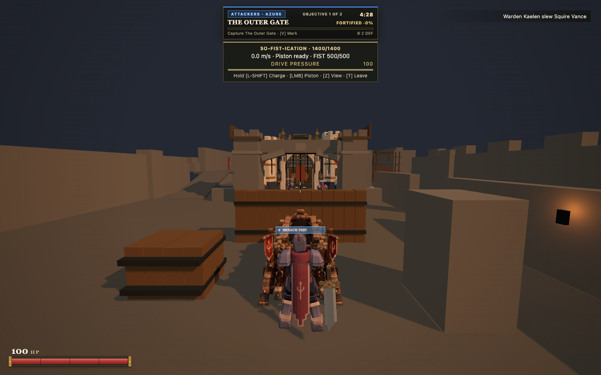
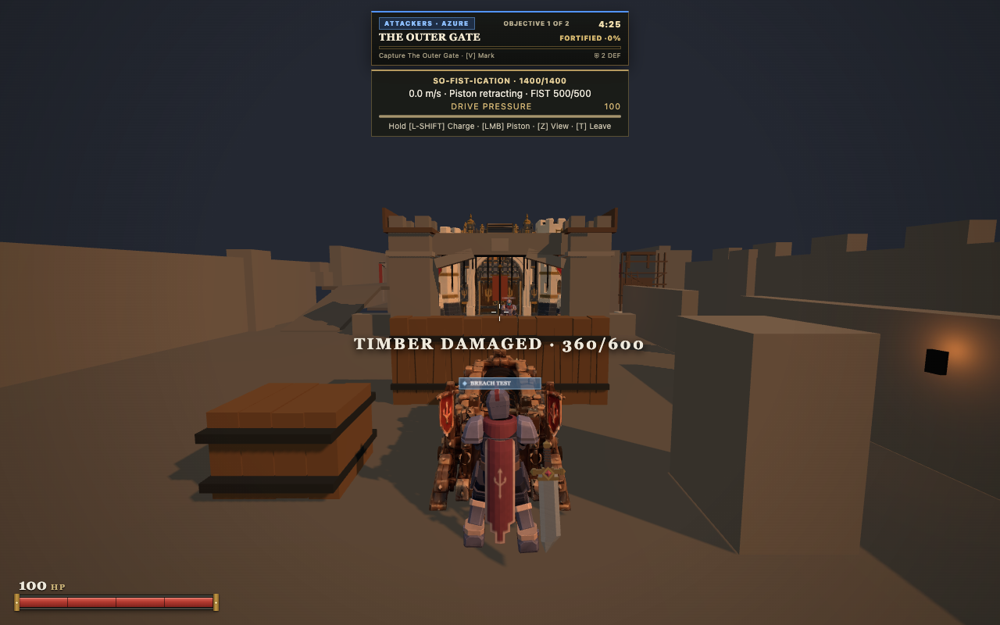
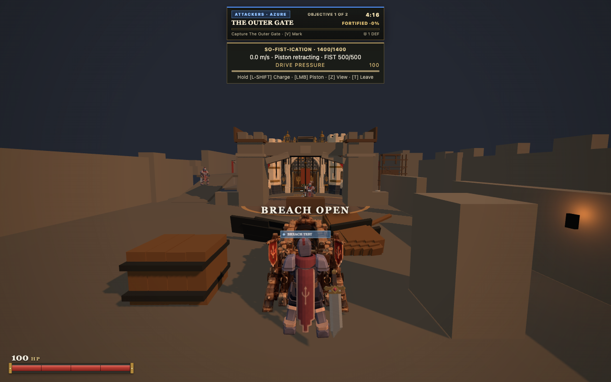
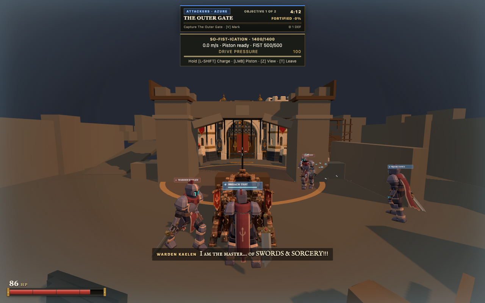
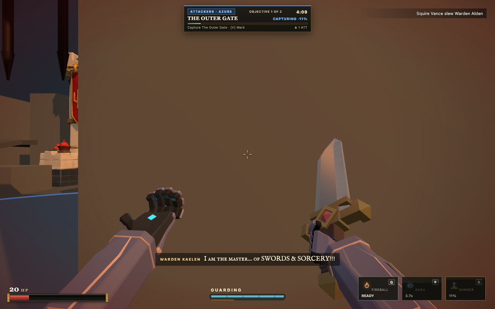
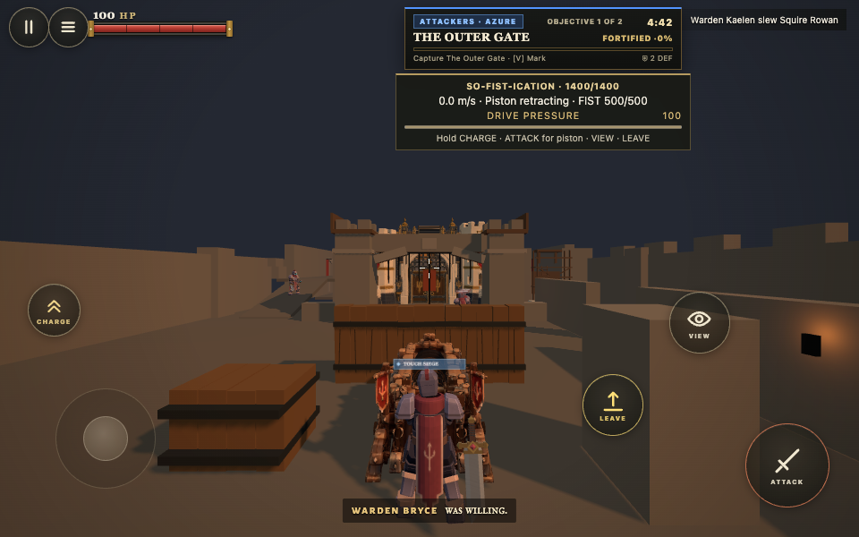

# Bastion siege defense evidence

Bastion Breakthrough now supplies one attacker So-Fist-ication emplacement and three selected timber defenses. The central reinforced barricade opens a direct approach to Objective 1. The Honorable Entry Gatehouse and boundary hoarding retain their capture dependencies. Bastion receives no ballista.

## Actual exported game

Chrome 155, Apple M1 with ANGLE Metal,1280x800, FOV 78, pixel ratio 1. Squire 2v2 was selected through the real Breakthrough menu. Both teams' bots remained active. This sequence uses ordinary walking, mounting, driving, attack, dismount, Sprint, Dash and Guard inputs. No gameplay, health, target or spawn fixture was injected.

[Sequence facts](sequence.json) record the three real strokes: 600→360→120→0. The first strike began at 40.9212 and failure occurred at 52.3686, approximately 11.45 seconds including input and capture gaps. Contact followed each actual strike by approximately 2.15 seconds. The authored 2.08 second release onset and four second cycle remain intact. Deliberate stationary impacts felt usable against this defense; no shared timing change was warranted.

The ram then crossed the former collider at z = −14.1 and reached z = −9.0169. Its operator dismounted and reached the capture radius alive. The final image shows capture advancing while the capture gate remains closed. The operator finished at 20 HP; the ram provides an assault opening and still requires cover.

These captures came from the standalone HTML5 export of source c282922. Rebase onto main 6bc2be9 changed no client/shared runtime source; `git diff c282922 166a8f5 -- client shared` was empty. PR224 merged during implementation, so the new draft targets main directly.

## Touch

960x600 Chrome touch emulation passed mounting, joystick driving, an actual piston impact, view change and leaving. The sole fixture moved the first attacker spawn to the real rear station to avoid a long automated joystick approach. Normal machine position, combat, defenders, health and collision were retained. The strike changed 600→360. Normal Guard returned on leaving. [Touch facts](touch-result.json).

Physical phone, Safari and live itch iframe testing remain unverified. Nothing was uploaded or deployed.

## Focused regressions

Nine structural tests and one real WebSocket test cover ordinary sword and Fireball contacts, heavy bolts, a shielding permanent wall, simultaneous projectile impacts, the charge/piston cap, cached navigation, actual capture advancement with the breach preserved, reset, enemy operation refusal, friendly sabotage prevention, persistent wrecks, late join and token resume. Existing ram contact, component, terrain and impact tests remain green.

Full `npm run verify` passed 1,756 repository tests, 19 HTML5/release tests, 500 module syntax checks and HTTP/WebSocket SmokeOK. ZIP integrity passed. Export contains 987/1000 files, approximately 47.82 MiB zipped. Canonical ram asset and rollback assets remain unchanged.

## Frame pacing

[Measurements](performance.json) compare PR224 runtime source 38e39ca with the candidate in the same browser, viewport, settings and opening camera. Both have six active actors. The candidate's collision moves the initial camera backward by 5 cm. Bot decisions and spell selection vary between runs; these are eight second samples, not deterministic performance benchmarks.

| Scenario | Frame median | Frame p95 | Frame maximum | Host CPU median | Host CPU p95 |
| :--- | ---: | ---: | ---: | ---: | ---: |
| Before, stationary |16.7ms|16.8ms|16.8ms|0.9ms|2.5ms|
| Candidate, stationary |16.7ms|16.8ms|33.3ms|0.9ms|2.9ms|
| Candidate, drive and piston |16.7ms|16.8ms|50.0ms|2.4ms|8.8ms|

The active sample contains two frames above 33.5 ms and eleven host intervals above 50 ms. Those intervals remain a limitation; these samples do not establish their cause. There is no measured frame rate gain. The new mechanics maintained the measured frame p95 in these samples.

## Integration and reproduction

The reusable [structure and emplacement contract](../../integration/siege-structures.md) leaves Antigravity's larger battlefield untouched. The handoff was [posted on its Outerworks PR225](https://github.com/CaptainFredric/swords-and-sorcery/pull/225#issuecomment-6387707336) after native input failed. Recipient acknowledgment remains pending.

Run `node scripts/siege-browser.mjs` against3251, or set `SIEGE_URL` to an extracted export. The saved successful scenario uses `SIEGE_SKILL=squire SIEGE_SIZE=2`. `scripts/siege-touch.mjs` and `scripts/siege-performance.mjs` reproduce the other checks. These scripts require Playwright installed in the environment; `PLAYWRIGHT_MODULE=/absolute/path/to/playwright` selects an existing installation.

Current renderer construction assumes timber screens across X. Other orientations or fortification art should supply their matching authored rendering while retaining the health and collider contract. Multiple simultaneous ram emplacements would require an explicit collection design; this implementation deliberately supports one.
