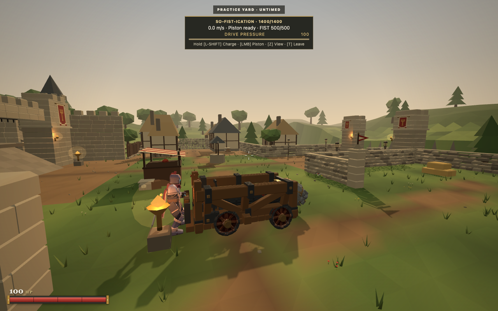
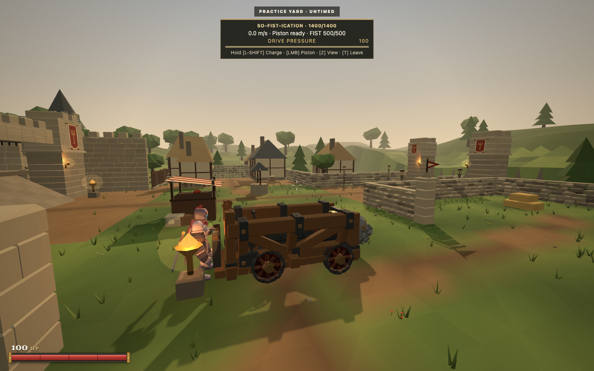
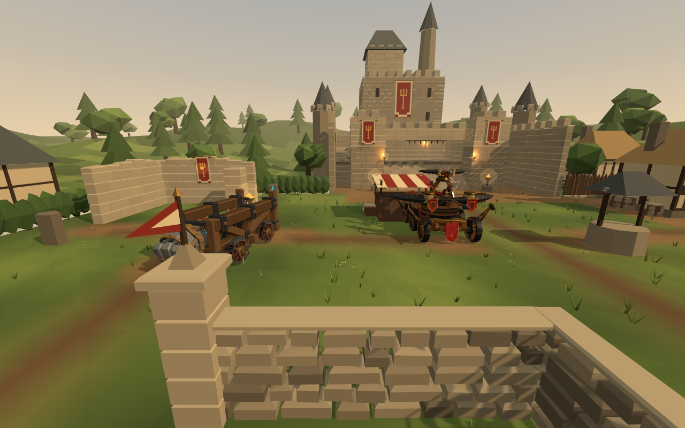
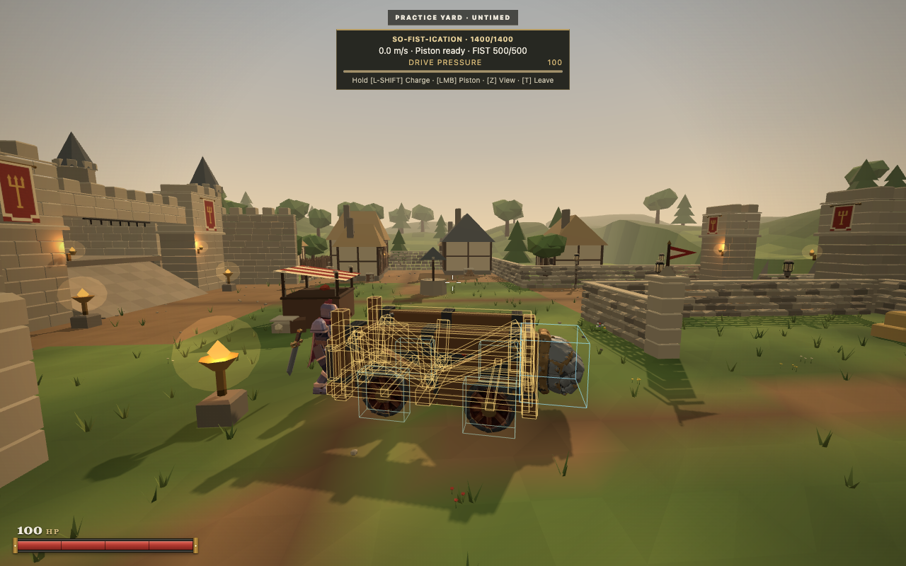
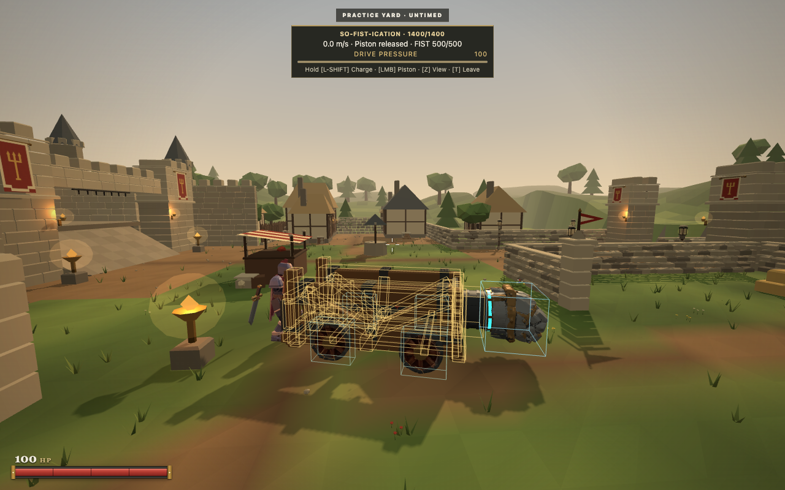
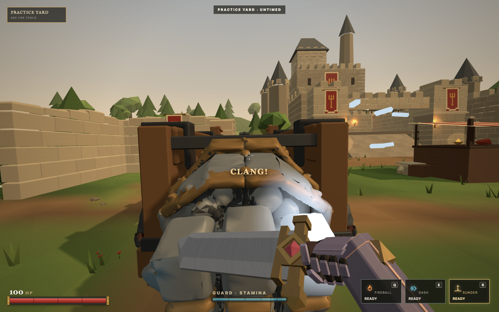
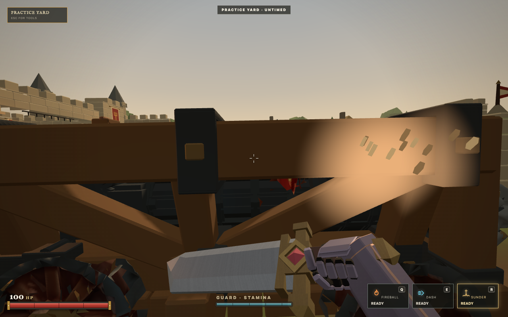
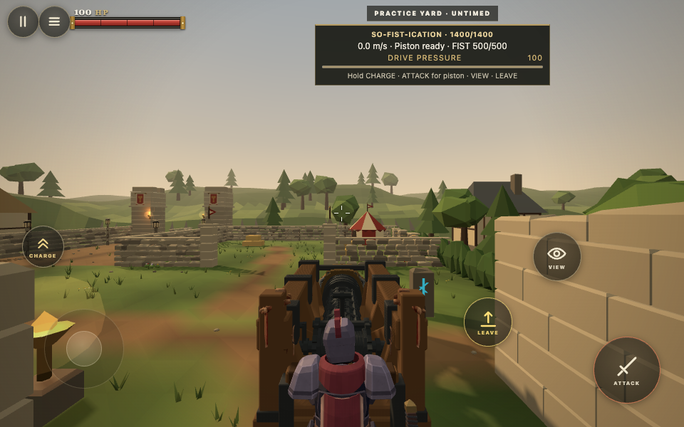

# So-Fist-ication refinement evidence

The ram now has straight, bound timber load rails, clearer material regions, wider wheel tracks and a modest increase in height and length. Player movement uses its oriented physical volumes. Mounted look responds immediately while carriage translation is filtered separately. Damage marks occupy a small patch of the struck surface and follow its component.

## What changed visually

The original asset used one material and a busy 1024 square atlas for every surface. Some added mechanical parts sampled tiny atlas swatches. The original had smooth custom normals across most of its carriage and fist. Raising texture resolution would have preserved these problems.

The source revision retains the authored piston, winch, chains, fist, cloth, wheel spoke detail and all four animation clips. It adds real walnut rail geometry with iron bindings and square bronze fasteners, moves the lower rails inward, rounds the wheel running surfaces and provides steering clearance. The fist, wheel rims and mechanisms have broad material regions. The original four maps remain at their original resolution. Filtering remains enabled. The main timber frame was reconstructed around the retained moving mechanisms. Its planked bed, splayed supports, diagonal braces, crossmembers and operator bar have clean geometry and material boundaries. The original fist, wheels and cloth preserve their authored surface character. Accidental atlas emission was removed from the physical gears and chain; the arcane collar remains emissive.

The editable source and export tool are in `assets/source/so-fist-ication` and `tools/assets/export-so-fist.py`. The source export reproduced the same geometry, animation and embedded image binary buffer as the delivered candidate. Export metadata names are normalized. The original binary remains recoverable from commit `6249095`, with its original SHA recorded in the source manifest.

## Matched local response sample

Chrome155, AppleM1 Metal, 1280×800, FOV78, pixel ratio1, Sharp quality, identical Practice encounter, initial spawn and camera. Baseline source is `6249095`. The ram was built and operated through the real UI. Neither positions nor movement results were injected.

| Observation | Before | Candidate |
| :--- | ---: | ---: |
| Speed after one second of forward input | 2.69m/s | 3.80m/s |
| Ordinary speed target | 4.2m/s | 4.8m/s |
| Reverse target | 1.9m/s | 2.5m/s |
| Ordinary acceleration | 2.6m/s² | 3.8m/s² |
| Braking | 4.0m/s² | 5.8m/s² |
| Pressure charge peak | 12m/s | 12m/s |
| Stationary frame time p95 | 16.7ms | 16.7ms |
| Frames above33.5ms, out of361 | 0 | 0 |
| Host tick CPU median / p95 | 0.5 / 0.8ms | 0.5 / 0.9ms |
| Active frame time p95 | 16.7ms | 16.8ms |
| Active host CPU median / p95 | 1.3 / 2.3ms | 1.8 / 3.6ms |
| Renderer texture count | 50 | 50 |
| GLB size | 6,141,788bytes | 5,356,608bytes |
| Triangles | 63,449 | 39,378 |
| Material regions / primitives | 1 / 17 | 12 / 30 |

The rebuilt asset is12.8% smaller and has37.9% fewer triangles. The more faithful frame hit volumes add simulation cost in the active sample. Lazy evaluation of SAT axes reduced that cost from the first frame candidate; the final cost is reported above.

The frame results show equivalent pacing in this short sample. They do not establish an FPS improvement. Stronger acceleration explains the response change. Obstacles stopped some later reverse and charge segments in this small lane; those segments are genuine collision footage, rather than a maximum speed measurement.

The scale is2.85 instead of2.65. The front wheel track changed independently from the source±0.338 to±0.43, and the rear to±0.37. Wheelbase, wheel radius, stroke, hit volumes, operator station, grip locators, safe exits and terrain sampling follow the same dimensions. The normal inner wheel steering limit is45°. Turning remains proportional to actual travel. The chassis cannot pivot while parked.

## Collision and damage

The previous rotated AABB representation displaced a physically free player by1.34m in the reproduced45° case. The shared cylinder versus oriented box solution clips each box to the player's vertical span before resolving its horizontal footprint. Authority, local prediction and standing clearance use the same geometry. Damage volumes retain their own purposes.

The browser pass shows front, rear and profile overlays, a turned carriage, a live extended strike and ordinary walking around all four sides. Yellow outlines are frame volumes; blue outlines are the fist and wheels. The scale comparison uses a staged inspection camera rendering both actual, authoritatively parked machines. It changes the camera for that image, while machine poses remain untouched.

Real sword contacts caused a19HP armored fist hit and a22HP hull hit. The cold metallic fist ripple and warm timber patch come from accepted damage events and actual local impact coordinates. A nearest triangle anchors the small visual patch when the conservative damage box contact lies just outside a facet. Rejected and zero damage events do not flash a component. The surface mark remains in mesh space during rotation and animation. Authored parent names preserve component identity when the GLB loader splits material regions into child meshes.

## Mounted controls and remote presentation

A separate Ram mounted look setting defaults to0.65 times the player's ordinary mouse or touch sensitivity. Ordinary Spellblade sensitivity is unchanged. Look direction and its orbit offset update together; filtering applies to carriage translation. Relative touch coordinates prevent a viewport resize from becoming artificial thumb movement.

The touch pass used real Chrome touch events at960×600, with an initial valid parked ram and player position fixture. It covered two pixel drags, reversal, rapid swipes, simultaneous stick and look, view changes, resize and dismount. Physical phone hardware remains untested.

The remote harness uses two real WebSocket clients and an ordered45 to95ms inbound delay proxy. Only initial machine/player placement and reconnect identities are fixtures. All driving uses browser keyboard input. Its comparison changes only the presentation module, with the same candidate physics and assets.

The paired comparison produced these short run results. Both versions used the same candidate vehicle physics and assets; only the presentation module changed.

| Remote observation | Previous clock | Revised clock |
| :--- | ---: | ---: |
| Operator backward clock steps | 17 | 0 |
| Observer backward clock steps | 16 | 0 |
| Operator largest pose step | 0.347m | 0.172m |
| Observer largest pose step | 0.409m | 0.173m |
| Operator p95 pose step | 0.156m | 0.089m |
| Observer p95 pose step | 0.125m | 0.089m |

These are roughly five second driving samples, with273 to284 captured frames per client. They demonstrate removal of clock reversals and the large associated corrections under this ordered jitter pattern. They do not establish internet wide latency or frame rate guarantees.

Packet arrival previously changed the presentation clock abruptly. The revised clock advances continuously, slews gradually and holds at the last received pose during starvation. It discards accumulated clock debt rather than spending it as a large jump when a packet returns. Aim and the authoritative clock remain responsive. The client continues to avoid extrapolating machinery through unknown obstacles. Prolonged outages can still visibly hold the machine.

## Reproduction

Use the installed Playwright module through `PLAYWRIGHT_MODULE` and a local server through `RAM_URL`.

```sh
RAM_CHECK=handling node scripts/so-fist-refinement-browser.mjs
RAM_CHECK=damage node scripts/so-fist-refinement-browser.mjs
RAM_CHECK=touch node scripts/so-fist-refinement-browser.mjs
RAM_CHECK=space node scripts/so-fist-refinement-browser.mjs
node scripts/so-fist-remote.mjs
npm run verify
```

Run performance comparisons serially with other heavy work stopped. Browser console shader errors are checked as well as JavaScript errors. The editable source, GLB hierarchy, wheel pivots, stroke, contact damage, Guard, Steel, wall impacts, destroyed components, safe administration and both siege machines are covered by automated checks.

## Remaining limits

This pass introduces no Convoy mode or allied pressure bonus. The machine remains player operated. Its existing independent pressure and operator state can support a later escort rule. The video clips omit startup and idle profiling portions; the source recordings remain preserved locally. The current test evidence covers desktop Chrome and emulated touch. Physical mobile hardware and a deployed itch iframe remain outside this local pass. No build has been merged or deployed by this assignment.

## Captures

| Previous construction | Refined construction |
| :--- | :--- |
|  |  |













Video: [previous handling](before-handling.webm), [refined handling](after-handling.webm), [actual localized hits](localized-hits.webm), [touch precision](touch-precision.webm), [remote driver](clock-after-0.webm).

Raw short sample results: [handling](handling.json), [ordered remote comparison](remote-comparison.json).

The final exported Squire siege regression retained three piston blows to breach. A small initial chassis contact reduced600 to560.04 before the first piston brought it to360, followed by120 and0. The ram then drove past the former barrier toz−9.21; the operator dismounted and contested the objective alive at57HP. The browser reported zero JavaScript errors.

## Final verification

`npm run verify` passed 503 module syntax checks, 1771 repository tests, 19 HTML5/release tests and the HTTP/WebSocket smoke check. Export revision `ce018b2` contains 989 files, 47.36MB zipped and 64.11MB extracted. ZIP SHA256: `8fa4d575705fffb0f4ad68fcbdfa69623b74257183297fdff1b95fe4e4e1691c`. The extracted export passed desktop sword damage, oriented collision, construction of both machines, and emulated touch at Smooth quality. Native landscape/portrait transitions now cancel the previous thumb gesture; small same-orientation viewport changes preserve normal dragging. The final asset was also used in the two-client ordered-latency comparison above.
