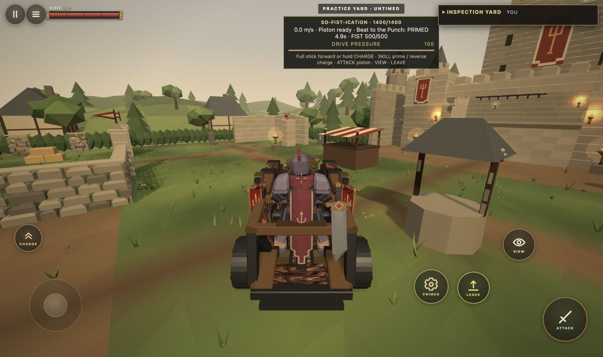
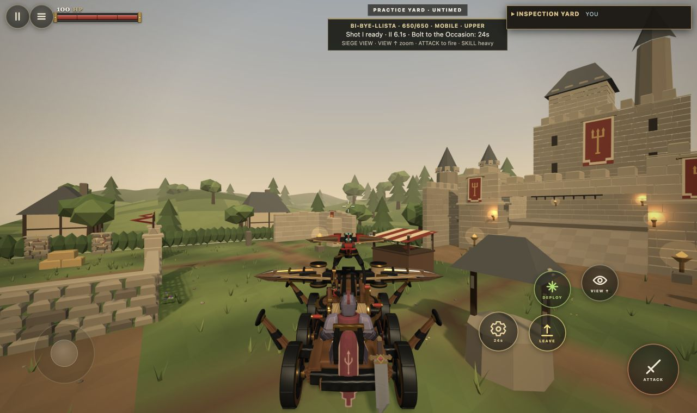

# Final siege assets: first integration increment

SO FIST v2.5 and Bi Bye llista v4.3 are installed from the exact supplied binaries. Previous runtimes are preserved under assets/source, outside HTML5. Upstream source/build ZIPs are preserved there and inspected as references; their replacement simulation snapshots and native helper binaries were never executed or copied into gameplay.

Ram scale stays 2.85. Rear wheels and axle move to native Z minus 0.820; wheelbase is 1.145 native / 3.26325 world. The actual closed fist bounds and wider wheel solids follow the delivered mesh. Terrain root height fits all four wheel contacts rather than treating the offset axle midpoint as the carriage origin. Steering pivots around the real rear axle, preserving wheel contact and differential wheel rolls. Existing motion, charge, damage and both machine Skills remain in their existing systems.

Ballista v4.3 retains the existing 65 node locator/transform layout and 21 clips. Existing muzzle chain, seat, controls, independent tracks, loaded bolt visibility and component damage remain active. No provider runtime module replaced the game implementation.

Actual Inspection gameplay built and mounted both machines. Keyboard U released heavy Bolt II while I stayed ready; U primed the new ram. Actual movement, turn, reverse and F piston input operated with the onboard rider. Emulated touch controls were visible and used for focus; exhaustive phone gesture and combat replay remains pending. Regression coverage includes normal attacks, Skills, terrain, components, collisions and muzzle transforms. The additional rear axle tests cover a moderate ramp and absence of rear axle lateral slip.

Fight and Flight v2.6, its contract and fitted reference are downloaded and inspected, but gameplay integration is still unfinished and is intentionally excluded from this PR. All flight, repeater, rotor damage and flight Skills remain pending a separate implementation PR. No full task completion or physical phone validation is claimed.
