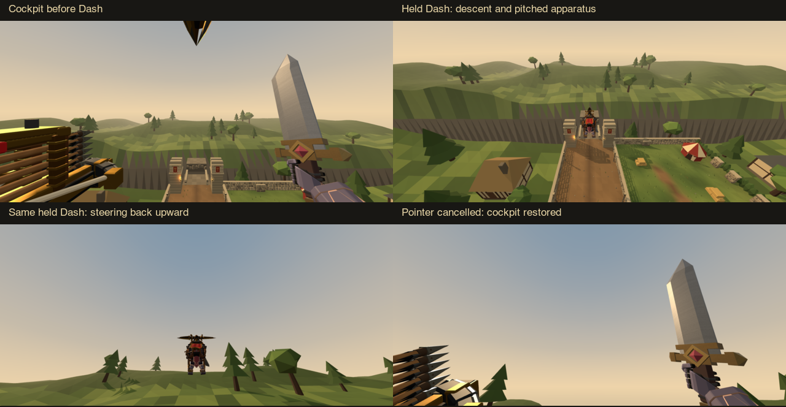
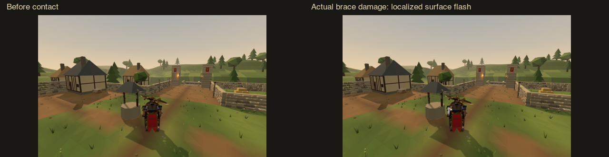
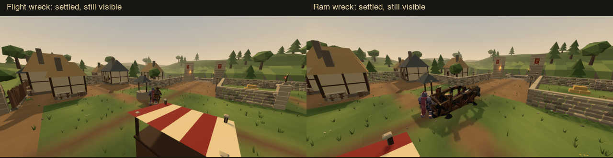
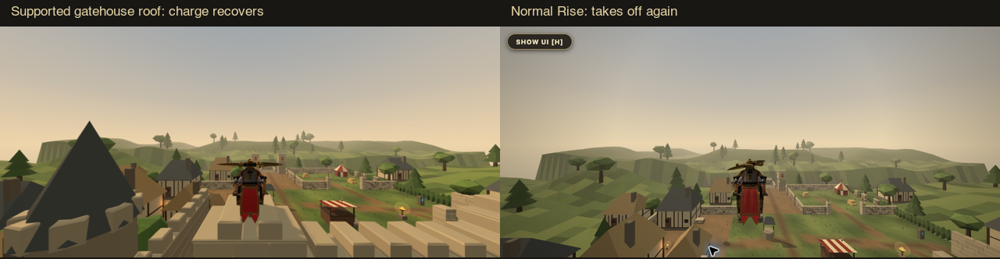

# Flight, contact and machine feedback repair

Based on main `d14a06f7`. Argon's models and animation files are unchanged.

## Behavior

Flight to the Valkyrie now uses an authoritative three dimensional direction. Total target speed remains 18 m/s. Speed response is 5.5/s; pitch steering is bounded to 1.1 rad/s and ±0.85 radians. The offensive forward lean is a separate neutral trim in the same attitude calculation. This preserves level thrust at a level crosshair while the apparatus enters its authored offensive posture. Starting or repeating a run adds no unsolicited upward impulse. The existing articulated muzzle, rotor contact and fitted rider consume that replicated body attitude.

A temporary third person boom enters smoothly and stays throughout the run. The selected view remains stored, so release, landing or interruption recovers to it. The brief existing FOV accent remains brief. Each camera target is clipped against the world. Input yaw and pitch are unchanged by the transition.

For a human operator in ordinary Practice, Prowess still drains and visibly refills, but its zero crossing leaves propulsion running. Valid held training Dash retains at least 2.1 flight charge. That exception is evaluated from the actual room and mounted owner each tick. Competition, tutorials, bots, terminal preparation and active Chivalry retain their separate restrictions. Emergency braking, stale input, collision, release, rotor failure and dismount still interrupt the run.

Support now considers floors, ramps and actual solid tops under a five point foot footprint. Roof contact from above can become grounded and recharge. Side contact, ceilings and unsupported overlap cannot. An overhanging chassis slides outward at bounded speed until it can fall, rather than zeroing every velocity component indefinitely. Collision uses the current supplied world, including changed structures.

Routine machinery and timber hit text is removed. Destruction and important component messages remain. Flight damage marks use the existing ram surface shader, actual positive damage events, replicated local contact coordinates and the nearest real triangle on the affected component. Each mesh owns its material and contact coordinates. The 220 ms mark follows articulated armor and preserves Steel emission. Existing ballista component flashes and ram surface marks remain.

Destroyed Flight apparatus falls under gravity with retained momentum before settling on support. Its visual deadline starts from ground impact; unsupported abyss wrecks expire below the world. Flight and ram ruins remain visible until their authoritative expiry and never retain active damage or player collision volumes. Both collapse poses enter progressively.

## Verification

`npm run verify`: 617 modules, 2,280 repository tests, 21 HTML5 release tests and smoke validation passed. Existing duplicate member warnings in tutorial UI and Effects remain. Exact revision export receipt is recorded in the PR.

The new regression cases first reproduced the broken behavior. Coverage includes actual Castleward gatehouse roofs, bridge and stair ramp, High Grounds canopy, wall and ceiling recovery, unsupported ledges, 40 seconds of held Practice Dash starting at nearly empty charge, finite competitive resources, neutral startup, emergency braking, localized event coordinates and falling wrecks. Existing terminal, muzzle convergence, sword, rotor, Steel, control and machine tests pass.

`flight-repair-network.test.mjs` connects two real WebSocket clients to a real server. Both receive the identical pitched run snapshot; upward steering, release, operator detachment and falling wreck state are observed through replicated messages.

## Browser evidence and limits

The images are actual game renders, using the authored v2.7 Flight model and v2.5 ram. Inspection fixtures place the operator and apparatus at repeatable safe starting positions. Normal mount validation and the actual local simulation run thereafter. No movement or damage is painted into the screenshots.

Desktop: real walking and T mount entered the cockpit; real held Space launched; real held E produced the recorded run and restored the requested cockpit on release. Native control interruptions left one genuine E hold running for several minutes; authority continued at the 18 m/s target across resource cycles. That extreme off-map run was discarded as presentation evidence.

Touch: the final sequence uses scripted touch PointerEvents through the normal TouchControls handlers at 844 by 390, including simultaneous Dash and look, downward and upward swipes, then pointer cancellation. This is emulated input, not a physical phone test. The selected view remains `sight` throughout while the temporary boom is active.

Roof verification: a staged descent onto the Castleward gatehouse settled at Y=6.6 m, with charge increasing from 23.5 to 41.2 while supported. A subsequent real held Space input took off to Y=11.49 m. The attempted scripted rail gesture was ineffective while the clean capture UI was hidden; the later native Rise input verified takeoff.

The authoritative component-hit fixture invokes normal damage and records the resulting positive HP reduction and localized flash. It is a controlled damage fixture, rather than a claim that every weapon variant was manually replayed. The wreck fixtures likewise use ordinary authoritative chassis destruction, then the live wreck simulation.

Automated tests and browser samples cover complementary parts of the acceptance matrix. Physical phone testing, an exhaustive manual tour of every High Grounds roof and two simultaneous browser observers remain unperformed. No frame-rate gain or production latency benchmark is claimed. Raw capture sequences and telemetry are retained in ignored `output/flight-repair`.

