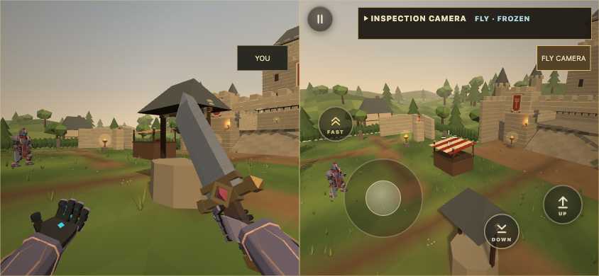

# Inspection camera

Local review candidate. Open Solo, then Inspection Yard, then **INSPECTION CAMERA** in the upper right.

**FLY** detaches the viewpoint from the controlled Spellblade. Move and look normally; hold Jump to rise, Crouch to descend, and Sprint for faster travel. Keyboard prompts follow the current bindings. Touch uses the existing stick/look gestures with held **UP**, **DOWN** and **FAST** controls. Flight passes freely through scenery for inspection and keeps working while the simulation is frozen.

**YOU** returns to the original player. **INHABIT DUMMY** takes control of the current living Practice dummy. Movement, attacks, Guard, spells and their normal validation use that actor. Its AI yields until control is returned. Removing or killing the possessed dummy safely returns control to You. The human network/profile identity stays unchanged. Dummy possession disables challenge rewards for the rest of that Inspection run. Siege operation and the Ultimate preparation tool remain with You.

**SPLIT VIEW** shows the actor's ordinary view beside the free camera. Tall layouts stack the views. One view receives input at a time; choose it through the camera controls or a pane label. Each view has its own aspect ratio and the first person arms appear only in the actor view. The observer sees the complete body and machinery. Both views share one simulation. Split view is optional and adds rendering cost.

**RESET CAMERA** places the observer behind and above the current actor. Freeze, Resume and Step also remain accessible in the camera panel. Frame playback remains in the existing Inspection tools. Touch control selections collapse the panel to leave the scene clear. On desktop use Escape to access the camera controls, then click the arena to resume mouse look.

Handoffs release held controls. Frozen handoffs preserve the captured pose and defer their neutral input until Resume. Camera travel never becomes body movement or weapon aim. Leaving Inspection clears the layout, flight mode, touch holds and visual ownership. Normal Practice, Tutorial and remote games cannot enable this camera or possession API.

[Short flight recording](flight.webm) shows actual touch driven camera travel around a frozen scene. It records the WebGL canvas; DOM controls are shown in the still above. No poses, effects or gameplay events are fabricated.

## Verification

Actual desktop mouse/keyboard input exercised frozen flight, split views, dummy movement, attacks and Fireball. Emulated multitouch exercised movement with rise, look, descent, cancellation, portrait stacking and the existing rotated shell. Dummy removal restored You, zero arm offset and ordinary aim gain. Returning to normal Practice removed the inspection layout and tools, and ordinary touch Fireball still cast. Toolbar events were checked for unwanted attacks. Physical phone testing remains outstanding.

Focused coverage includes camera movement/layout math, held touch rise/descent, mouse compatibility events, local only routing, frozen poses, safe actor return and reward suppression. Repository verification passed 1,868 tests, 20 HTML5 checks and the smoke check. HTML5 export succeeds. `verification.json` records the browser facts. No shared combat, server, model, balance or production release changes are included.
