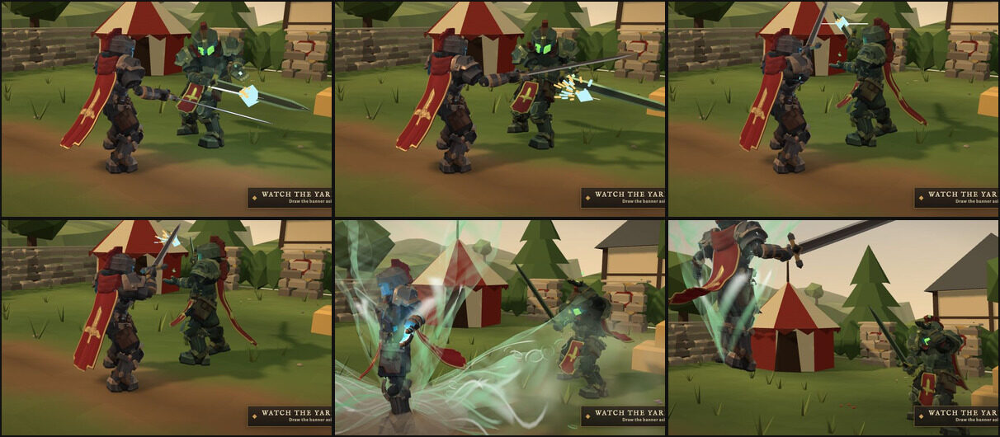
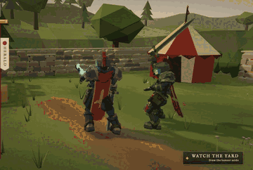
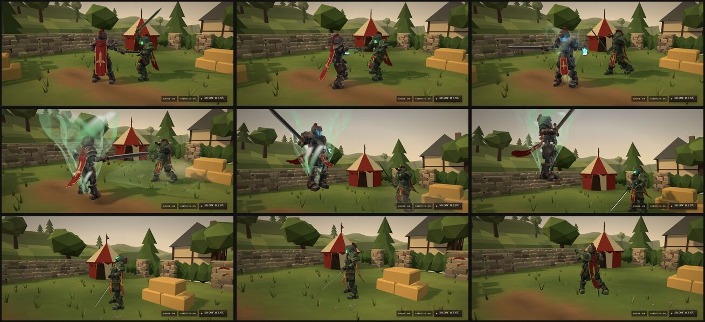
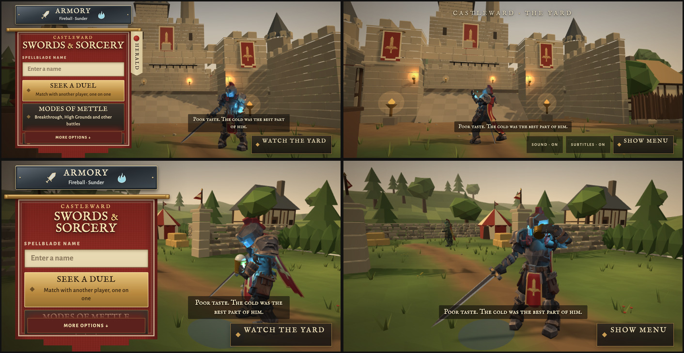
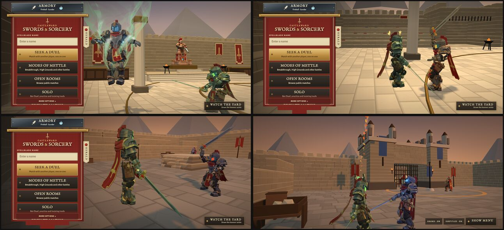

# Menu tour: audit fixes, the Gale Lift-Off Handover, and a carousel of maps

Branch `claude/awesome-benz-af7087`, draft PR #486. Not merged, not deployed. Merged with main twice, now up to date
with main `4ffc3267`. Both merges were clean (no conflicts): `MenuScene.mjs` auto-merged main's authored Armory clips
with the tour's world swapping. The merged-in Argon 89/25 Spellblade has every clip the tour uses.

## What the PR does

1. **Audit fixes to the existing tours** (kept from the first round):
   - The Slush's steam drew as hard faceted hexagons; it is now soft puff sprites.
   - Fights' walk-aways strode at sprint cadence: `clipAt` never passed the authored gait rate.
   - The White Flag's reveal was hidden behind the Spellblade's back. The shot is now 0.2 rad, and he steps back out of
     the way before the rival's long look at the flag.
2. **The Gale Lift-Off Handover:**
   1. Two parries.
   2. A spin, slow then fast, inside a Gale funnel.
   3. The rival backs off with his cape thrashing.
   4. Lift-off, hover, and flight out of frame.
   5. The rival stares up, then becomes the travelling knight.
   6. After that, the round changes hands now and then at a change of map.
3. **The carousel:** Castleward, the Court of Merit and the Outerworks, from varied starts and either direction, in a
   shuffled order. Each world is built in the dark of a short fade.

## What changed in this round

- **The parries meet the blade.** The new model's Guard clip holds the sword level, so the first version's parries met
  nothing. Now, during each parry, the director reads where the rival's blade really is on his rig. The arm solver
  brings the Spellblade's blade across it at 62% of its length, then sweeps it aside. The parry burst lands where the
  blades cross. See `parry-contact.jpg`.
- **No stalls in the vignette.** A per-frame shader log (`renderer.info.programs`) and a long-frame log found three
  causes, each fixed:
  - **His palm light.** Hiding the player's knight as he flew off removed his palm light from the scene. A change in
    the light count rebuilds every lit shader (200 to 350 ms). His lights are now stood in for at zero intensity while
    he is hidden.
  - **Disposed effect materials.** `Effects` disposed each transient's own material, and three.js drops a shader with
    its last material. So the next hit, ring or gust rebuilt it, in every fight on main too. `Effects` now keeps one
    retired material per kind (bounded: 12 after a long soak).
  - **Compiling on first sight.** The vignette's effects are now rehearsed out of sight and compiled as the menu loads,
    and again in the dark of each change of map. Rehearsing at the start of its round showed as an 83 ms stall of its
    own.
- **The slow spin is heard.** The two seconds between the gathering sound and the first whoosh were silent. The Gale's
  own gathering breath now plays with each batch of wisps, louder as the wind builds.
- **Phone landscape.** The round's subtitle sat under the Watch the Yard plaque, and under Show Menu in Watch the Yard.
  On short screens it now sits above the controls.
- **One registry entry per map.** Each map carries its renderer's loader. A test requires every map to be a world from
  the game's registry, with a renderer that exists. Edge of Victory's newer maps are not on this branch and are not
  assumed.
- **Capture tool** (`scripts/menu-tour-browser.mjs`): new `--record` (Chrome's screencast, at normal speed),
  `--observe`, `--layout`, `--state`, `--audio` and `--soak` options, plus per-frame shader-compile and long-frame logs.

## Verification

**The Gale lift-off at normal speed.** Screencasts at about 56 fps, in both the banner view and Watch the Yard, show:
- two parries with real blade contact;
- the spin building smoothly (turns per second never fall);
- the funnel growing with the wind, and the rival's cape gusted;
- the hover, then the departure, with the camera moving to the rival while the Spellblade is still rising;
- a stare of over 2 s with sky above the rival;
- the handover at the same pose and clip time;
- the walk back to the path on a gait at its own pace.

The probe saw no page errors, and no knight off the floor or inside a solid. Its only off-screen samples are the
instant of the scripted jump.

**Player state** (`--state`, real Chrome). The flow:
1. The lift-off was interrupted mid-hover by opening the Armory.
2. Spell and Masterstroke were changed there (Gale, Vortex), then back to the front door.
3. A handover and eight map changes: the round went to the Verdant Knight, back to the player, then to the Azure
   Knight.
4. The player left the front door while a rival had the round.
5. The player entered Practice.

At every step the player's knight was:
- on his stage, visible, in Castleward light;
- free of stand-in lights, wind and funnel;
- unchanged in meshes and materials, apart from the Armory's own palm orb and its Vortex showcase heat.

Practice joined with Gale, Vortex, `rigid_riposte`, and his profile's cloth and emblem. Cloth is a server profile item
(`profile.equipped`, from the Renown store). The tour has no path that writes it, and a source test forbids loadout,
cloth, emblem, settings or storage writes in the tour's code.

**Audio** (`--audio`: a real click to unlock, a log of every sound played, an analyser on the engine's output):
- Both swings and both parries play once each.
- The gathering breaths play every half second from 2.7 s, rising in gain, until the whooshes take over at 4.6 s.
- The lift-off pair plays at 6.1 s and the departure pair at 7.7 s. Nothing plays at the handover.
- The level rises from about −24 dB while gathering to −23 dB at lift-off. The stare sits at the music and ambience
  bed (−28 to −31 dB).
- After leaving for the Armory only the bed remains (−30 dB). No tour sound loops.
- His voice lines play only while the round is his.

**Not listened to by a person:** the balance and character of the sound still need a human listen.

**Phone landscape** (`--layout`, desktop Chrome emulation with touch). At 844×390, 932×430, 740×360, 667×375 and
926×428, in both views, the subtitle overlaps no yard control and is fully on screen. Not tried on a real phone.

**Soak** (`--soak 24`: 24 rounds at 4×, 16 changes of map, 12 handovers, forced GC before each sample):
- JS heap settles at 120–139 MB: 126.7 MB at round 4, 128.9 MB at round 23.
- Geometries return to the same count for each map pair, every cycle.
- Shader programs plateau at about 146.
- At most two worlds are held.
- Transients and debris return to 0.
- No growth.

**Frame times** (real Chrome, Metal, 1280×720). Main (`f4706f7c`, then `4ffc3267`) against the branch on Castleward,
3 rounds at 2×, runs interleaved. The machine was heavily loaded (load average 6–20), so frame times are noisy.

| | Main | Branch |
| --- | --- | --- |
| Menu ready | about 2.1–3.0 s | same, within noise |
| Round starts | about 4.7–5.9 s | same, within noise |
| Median frame | 16.7 ms | 16.7 ms |
| Whirlwind shatter spike (every round with one) | 120–250 ms | same |
| Lift-off round spikes | — | none in 2 of 4 runs; one 150 ms frame as the wind gathers in the other 2 |

The Whirlwind spike is its rival shattering into debris, CPU mesh splitting that is already on main. Changes of map
take 120–190 ms to build, plus up to about 400 ms for the first frame, all held in the dark.

**Tests:**
- Syntax and the browser module graph are OK.
- Tour and menu suites pass in full, except the inherited `How to Play states Chivalry's actual duration`.
- Full suite at the final merge: the branch has 23 failures out of 3211; main `4ffc3267` has 21 out of 3210, the same
  21.
- The branch's two extra failures are `snapshotAckWindow` network timing tests. They pass 3 out of 3 when run alone,
  and the branch touches no server or simulation code.

## Not done or not verified

- A person listening to the audio, and a real phone.
- The Whirlwind's shatter spike (inherited from main): building the debris could be prepared ahead, as a separate
  change.
- In captures of the vignette in Watch the Yard, one stall appears when the screencast starts together with the
  banner's withdrawal. Plain Watch the Yard runs on both main and the branch show no stall there.

## Evidence














Reproduce (local server on 3017, Node 24):

```
node scripts/menu-tour-browser.mjs --out out/v --maps castleward --jump galeLiftoff --record [--observe]
node scripts/menu-tour-browser.mjs --out out/s --state
node scripts/menu-tour-browser.mjs --out out/a --maps castleward --audio
node scripts/menu-tour-browser.mjs --out out/l --maps castleward --rounds 0 --mobile --layout
node scripts/menu-tour-browser.mjs --out out/k --speed 4 --soak 24
```
