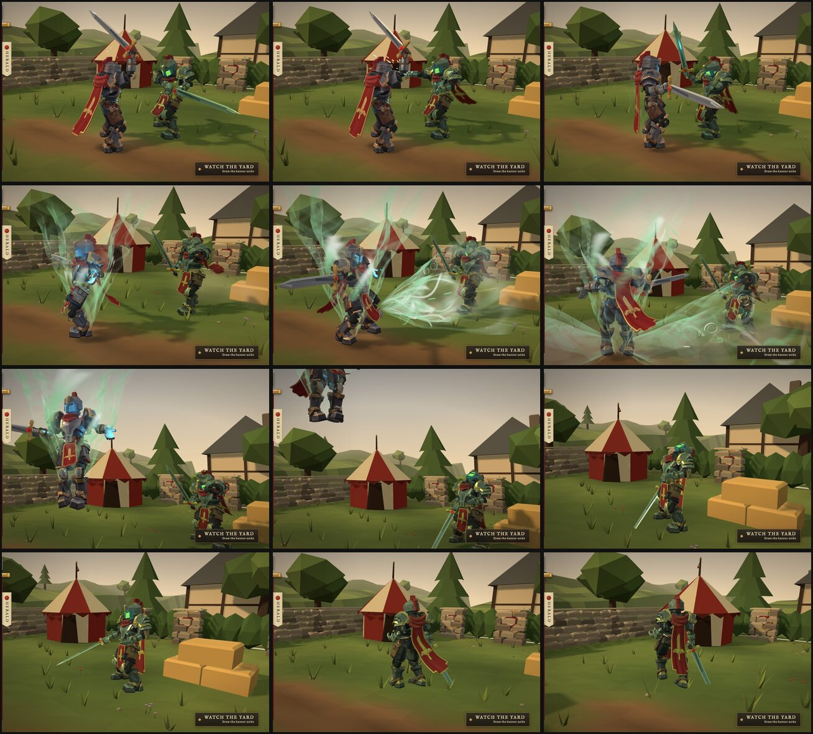
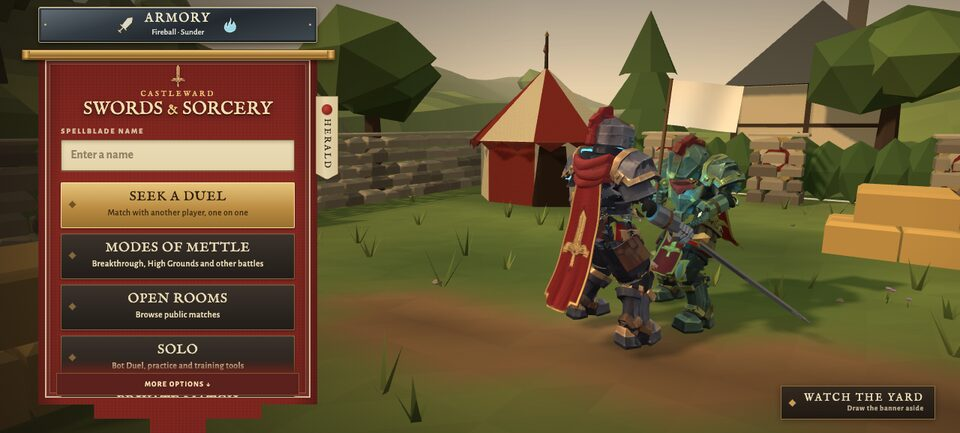
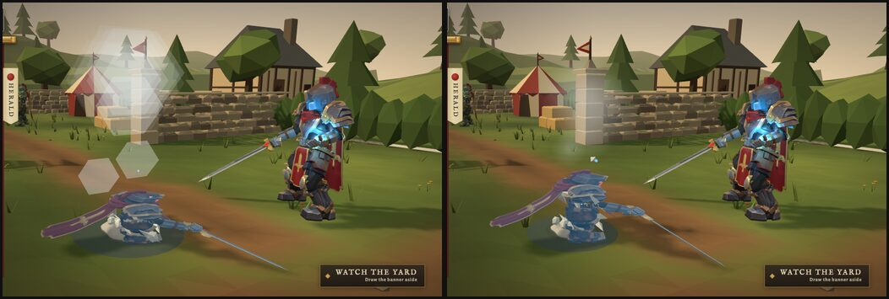
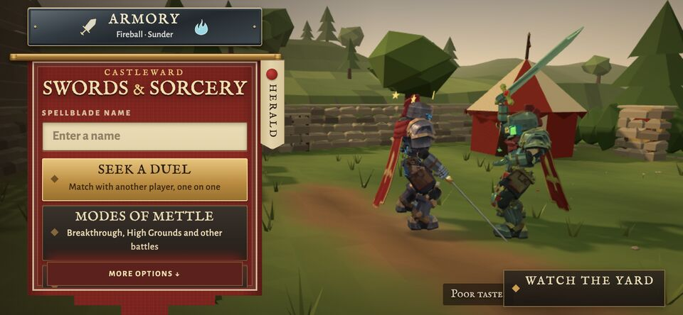

# Menu tour: audit, the Gale Lift-Off Handover, and a carousel of maps

Baseline: `41a8b082` (main). Draft; not merged, not deployed.

## 1. Audit of the existing tours

Tool: `scripts/menu-tour-browser.mjs` (real Chrome, Metal GPU, the running menu). It wraps the round's update and checks
every frame: the clock stalls, a knight off the floor or inside a solid (the world's own `surfaceHeightAt` and solids),
the camera inside a solid, the traveller hidden behind a solid or off the open part of the screen, page errors. It also
takes a still of every stop, films a fight frame by frame (`--jump`, `--sequence`), and with `--leave` opens the Armory
and comes back, recording the player's knight before and after.

Five rounds of the Castleward tour on main (3x speed) and three at real speed: no stalls, no knight off the floor or in
a wall, no page errors. Looking at the stills and frames found three real faults, fixed at their cause:

| Fault | Cause | Fix |
| --- | --- | --- |
| The Slush's melt steamed hard-edged white hexagons a metre wide, hanging over the heap | `Effects.steam` drew its puffs with the faceted dust (unshaded icosahedra) | soft puff sprites (`puffTexture`), as the Gale's breath uses; only the menu's Slush calls it |
| Every walk-away (Whirlwind, Sky-Bait, its payoff, the Slush's return, the White Flag's steps) ran its legs at full sprint cadence while moving at a stroll | a looping gait clip strides on the animator's own phase at `plan.rate` and ignores `time`; `clipAt` never passed the authored rate on | `clipAt` returns the rate when it is not 1 |
| The White Flag's gag (the rival's long look at the flag he has just been handed) was hidden behind the Spellblade's back | the shot was turned 0.4 rad behind his shoulder | 0.2 rad (nearer side on); any nearer and the fleeing rival runs past the lens (the camera-distance test catches it). Better, not perfect: at some stops the two still overlap while the Spellblade steps in for the flick |

Seen and left: on a phone on its side the subtitle box sits under the Watch the Yard button (menu CSS, untouched here).
The inherited `How to Play states Chivalry's actual duration` test fails on main too; `npm test` here: 29 failures,
all in server, input, touch-layout and vortex-camera suites this branch does not touch (main has about 28; several are
socket-timing tests that vary run to run).

## 2. The Gale Lift-Off Handover

`tourFights.mjs` `makeGaleLiftoff` (one of the rarer fights, `RARE_FIGHTS.galeLiftoff`: round 3 of a visit, then every
sixth). The rival attacks twice; both blows are parried with the game's own parry (`spellbladeMotion` `REACTIONS.parry`
deflection, `Effects.blockBurst({ parry: true })`, `parryRecipe`), and the rival is driven back by each. The Spellblade
turns, slowly then faster (`galeTurns`), arms out as in the Whirlwind; the Gale's wind gathers round him (`galeGather`)
and stands up round him as a funnel made of the Gale's own wind cone and ribbons (`tourProps.galeFunnel`, built once,
turning with him). The rival backs off into it, head down, a hand before his visor, his cape gusted by it several times
a second (`cloth.gust`, as a Gale gusts a knight's cape in play), with low gusts off the funnel raising the dust at his
feet. At lift-off a ring off the ground and a blast to either side; he hangs at 1.35 m, then climbs out of the picture.
The rival looks up after him (Sky-Bait's gaze) for over two seconds; then the round is his: the handover hands the
traveller part to that rival (`tourCast.handOver`) at exactly his pose and clip time, and he walks back to the path and
on. After that the round changes hands now and then at a change of map (`changeHands`: back to the Spellblade, or on to
another rival), and the lift-off can come round again with whoever has it.

Visual only: the player's knight is never posted at a stop (`castIsSound`), never dressed, burned, frozen or broken;
he is only hidden while someone else travels. Leaving the front door resets the cast (his again, shown), and the menu
puts him back on his stage in Castleward. The Spellblade's voice lines play only while the round is his.

## 3. The carousel of maps

`tourMaps.mjs`: Castleward, the Court of Merit (round the arena floor between pillars and stands) and the Outerworks
(round the bailey: inside the breach, the east lane, under the gate towers, past the storehouse). Each route is a closed
loop of hand-placed points with three stops; each map can be run from any start that leaves room for the stops, either
way round (Castleward 20 ways, Court 20, Outerworks 12). A visit opens on Castleward as before (the Slush, then
Sky-Bait's setup); after that each map gets one or two rounds, the next map chosen so none repeats before every other
has had its turn. The vignette order shifts with the round counter as before, and a stop with no room for its fight
stages another.

`tourWorlds.mjs`: the next world's renderer module is fetched during its predecessor's last round; the world is built
in the dark of a 0.55 s fade out / 0.7 s fade in, with its own sky, fog, hemisphere and sun. One other world is kept
at a time. Leaving the front door shows Castleward again at once.

Tests: `tourMaps.test.mjs` (every metre of every route on level standable floor and clear of solids and props, stepped
with the game's `surfaceHeightAt`; stops spaced; fights fit and are filmed clear at every stop; the carousel never
repeats a map), `galeLiftoff.test.mjs` (the beats, the parries, the spin, the flight, the seamless handover, the cast
never putting the player's knight at a stop, nothing touching his loadout, cloth, emblem or storage).

## Performance (real Chrome, Apple GPU via Metal, 1280x720; the probe's own numbers)

Like for like, Castleward only, three rounds at 2x, main vs this branch: menu ready 2.02 s vs 1.95 s; the round starts
4.68 s vs 4.60 s; median and 95th-percentile frame 16.7 ms on both (vsync); 59 vs 61 draw calls; JS heap 97 vs 108 MB
(the fourth rival). Frames over 40 ms: main 3 (183, 50, 133 ms: first-use hitches in the first fights), branch 6 (the
same, plus up to 150 ms the first time the lift-off's parry and gusts are drawn).

The carousel: another world's renderer module is fetched during the round before; building it takes 120 to 185 ms and
its first drawn frame up to about 270 ms more, both in the dark (the round holds the dark for three drawn frames after
building, so the browser's shader linking lands there; `compileAsync` stalls on some of the Outerworks' materials in
three r169, so it is not used). With the Outerworks on show the menu draws about 90 to 130 calls and 200k triangles;
heap 180 to 220 MB with one other world kept. No frame over 40 ms with the picture up during a change of map in the
final run. Before the dark hold, the Outerworks' first visible frame stalled 1.5 s.

## What was not verified

- Audio: no sound was heard. The lift-off's whooshes, parries, gusts and lift-off blast use the game's recipes, placed
  as the other fights' are, but their levels are unjudged.
- A real phone: phone-landscape was emulated in desktop Chrome only (layout and framing, not a phone GPU).
- Long sessions: about ten rounds and five changes of map at most in one visit; memory looked flat with one other
  world kept, but a half-hour menu idle was not run.
- High Grounds, Greener Pastures and the other worlds are not in the carousel: Greener Pastures draws trees outside its
  collision data, and Ruined Keep is too cramped for the fights' footwork. Outerworks is drawn in its own low dusk
  light, and its southern stop sits in the breach wall's shadow.
- Reduced motion and Smooth quality keep the round off, as before; not re-checked in a browser.

## Evidence










Reproduce (local server on 3017; Node 24):

```
node scripts/menu-tour-browser.mjs --out output/menu-tour --maps court-of-merit,outerworks --rounds 3 --speed 2 --stills
node scripts/menu-tour-browser.mjs --out output/vignette --maps castleward --jump galeLiftoff --sequence galeLiftoff --seq-speed 0.6 --leave
```

`--leave` opens the Armory after the handover and comes back, and reports the player's knight before, in the Armory and
after: cloth, emblem, visible meshes and stored settings were identical, and the round was his again on Castleward.
