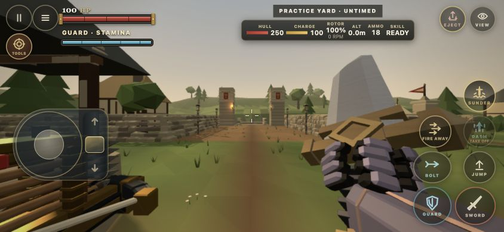
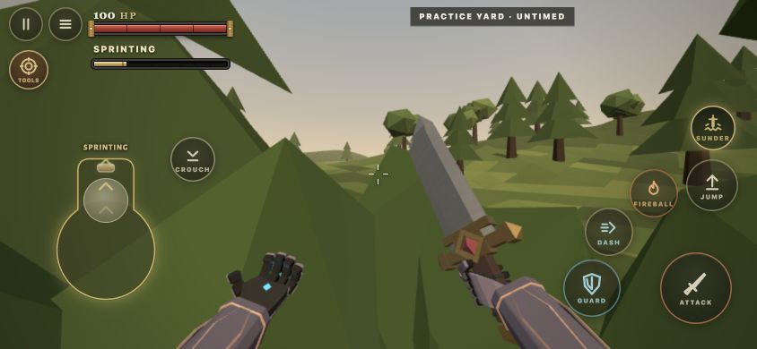
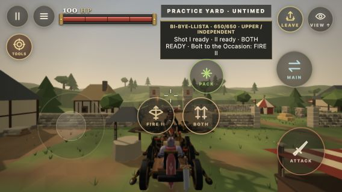
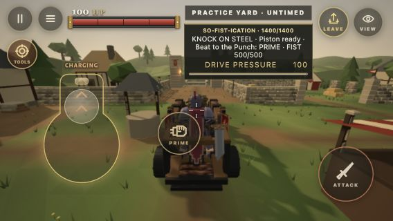
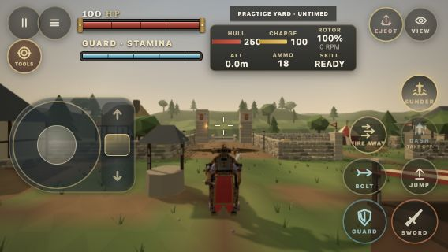
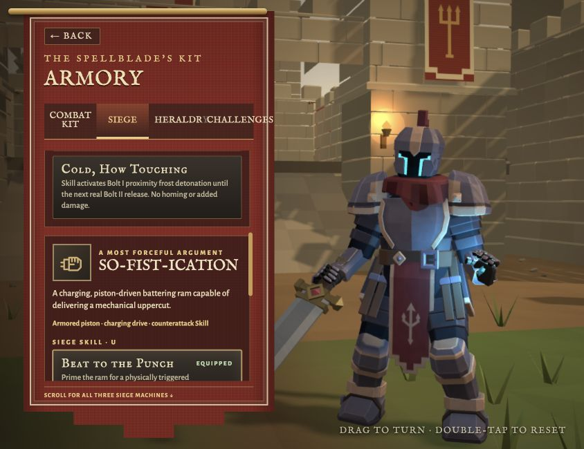

# Siege controls and Chivalry

The mounted controls now inherit the ordinary mobile button skin. The distinct siege metal faces have been removed. Contextual actions, fixed press targets, normal press feedback and saved custom layouts remain. Leave and View share the upper auxiliary row on all three machines. On short phones the status panel reserves that row and omits redundant button instructions.

Sprint and Charge use one widened continuous outline joined to the movement circle. Their existing input thresholds, authoritative feedback and independent input sources remain intact.

Holding flight Dash now permits aiming while dragging beyond its button, through the same pointer capture and cancellation path as Sword, Guard and Bolt. The real machine can pitch to 75.6 degrees during an offensive run, compared with 68.8 previously. A support clearance bound uses the authored hub and blade dimensions. The rotor contact geometry follows that actual tilt; its radius and damage remain unchanged.

Simple SVG glyphs distinguish the repeating bolt, Fire Away volley, heavy launcher, frost launcher, paired release and ram fist. The Armory uses the mechanical fist instead of an emoji.

Spells & Chivalry lasts ten active seconds after its existing startup. Eligible contacts within a 90 degree frontal arc receive an authoritative parry attempt while stamina is available and the defender is free of stagger and Guard break. Each existing weapon contact path still validates its physical contact. Manual Guard timestamps remain unchanged. Rear attacks, area explosions and heavy attacks retain their ordinary rules. The Armory describes this behavior.

## Actual browser checks

Chrome Practice used actual touch input at 844 × 390 and 568 × 320, plus a 390 × 844 display rotated through Castleward's own screen control. Only initial machine placement and the airborne start were staged with existing shared APIs. The touches then drove the normal input, commands and local authority.

The held Dash drag changed yaw by 0.8874 radians and pitch by −0.2832 while propulsion remained active and the machine traveled 11.99 metres. Cancellation cleared Dash and ended propulsion. The captured authority snapshot is [here](evidence/dash-drag-facts.json). The ram's actual forward joystick gesture activated Knock on Steel. The ballista's actual Skill press exposed BOTH, separated from Leave. The Armory fist was inspected at its real rendered size.

Additional captures show the [held Dash](evidence/dash-drag-844.png) and [rotated layout](evidence/flight-rotated.png). These are actual gameplay renders. Physical phone testing and a new extended remote latency session were not performed. Shared authority regressions cover the affected combat paths; ordinary desktop bindings were unchanged.

## Verification

Focused tests cover pointer drag and cancellation, simultaneous Bolt input, custom and mirrored auxiliary positions, actual low altitude rotor clearance, exact Chivalry duration and expiry, real frontal sword/Core/repeater/rotor contacts, rear hits, empty stamina and Guard break. The Core test also confirms that its subsequent area blast still damages the defender.

`npm run verify` passed 628 module syntax checks, all 2,337 repository tests, 21 HTML5/release checks and the HTTP/WebSocket smoke check. The exact committed HTML5 package is checked separately. No merge or deployment is part of this change.
