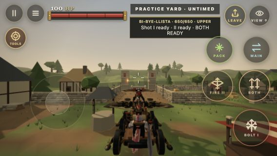
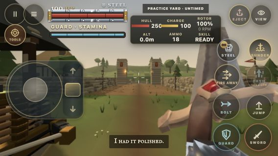
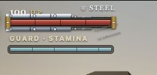

# Siege controls and Steel debris followup

Ballista primary fire is now a 76 px circle at the right edge; Skill and BOTH form a separate 64 px pair above it, with 56 px utility controls above those. Flight uses circular 64 px Sword/Guard/Bolt targets, 60 px Dash/Skill/Jump targets and 54 px upper utilities. Existing normal button styling and press feedback remain. Untouched old rectangular presets migrate; deliberate custom layouts remain. Mounted primary labels identify Bolt I and Piston.

Steel debris previously lost its sibling based placement when a cloned plate was appended to the health frame. Each fragment now freezes the actual decaying plate's local position and dimensions before detaching. Positive strength reaching zero emits once, including the final thin plate; recalling Steel at the same displayed strength updates the frame without falsely shedding it.

Verification: all 68 focused touch, layout and ballista HUD tests pass. The original implementation also passed all five GitHub checks, including full repository verification and HTML5 packaging. The final mobile status copy change was followed by the focused tests and fresh in-game inspection.

Actual Chrome renders were inspected at 844 by 390 and 568 by 320 for both machines. A real touch Skill press exposed BOTH in the new location. The mobile ballista status text omits the Skill wording already shown on its button, keeping Pack clear on short phones. Initial machine placement used shared simulation APIs; subsequent touch interaction used normal inputs. A first relocation fixture landed on unsupported scenery and was rejected; its captures were replaced with the supported pad captures below.

A normal Steel cast was observed through its full decay. Five fragments detached once each, at local X coordinates 120, 90, 60, 30 and minus 5 pixels. Each fragment's position and width matched the section wearing through. Raw measurements are in [steel-decay.json](evidence/steel-decay.json). These are measurements of the live HUD, not simulated CSS examples.

Larger captures: [ballista](evidence/ballista-844.png), [flight](evidence/flight-844.png). Physical phone testing remains outside this pass. No merge or deployment was performed.
