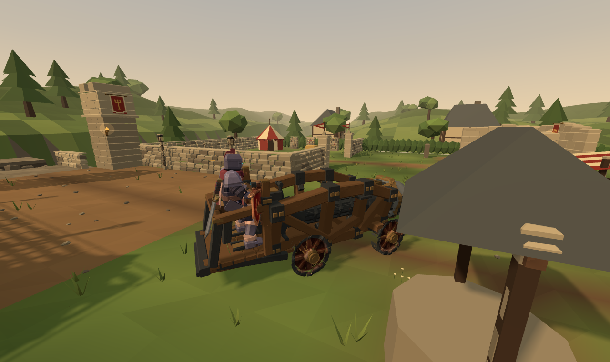
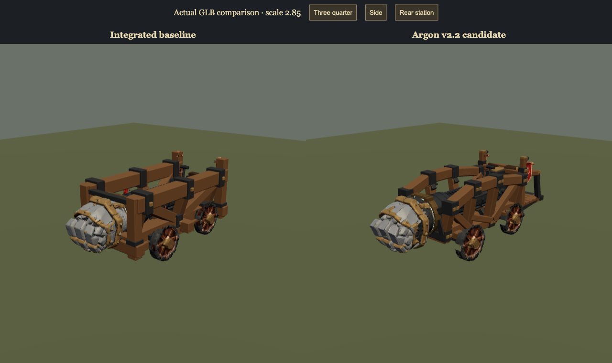

# SO FIST v2.2 review candidate

The actual Practice Yard now boards the production Spellblade onto the rear platform. Pelvis, boot soles and control hands share the inclined, interpolated carriage transform. The rider braces through recoil; dismount returns to collision checked ground. The same pose path serves local and remote character instances.

[Rear station comparison](matched-rear.png) · [Actual piston cycle](strike.mp4) · [Actual reverse and steering](drive.mp4)

## Decisions

Argon's geometry is retained at Castleward's existing 2.85 scale. The larger rear boarding station replaces ground operation. A stretched timber atlas region on the braces/platform now uses the existing walnut material. Fist, wheels, piston, heraldry and the four clips remain authored geometry. Whole carriage animation tracks are excluded at runtime so wheel contact and authority remain registered; the mechanism and rider carry recoil.

The delivered Blender source differs from its GLB: it lacks thirteen station locators and exports substantially more vertices. Both original sources are preserved. A separate editable Blender source was reconstructed from the verified GLB and successfully exported through the repository helper. Disabling forced frame sampling preserves the twenty six fractional LINEAR stroke keys exactly.

Release is 0.68 seconds; maximum extension is 0.88 seconds. The independent four second firing interval remains. Collision can happen earlier than maximum extension. Shared stroke limits stop visible extension at actual obstacles. HUD and mechanical sound use the same release timing.

The production hand rig has static fingers. Its left palm braces the control bar; this pass adds no articulated finger grasp or detailed lever pulling animation.

## Files and preservation

| Area | Changed files and purpose |
| --- | --- |
| Shared fit and authority | `shared/sim/soFistGeometry.mjs`, `soFistication.mjs`: station transforms, boarding, safe exit, headroom, rear deck solids and actual stroke curve |
| Rider and camera | `client/game/RamOperatorPose.mjs`, `SpellbladeAnimator.mjs`, `RemotePlayers.mjs`, `SpellbladeAssets.mjs`, `GameRuntime.mjs`: production rig pose, restoration, carriage attachment and sightline |
| Presentation | `client/worlds/SoFisticationRenderer.mjs`, `client/game/sound/SoFistSound.mjs`, `client/ui/soFistHudView.mjs`: authored asset, recoil, matching audio and HUD |
| Source | `assets/source/so-fist-ication/`: supplied source, runtime matching source, prior GLB rollback and provenance manifest; canonical `SoFist-crafted.blend` unchanged |
| Export and checks | `tools/assets/export-so-fist.py`, three ram test files: reproducible asset and focused regression coverage |

Hull 1400, fist 500, wheels 180, Drive 250; speeds 4.8/2.5/12 m/s, pressure, 30 Hz, steering, terrain, contact energy, mitigation and structure budgets are preserved. No provider simulator, replacement renderer, new character or input system is introduced.

The actual prior runtime is 5,356,608 bytes. The final source export is 5,355,244 bytes, 1,364 bytes smaller, with 51,990 vertices, 33 nodes, 17 meshes and four clips. Original 1024 square textures remain. The old runtime is preserved outside the HTML5 package; no duplicate runtime asset is shipped. SHA256: `479d96ec89f0c2e36aa4a042305061cc1a16101ad6d7ce068c8184b8e566170b`.

## Verification and limits

Syntax verification passes for 537 modules. The focused run passes 115 tests covering ram movement/contact damage, Guard/Steel, wall arrest, damage fallback, boarding/headroom/exits, disconnect, structure damage, network structure replication, touch controls, camera and ballista presentation. Four rider checks and asset validations cover the changed contracts. HTML5/release checks pass 21 tests and the HTTP/WebSocket smoke check passes. Full gameplay suite was deliberately omitted per the creator's request for proportionate testing.

Real browser Practice/Inspection controls produced boarding, elevated boots within about 5 mm of the footrests, forward Charge, wall stopping, reverse at 2.5 m/s, steering, first person sight, piston release and safe dismount. Captures use actual integrated gameplay. `strike-facts.json` records the real strike event and renderer positions; `drive-facts.json` records authority during the reverse/steering clip. Touch was emulated. Native keyboard firing worked; a complete physical keyboard/mouse pass, physical phone and live second observer were not performed. Terrain and combat variants use focused authority regressions rather than fresh exhaustive manual replay. No frame pacing improvement is claimed.
