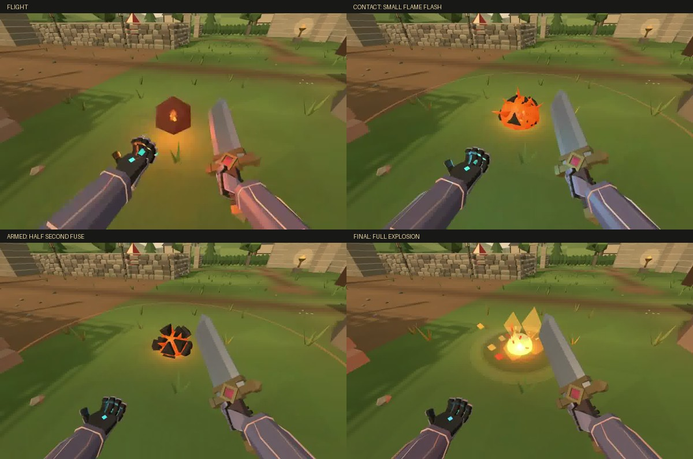
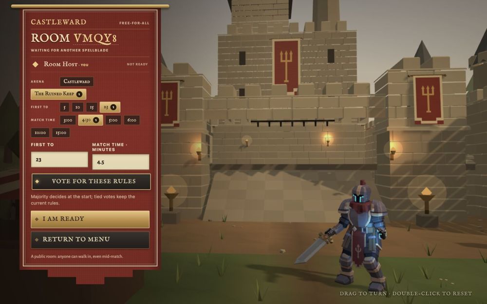

# Spells and room setup

Coreflagration now holds its armed core for 0.5 seconds, down from 0.9. Initial damage remains 5, followed by the existing 20 damage explosion and 6 burn. The existing GLB flight and countdown clips now play. Contact produces a short outward flame flash. A thin fixed 3m warning perimeter replaces the asset's opaque triangular warning spikes. Final detonation uses the ordinary explosion renderer.

[Actual Coreflagration cast](coreflagration.mp4)

Gale samples its selected mode at the end of the existing 0.5 second gather. Swipe upward for Burst, downward toward yourself for Sustained, or tap for Balanced. Returning near the button center during the gather restores Balanced, with hysteresis between the thresholds. The mouse wheel provides the same choice during a keyboard cast. A short mode label confirms selection.

| Mode | Initial push | Continuing wind | Wind duration |
| --- | --- | --- | --- |
| Balanced | 18 m/s | 14 m/s | 0.55s |
| Burst | 22 m/s | 4 m/s | 0.14s |
| Sustained | 4.5 m/s | 10 m/s | 1.25s |

Balanced preserves existing handling. Every mode keeps the 6 second cooldown, normal protection and obstruction checks, and at most one damage application per target, capped at 8. Sustained wind can carry and lift bodies. Caster support requires a nearby real surface and has a bounded vertical velocity. The visible gust follows the actual wind duration. Chivalry retains its prepared spell fan on touch, which takes priority over the ordinary Gale swipe; desktop wheel shaping remains available during its Gale gather.

[Actual sustained Gale cast](gale-sustained.mp4) · [Duration frames](gale-duration.jpg)

Room setup now preserves controls across the 500ms lobby refresh. Public FFA rooms retain majority voting, including custom whole scores from 1 to 100 and clocks from 1 to 30 minutes. Private waiting rooms give the connected host mode, compatible arena, team size, score and clock controls. The host can swap opposing human or bot positions. Readiness clears after rule or team changes. Legacy votes cannot override private host settings.

[Private host settings](host-rules.png) · [Phone landscape team organizer](host-teams-touch.png)

The initial joined message now includes full rules and roster. Outerworks resolves correctly on the server. Reconnecting to a waiting siege respects human readiness. Existing bot replacement already worked in authority and is preserved; its slots now explicitly say OPEN SEAT. The redundant tutorial touch pause control is hidden, while the working tutorial Options retains restart, skip and return.

## Verification

Fresh `npm run verify`: syntax passes for 525 modules, 1,887 repository tests, 21 HTML5 tests and Smoke OK. Regressions cover the fuse deadline, profile commit and rejection, actual late wind entry, bounded lift, surface range, touch gesture cleanup, room rights and bounds, team preservation, bot replacement, host migration, reconnect readiness and real WebSocket joins during countdown.

Actual browser checks: typed 23 kills and 4.5 minutes, map and mode changes, public vote tallies, 2v2 Outerworks, an independent second client joining by code and replacing a bot, host swapping both humans, and both clients starting the real siege. Touch up, down and tap committed the three Gale profiles with unchanged aim. Browser keyboard Q and wheel committed Sustained. Captured and inspected both spell recordings and tutorial Options. Phone landscape layout checked at 844 × 390 without horizontal overflow.

Physical phone and physical desktop Pointer Lock were unavailable during this final pass. Browser keyboard and emulated touch paths were exercised. Network integration and shared simulation tests cover authority; a remote latency playtest of the new sustained lift remains useful. These provisional Gale force profiles warrant multiplayer balance feedback. No production asset, live itch page, upload, merge or deployment was changed.
