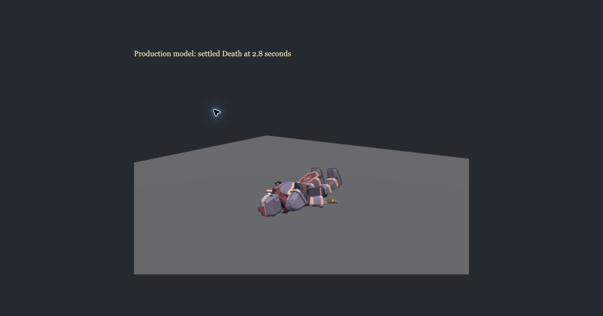
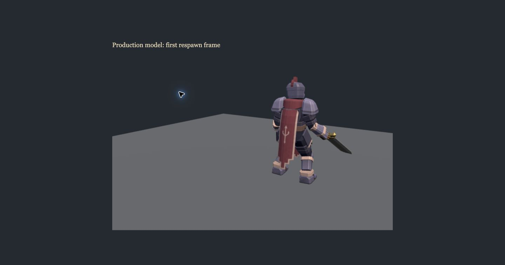

# Tutorial, remote death and prepared cast pass

Baseline: GitHub main `d7b3cf2`, with PRs 149, 150 and 151 merged. Isolated branch: `polish/tutorial-death-selection`. The original `feat/ultimate-voice-each-use` checkout remains untouched.

## Remote death

The former 1,050 ms visibility timeout is removed. Every dead remote player stays at the authoritative position until an actual living snapshot or room removal. Dead rigs remain excluded from `bodies()`; collision and target rules are unchanged. A life transition clears interpolation history, stale hit/cast/jab/landing state and cloth motion, avoiding a corpse interpolating into the spawn point.

The production GLB already has a nonlooping Death clip and immediate Death to Idle transition. No Blender/action assets were changed. A browser render fixture loaded the production model and RemotePlayers pipeline: at 2.9 seconds the body was visible, its 1.20000005 s Death clip was clamped at its final frame, and pelvis, spine, head and upper arm rotations matched 1.8 seconds exactly. Separation contained zero bodies. The first respawn frame was Idle at the supplied spawn point, with living pelvis orientation. An abyss fixture stayed at y = −20, and an empty room snapshot removed the rig.

These death captures are a renderer fixture, rather than fabricated gameplay kill screenshots. [Reproducible browser fixture](tutorial-media/preview/remote-death-inspection.js) can be evaluated on a local `?debug` Practice page. It exposes `__deathFixture.pose` for inspection and `__deathFixture.dispose()` for cleanup; it changes no server or room state.

## Tutorial

[Playable chapters, exact cutoff, all 23 new recording keys, browser evidence and remaining work](tutorial-framework.md).

Solo directly offers Tutorial Preview. Chapters I through III are playable with captions. The retained joke and honest development notice appear after “Then it seems best we remain strangers!” Full tutorial completion and server Renown remain unawarded.

## Spells & Chivalry

Desktop numeric choice sends one `castPreparedSlot` intent containing the prepared slot and current aim. Authority validates the integer slot and resolves its spell from the player’s own repertoire, then calls the existing select and cast path. Startup only preselects; active selection attempts the cast immediately. Cooldown, stagger, ongoing gather, shared projectile lockout and ultimate expiry continue to apply. An unavailable chosen spell remains current and is displayed with its real cooldown. No gauntlet fallback is introduced.

Touch already used the existing atomic `castPreparedSpell` path; it is preserved and tested. HUD, Armory and How to Play now describe choose and cast, with startup preselection distinguished. Q release does not fire a duplicate spell after numeric selection.

## Gameplay values and overlap

Damage, hit windows, durations, movement speed, stamina costs, Guard rules, bot skill and ultimate tuning are unchanged. The presentation timeout removal does not change the respawn timer. Voice director, recorded lines, Credits VO, menu music, Sunder, Vortex, terrain and ultimate startup are untouched.

## Verification

Final focused suite: 102 passing tests, including real two client Chivalry broadcast.
Full `npm run verify`: 1,159 passing game tests, 4 passing HTML5 export tests, syntax validation of 373 modules and HTTP/WebSocket smoke pass.

The actual itch.io iframe and hardware touch remain release checks after approval. No game publication, deployment or main merge was performed.

## Changed files

1. `client/game/InputController.mjs`
2. `client/game/InputController.test.mjs`
3. `client/game/RemotePlayers.mjs`
4. `client/game/remoteSnapshots.mjs`
5. `client/game/remoteSnapshots.test.mjs`
6. `client/index.html`
7. `client/main.mjs`
8. `client/network/GameLink.mjs`
9. `client/network/GameSocket.mjs`
10. `client/network/LocalHost.mjs`
11. `client/network/preparedCommands.test.mjs`
12. `client/tutorial.css`
13. `client/tutorial/TutorialDirector.mjs`
14. `client/tutorial/TutorialDirector.test.mjs`
15. `client/tutorial/TutorialMovementCues.mjs`
16. `client/tutorial/TutorialMovementCues.test.mjs`
17. `client/tutorial/TutorialSession.mjs`
18. `client/tutorial/TutorialSession.test.mjs`
19. `client/tutorial/TutorialView.mjs`
20. `client/tutorial/TutorialView.test.mjs`
21. `client/tutorial/tutorialChapters.test.mjs`
22. `client/tutorial/tutorialRecordings.mjs`
23. `client/tutorial/tutorialRecordings.test.mjs`
24. `client/tutorial/tutorialScript.mjs`
25. `client/ui/HUD.mjs`
26. `client/ui/preparedHud.test.mjs`
27. `docs/tutorial-death-selection-pass.md`
28. `docs/tutorial-framework.md`
29. `docs/tutorial-media/preview/approach.png`
30. `docs/tutorial-media/preview/cutoff.png`
31. `docs/tutorial-media/preview/death-settled.png`
32. `docs/tutorial-media/preview/naming.png`
33. `docs/tutorial-media/preview/opening.png`
34. `docs/tutorial-media/preview/remote-death-inspection.js`
35. `docs/tutorial-media/preview/respawn-first-frame.png`
36. `docs/tutorial-media/preview/rival.png`
37. `docs/tutorial-media/preview/sprint-prompt.png`
38. `docs/tutorial-media/preview/touch-landscape.png`
39. `docs/tutorial-media/preview/touch-portrait.png`
40. `docs/tutorial-recording-plan.json`
41. `server/tests/chivalry-network.test.mjs`
42. `server/tests/chivalry.test.mjs`
43. `shared/sim/wire.mjs`
