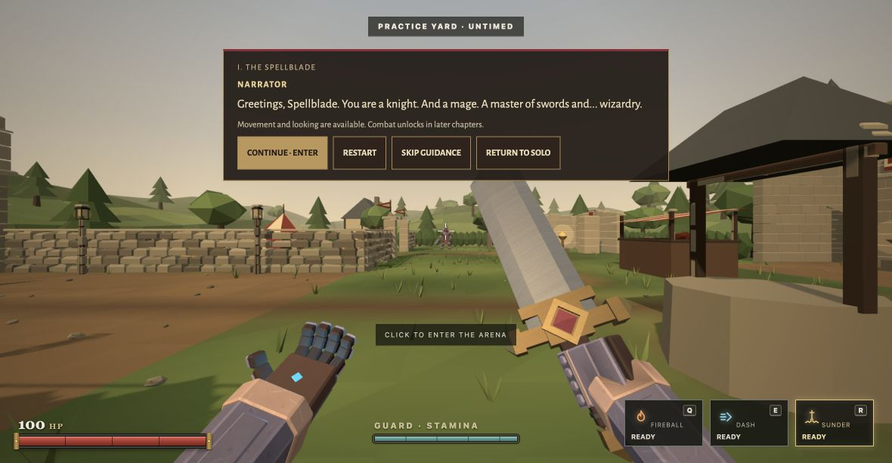
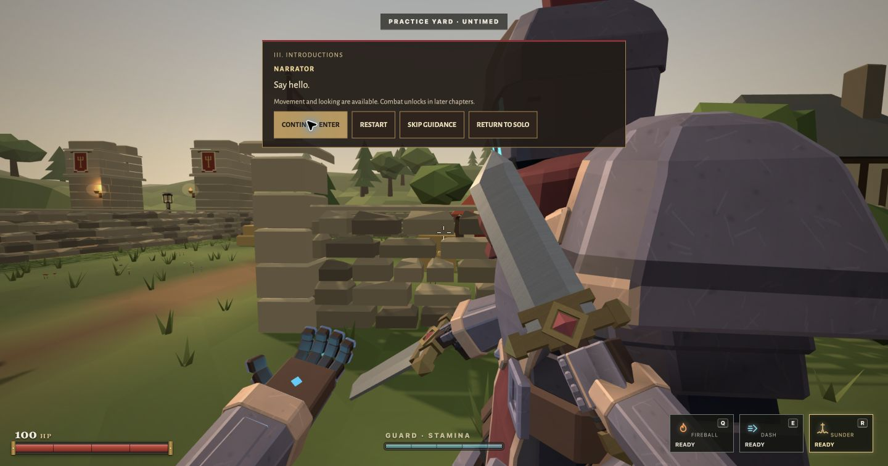
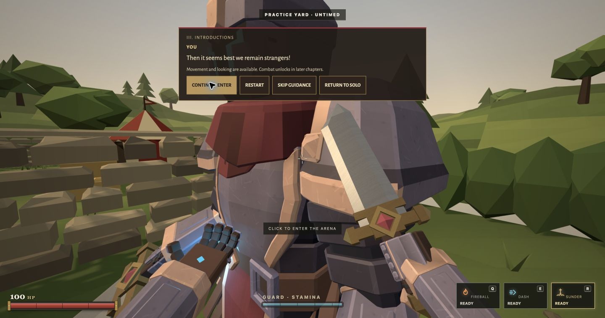
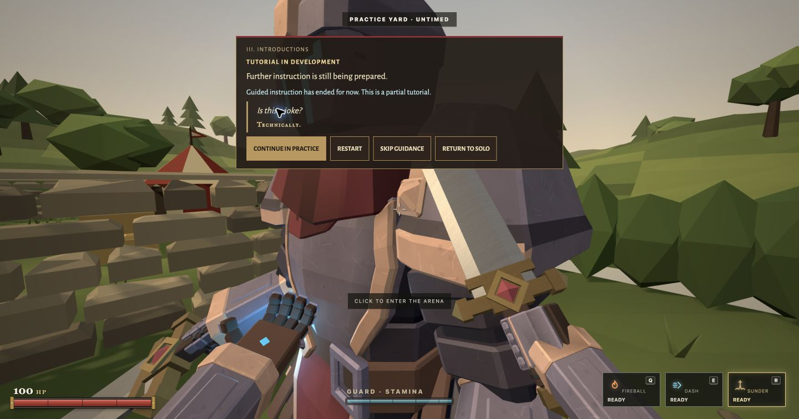
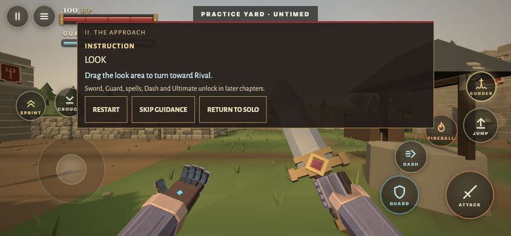
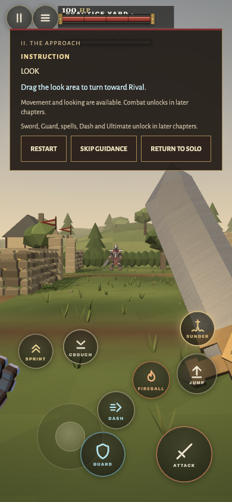

# Castleward tutorial preview

Solo now launches a playable local caption driven preview. Its intentional endpoint follows chapter III, immediately after YOU says “Then it seems best we remain strangers!” The creator’s “Is this a joke? Technically.” notice appears there, with Continue in Practice, Restart and Return to Solo. Reaching this boundary records neither full tutorial completion nor server Renown.

## Chapters and current availability

| Chapter | Current playable content |
| :--- | :--- |
| I. THE SPELLBLADE | Existing introduction and sighting of Rival |
| II. THE APPROACH | Look, genuine progress toward Rival, sprint, real stamina drain, winded state, recovery and conversational proximity |
| III. INTRODUCTIONS | Greeting, resemblance and the creator’s new naming exchange |
| IV. NEGOTIATIONS | Script and genuine contact cue foundation retained; staging remains unfinished |
| V. CORRESPONDENCE | Script and Guard/postscript cue foundation retained; staging remains unfinished |
| VI. ACTUAL DUEL | Script and real outcome tracking retained; responsive duel handoff and endings remain unfinished |

`TUTORIAL_CHAPTERS` owns stable beat IDs, availability and chapter titles. `TUTORIAL_BEATS` remains a flattened compatibility export. `TUTORIAL_PREVIEW_STOP` currently selects `introductions`; the director can stop after any implemented chapter and rejects an unimplemented boundary. Extending the cutoff requires completing that chapter’s session choreography and control permissions first.

The optional frolic exchange is separate from the main progression. It can appear once per run after substantial wandering away from Rival. Its separate cue and Continue Aside control never replace or block the main action gate. Restart resets its eligibility and rejects audio callbacks from the earlier run.

## Genuine movement and control protection

`TutorialMovementCues` reads ordered local snapshots. It remembers genuine actions performed during dialogue rather than forcing players to repeat them later. Current gates use aim changes, four metres of approach progress, real forward sprint movement, a five point stamina decrease, actual exhaustion, the existing 25 point sprint recovery threshold, and proximity within 3.4 metres. Teleport/death discontinuities do not count as walking. The frolic threshold requires 35 metres of travel and at least six metres farther from Rival than the starting distance.

All stamina comes from the normal `guardStamina` and `sprinting` fields. Sprint remains 11 m/s, costs 10 stamina/s and uses the existing combat implementation. Narration advances with explicit Continue or Enter while recordings are missing. Action gates never depend on an invented narration timer.

`TutorialSession` stages an ordinary local Castleward Practice session, with a passive production Spellblade named Rival and normal 100 HP. During chapters I through III, looking, walking and sprinting are available. Sword, Guard, spells, Dash, Ultimate, jump and crouch are visibly deferred. Protection exists both before local prediction and at LocalHost’s tutorial command filter; shared combat rules are unchanged. Practice mutation tools are hidden during guidance. Trying an unavailable control shows an explanation.

Restart resets staging, movement facts, dialogue, camera aim and optional branch eligibility. Skip offers the development endpoint and Practice. Leaving disposes session listeners and the command filter. Continue in Practice starts the ordinary Yard and restores incidental combat voice. It deliberately begins a fresh Practice session rather than silently turning the scripted conversation into combat.

## Existing combat foundation preserved

`TutorialCombatCues` retains genuine sword contact, successful ordinary Guard/parry, natural Guard lowering, ordinary sword damage, and real duel outcomes. Sword swings alone, unrelated fighters, burns, Vortex contacts, ram blocks and forfeits cannot satisfy the wrong gates. The postscript still requires an ordinary strike after Guard lowers; held Guard is never bypassed. These foundations remain tested for future chapters, but the preview ends before their choreography.

The player remains YOU in captions and `spellblade` in the audio plan. The other actor remains RIVAL. Naming and movement dialogue are the creator’s exact editable draft, with no narrator explanation of the naming joke.

## Recording plan

All 33 established recording keys remain. The generated plan currently requests 56 spoken keys, including 23 new lines; this is a dated inventory, not a fixed final count. Prompt and stage beats have no spoken recording keys.

Regenerate after editing the script:

```sh
node --input-type=module -e "import { tutorialRecordingPlan } from './client/tutorial/tutorialRecordings.mjs'; console.log(JSON.stringify(tutorialRecordingPlan(), null, 2));" > docs/tutorial-recording-plan.json
```

[Full recording plan](tutorial-recording-plan.json)

| New recording key | Audio speaker | Exact creator text |
| :--- | :--- | :--- |
| `tutorial.introduce-yourself` | narrator | Go on. Introduce yourself now. You can do it. |
| `tutorial.he-may-introduce` | spellblade | I am a Knight. And a mage. He may choose to do so himself. |
| `tutorial.also-walk` | narrator | You can also walk. |
| `tutorial.quite-a-distance` | spellblade | He is quite a distance away. Is there any way of moving faster |
| `tutorial.run-faster` | narrator | Yes... you can run faster. |
| `tutorial.reminding-me` | spellblade | Aha! Thank you for reminding me. |
| `tutorial.what-is-below` | spellblade | This is indeed much faster. Wait, what is that below? |
| `tutorial.your-stamina` | narrator | That is your stamina |
| `tutorial.did-not-order` | spellblade | Why is it going down? I did not order it to. |
| `tutorial.consumes-energy` | narrator | Sprinting typically consumes more energy |
| `tutorial.not-typical` | spellblade | I am not typical! |
| `tutorial.clearly` | narrator | Clearly. |
| `tutorial.cannot-sprint` | spellblade | Hello? I can no longer sprint! |
| `tutorial.time-to-recover` | narrator | You need time to recover |
| `tutorial.sound-recover` | spellblade | Do I SOUND as though I need to recover!? |
| `tutorial.good-question` | narrator | ... Good question. |
| `tutorial.worth-speaking` | spellblade | When am I to find someone worth speaking to? |
| `tutorial.seem-certain` | rival | You seem certain that you will be able to |
| `tutorial.name-matters` | spellblade | Of course. I have a name. |
| `tutorial.properly-defeat` | rival | I only give my name to those who I properly defeat! |
| `tutorial.remain-strangers` | spellblade | Then it seems best we remain strangers! |
| `tutorial.frolic-fields` | narrator | The Spellblade decides to frolic in the fields, as he may one day never do so again |
| `tutorial.remembering-move` | spellblade | I am not frolicking. I am remembering how to move! |

Keep original takes and distinguish narrator, spellblade and rival processing. The narrator does not receive the knights’ helmet treatment. The current preview has captions and explicit Continue, with incidental runtime combat chatter suppressed. It adds no synthetic voice or guessed audio durations.

`playTutorialCue` remains the insertion point for decoded takes on the existing voice bus. It captions immediately, advances on the source’s actual `ended` event, and prevents stopped/stale audio from advancing restart or skip. A future loader must use `appUrl`, decode the creator’s takes and stop active playback when replacing or leaving a scene. Ordinary `VoiceBank.say` rules remain separate.

## Remaining production work

1. Recorded take ingestion, asset manifest, decoding and connection to live caption playback.
2. Rival conversational posing, sword drawing, controlled Attack and Guard demonstrations, and the abrupt ordinary postscript.
3. Camera and first person staging beyond the existing gameplay camera and production idle pose.
4. Release into normal responsive bot control and genuine duel outcome endings. The retained “Well, things do not always go according to plan.” / “Indeed.” exchange requires an appropriate defeat branch; a victory counterpart remains creator authored work.
5. Creator dialogue for Dash, one spell, the Guard/Sprint stamina connection and a true completion beat.
6. Progressive control permissions for the later chapters and authored responses where appropriate for refused actions.
7. Actual itch.io iframe checks after the candidate is approved and uploaded. Browser emulation does not prove hardware touch compatibility.

There is no separate combat simulator, tutorial damage tuning, unblockable postscript, Rival rename or premature completion award.

## Validation and observed limitation

The preview was walked through in the actual desktop browser from Solo to chapter III and its endpoint, using the production scene and models. Native mouse look, keyboard walking, Enter/Continue, early attack protection, real exhaustion/recovery, conversational proximity and Practice handoff were inspected. The automation tool supplied Shift only as a modifier flag, so the sprint exercise explicitly held the existing input controller’s Shift binding while native W drove movement. Stamina and progression still came from normal authoritative simulation; this is not a claim of an independently verified physical Shift chord.

Touch controls, captions, Continue, blocked attack feedback, skip, restart and Return to Solo were exercised in the browser. Direct viewport measurements covered 844 × 390 and 390 × 844 with 44 px actions inside the viewport. These are emulated touch checks. Desktop Pointer Lock succeeded in the foreground Chrome window; a background automation tab rejected it with WrongDocumentError.

A full stamina bar requires ten seconds of sprinting. Rival starts 25 metres away, so a player following the dialogue will often pass him before exhaustion and then turn back. This follows the creator’s required genuine winded sequence, but its pacing deserves playtesting before recording. A future authored suggestion to circle the Yard could clarify that exercise without changing movement or teleporting Rival.

The preview has no automatic checkpoint saving. Players can restart or leave at every step.

## Visual evidence







