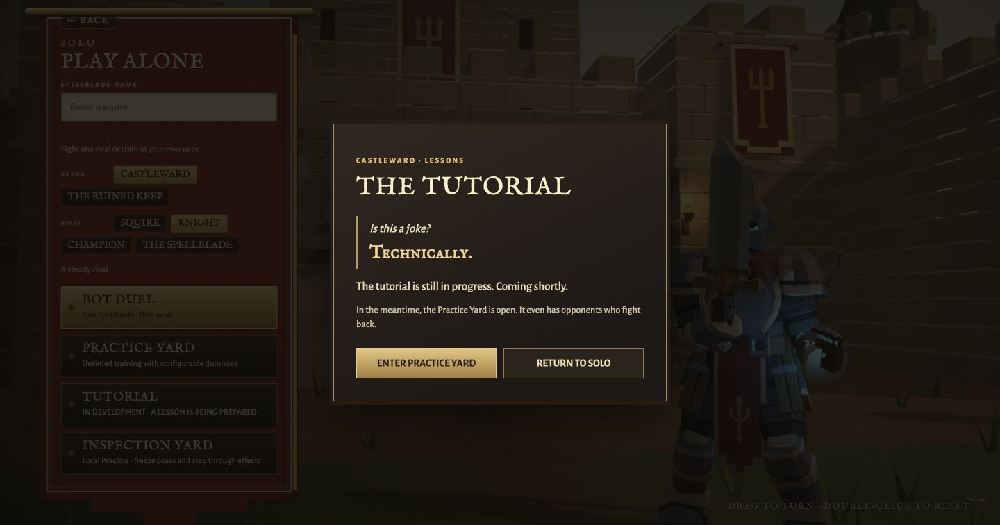
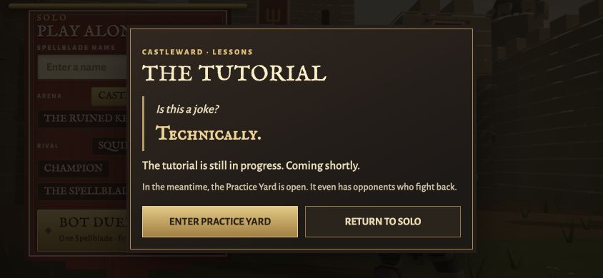

# Castleward tutorial — draft framework

**Status:** The player-facing Solo menu offers a clearly labeled *Tutorial — in development* notice. It is not yet a playable scripted tutorial. The notice can send players into the real, existing Practice Yard rather than faking a completed feature. This branch changes no combat mechanics, HP, Guard behavior, bot balance, or VO assets.

## What is ready

- `client/tutorial/tutorialScript.mjs`: one editable sequence with stable IDs and speaker attribution for future voice takes; written from the creator's preliminary draft, not final approved dialogue.
- `client/tutorial/TutorialDirector.mjs`: an isolated, testable progression state machine. Dialogue waits for `continue`; action prompts require the appropriate real gameplay cue rather than just time elapsed.
- Solo menu entry + accessible native dialog with the temporary joke: **“Is this a joke?” “Technically.”** followed by an honest under-development notice and a link to Practice.
- Tests verifying cue order, distinct sword contact / successful Guard / damage events, and skip/restart safety.

## Deferred — do not imply these are implemented

1. Connect the director to an actual **local** solo tutorial encounter and its HUD/subtitle display, with no remote dependency or server-verified Renown.
2. Create a staged rival using existing Spellblade assets and ordinary shared combat rules. He begins in a conversational pose, then draws his sword. He should not be replaced by a generic nonreactive target.
3. Align narrator, Spellblade and rival dialogue to recorded takes using the stable `tutorial.<beat-id>` recording keys. Editing lines is expected; don't script artificial pauses over unrecorded dialogue.
4. Advance `attack-prompt` on sword **contact**, not a button press; advance `guard-prompt` on a **successful Guard**. The postscript strike happens **after Guard has visibly come down**, then triggers the **normal** player-damaged event and current health presentation (the player has 100 HP at full health). There is **no** unblockable or arbitrary forced-damage rule.
5. Transition from the instructor-controlled setup to a real responsive duel. Let the ending dialogue adapt to the encounter outcome. Never override player competence just to force a scripted exchange.
6. Retain optional skip, replay, caption accessibility and a reliable return to Solo. Test desktop Pointer Lock, touch, local game flow, and actual itch.io iframe after the implementation.

## Recording session

Separate voices/performances: `narrator`, `spellblade`, `rival`. Stage/prompt entries do not require recordings. The script's `recordingKey` values are intended as asset identifiers, not claims that the files exist. Keep alternative readings and pauses where useful, particularly **“You did,” “There was an extra,”** and **“Indeed.”**

This framework intentionally leaves the script and scene choreography open for further editing before production.

## Hardening pass on 10 October

The original announcement, native modal, creator dialogue and all 33 recording keys were retained. The unfinished entry now follows Bot Duel and Practice, keeping playable activities first. The draft remains unpublished.

`TutorialDirector.cue` captures the current dialogue with a run token. Pass that token back to `completeDialogue(cue)` on playback completion. A prior line, skipped take or earlier run cannot advance a restarted scene. Construction no longer calls the owner before it can install the director reference.

`TutorialCombatCues` observes existing Room events for a specific local player and rival. Sword swings alone and another pair's fight cannot complete the contact gates. Guard breaks and Vortex or ram blocks cannot satisfy the successful defense gate. Burns and ultimate damage cannot satisfy the ordinary postscript damage gate; forfeits cannot finish the duel. A normal block or parry can satisfy Guard instruction. A new silent `lower-guard` staging beat waits for Guard to actually come down before the postscript strike; it never issues a Guard command. Reasserting Guard prevents the damage gate from succeeding. Ordinary rival sword damage then advances the scene. A genuine duel death in untimed Practice or a normal scored match ending can complete the duel, and the outcome is retained for the eventual ending.

There are 39 beats: the original 38 plus that silent staging gate. The creator's dialogue remains editable in `tutorialScript.mjs`. No additional spoken lines were written.

## Recording and playback insertion points

Generate tomorrow's recording list from the editable script:

```sh
node --input-type=module -e "import { tutorialRecordingPlan } from './client/tutorial/tutorialRecordings.mjs'; console.log(JSON.stringify(tutorialRecordingPlan(), null, 2));" > output/tutorial-recording-plan.json
```

The list identifies each speaker, line, source filename and output file base. Examples are `tutorial.greeting.wav`, `tutorial.you-did.wav`, `tutorial.admire-me.wav`, `tutorial.technically-correct.wav`, `tutorial.extra.wav` and `tutorial.indeed.wav`. Keep additional takes as separate originals. Preserve narrator, player and rival attribution while processing; the narrator should not automatically receive the knight's gruff helmet treatment.

The future tutorial asset manifest can retain the existing voice manifest's `lines` structure, under a separate tutorial asset base:

```json
{
  "lines": {
    "tutorial.you-did": [{ "file": "narrator/tutorial.you-did-1" }]
  }
}
```

The future loader should use `appUrl` for subdirectory deployments and decode M4A with WAV fallback using the existing audio context. Supply the decoded take to `playTutorialCue`. It uses `SoundEngine.playBuffer` on the existing voice bus, displays the supplied caption and completes on the audio source's actual `ended` event. Stop its handle when skipping, leaving or replacing the scene. Missing, suspended or muted audio can retain captions and explicit Continue; the helper invents no narration durations.

Do not pass tutorial keys to `VoiceBank.say` unregistered. That method requires ordinary combat voice rules and would fail for these new keys. The helper deliberately uses the existing audio engine without changing the combat voice director, Credits archive, menu music or existing VO.

A future local session can compose these adapters:

```js
let playback;
const director = new TutorialDirector({ onChange(progress) {
  playback?.stop();
  if (progress.current?.kind === 'dialogue') {
    const cue = director.cue;
    playback = playTutorialCue({ cue, buffer: decodedTakes.get(cue.recordingKey), engine,
      onCaption: showTutorialCaption, onComplete: cue => director.completeDialogue(cue) });
  } else {
    // Dispatch the creator's staging direction or show the ordinary input prompt.
  }
} });
const cues = new TutorialCombatCues(director, { local: true, playerId, rivalId });
const offEvents = localHost.on('events', batch => cues.accept(batch.events));
const offSnapshot = localHost.on('snapshot', snapshot => cues.snapshot(snapshot));
director.start();
// On leave: playback?.stop(); director.skip(); offEvents(); offSnapshot();
```

Bind to the actual local host/session, not background multiplayer events. LocalHost delivers ordered combat events before the new snapshot. Keep that order; using its previous snapshot to reinterpret a fresh hit would misclassify Guard transitions. The snapshot adapter handles a lowered Guard that occurred while dialogue was still running.

## Intentionally unfinished

Recorded take ingestion and decoding, live tutorial subtitles/Continue UI, the staged rival, camera choreography, temporary suppression of incidental chatter and the transition to normal bot control remain production work. These adapters are tested foundations, not a connected playable tutorial. Existing Practice fallback still starts ordinary Practice. HP, damage, hit windows, Guard rules, bot behavior and rewards remain unchanged.

Let the player keep Guard up during the postscript setup if they choose. The staging director can wait or acknowledge the defense once the creator writes that branch. If the player wins the final duel, use the observed outcome to revise the ending rather than forcing the rival's victory line after he has fallen.

## Verification and browser evidence

All 12 focused tutorial tests passed. Full `npm run verify` passed with 1,139 game tests, 4 HTML5 export tests, syntax validation of 364 modules, and the HTTP/WebSocket smoke check.

Actual browser checks covered 1440 × 756 desktop, 844 × 390 short landscape and 390 × 844 narrow portrait. The landscape check exposed clipped action buttons; reduced vertical spacing now keeps both 44 px actions inside the notice. Escape dismisses the notice and restores focus to the Tutorial entry. The Practice action honors existing name validation, starts the actual Practice Yard, and permits returning to the main menu. These checks validate the announcement and fallback, not a scripted encounter.

Desktop notice:



Short landscape after the spacing correction:


