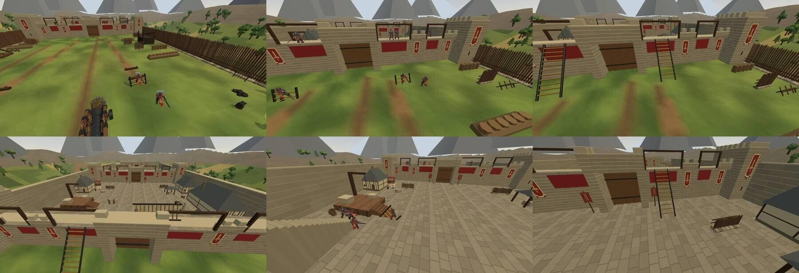

# Restless Day: autonomous siege bots, acceptance

A 5v5 Restless Day siege played to its end by bots. The human idles, carries a ladder off, or disconnects. All of it
runs on the authoritative sim: the server's 30 Hz step, the mode's own ladder rules (lip, foot band, the carry beam),
real combat, and sundown at 780 s.

## How to reproduce

```bash
# seeded authoritative match (node 24); --human idle|carry|leave, --root another checkout for a before/after
node scripts/world-bot-match.mjs RESTLESS_DAY restless-day 790 --seed 1 --human idle
# the same siege in real Chrome through the menus: drawn ladders and carriers against the authority, and a clip
CHROME_BIN=... SS_URL=http://127.0.0.1:3017 node scripts/restless-day-siege-browser.mjs 150 --out output/restless-day-siege
# unit tests for the coordinator, the planner and the rules touched
node --test server/tests/restless-day-siege-bots.test.mjs
```

## Seeded matches (790 s each)

### Before: the rebuilt map alone (#419, `--root`, same seeds)

| run | pickup | place | outer | inner | Renowner | end | picks / drops | blocked (bot-s) | void |
|---|---|---|---|---|---|---|---|---|---|
| s1 idle | 2.5 | 7.0 | 17.6 | never | never | defenders, sundown 780 | 6 / 0 | 3,165 | 0 |
| s2 idle | 2.5 | 7.0 | 27.6 | 119.8 | 121.6 | attackers, Renowner 210 | 2 / 0 | 765 | 0 |
| s8 leave | 2.5 | 7.0 | 26.3 | 342.6 | 344.8 | attackers, Renowner 725.6 | **164 / 161** | 2,250 | 0 |

Before #419, on main, no bot reached the wall in a 7-minute match. With #419 alone:
- **Bots get stuck.** In each run, 7 to 9 of the 9 bots were stuck for 15 s or more at some point.
- **The ladder loop is visible.** In s8, a ladder was picked up and dropped 164 times after the inner breach.
- **Seed 1 never breached the inner curtain.**
- **Seed 2 won faster than any run below.** The old defenders held fixed posts by slot and did not follow the fight;
  in phase 2 they stood in a line at z 47.

### This work

Times are seconds from the start of the match.
- *picks / drops*: ladder pick-ups and set-downs.
- *blocked*: seconds any bot spent stuck for 15 s or more without making headway, counted in 15 s samples.
- *recov*: stall recoveries.
- *void*: bots lost to the void.

| run | pickup | place | outer | inner | Renowner | end | picks / drops | blocked (bot-s) | recov | replans | void |
|---|---|---|---|---|---|---|---|---|---|---|---|
| s1 idle | 1.8 | 9.9 | 31.9 | 86.1 | 94.8 | attackers, Renowner 604.8 | 4 / 1 | 60 | 9 | 5 | 0 |
| s2 idle | 1.8 | 9.9 | 19.5 | 40.7 | 43.5 | attackers, Renowner 495.2 | 4 / 0 | 15 | 6 | 1 | 0 |
| s3 idle | 1.8 | 9.9 | 14.0 | 33.0 | 36.0 | defenders, sundown 780 | 4 / 0 | 0 | 4 | 1 | 0 |
| s4 idle | 1.8 | 9.9 | 16.3 | 53.9 | 56.7 | defenders, sundown 780 | 5 / 1 | 0 | 6 | 1 | 0 |
| s5 idle | 1.8 | 9.9 | 15.5 | 48.7 | 51.5 | attackers, Renowner 424.0 | 7 / 3 | 255 | 5 | 1 | 0 |
| s6 idle | 1.8 | 9.9 | 17.5 | 50.9 | 66.4 | defenders, sundown 780 | 5 / 2 | 60 | 5 | 4 | 0 |
| s7 carry | 1.8 | 9.9 | 17.4 | 40.9 | 43.1 | defenders, sundown 780 | 6 / 3 | 60 | 4 | 1 | 0 |
| s8 leave | 1.8 | 9.9 | 17.1 | 46.1 | 48.0 | defenders, sundown 780 | 5 / 1 | 45 | 1 | 1 | 0 |
| s9 carry | 1.8 | 9.9 | 18.7 | 68.3 | 71.4 | attackers, Renowner 744.3 | 5 / 2 | 45 | 10 | 2 | 0 |

How the human behaves in each mode:
- *carry*: the human walks to the nearest ladder at once, shoulders it, carries it toward the wall as far as z −50, then
  stands there holding it for the rest of the match.
- *leave*: the human disconnects at 60 s.
- *idle*: the human stands at spawn.

How the counts are kept:
- *picks / drops* count every pick-up and set-down, by bots and the human alike.
- *blocked* also counts a defender holding still at the dais in a long fight. Most of s5's 255 s is one defender
  knocked down into the field (see Limitations).
- Batch v8, run before the exit-guard change, gave the same picture: attackers won 5 of 9, outer breach 15–31 s,
  inner breach 34–118 s, nothing lost to the void.

- **Every match runs to a verdict.** There are no deadlocks.
  - Attackers won 4 of 9 by breaking the Renowner, at 424–744 s.
  - Defenders won 5 of 9 at sundown.
  - Sundown was not changed, and no defender was weakened to get this split.
- **The opening is the same in every seed.** First pickup is at 1.8 s and first placement at 9.9 s. Seeds only change combat.
- **No bot was lost to the void, in any run.**
- **Drop and re-pick loop:** at most 7 pickups in a match, against 164 pickups and 161 drops in the seed-8 baseline (and about 5,800 ladder events in the audit's 7-minute match).
  - In phase 2, any carried ladder is set down once and never picked up again (tested across a death and respawn).

## Browser acceptance (real Chrome, Metal GPU, idle human)

The game was launched through the real menus (Mettle → Restless Day → play with bots) on the browser's own
authoritative host, with the human idle. Every 2 s, each drawn ladder and each carrier's drawn rig was compared with
the authoritative state:

| run | samples | phases reached | outer / inner breach | deployed & lying ladders | carried ladders | carrier rigs | missing ladders | page errors |
|---|---|---|---|---|---|---|---|---|
| final | 134 (49 with a ladder in carry) | 0, 1, 2 | 21.8 s / 51.0 s | **0.00 m** | **0.00 m** | ≤ **1.24 m** | 0 | 0 |
| earlier code (guards at 0.9 m) | 134 / 138 | 0, 1, 2 | 18.1 s / 67.5 s | 0.00 m | 0.00 m | ≤ 0.76 m | 0 | 0 |

How to read the columns:
- The drawn ladder groups sit exactly on the authoritative positions, whether deployed, lying or on a shoulder.
- A carrier's rig trails his body by up to about 1.2 m, which is remote interpolation at walking pace. The pass limit
  is 1.5 m.
- In the frames, carried ladders ride on their edge at hip height along the carrier's heading, and deployed ladders
  stand against the landings with knights climbing them.



[The first 40 s as a clip](restless-day-siege-bots-clip.gif): the carry, the placement and the climb, at about 5× speed.

**The existing `scripts/restless-day-browser.mjs` regression still passes.** It covers staged Interact pickup and
placement, the real climb, ladder destruction and its replacement, and sundown. It passed 3 of 3 runs after one
staging change: the bots now shoulder `ladder-a` themselves, so the script has the carrying bot set it down before the
scripted knight takes it. Before that change it failed 2 of 3 runs, once at the pickup and once at the climb. The climb
failure was the two exit guards then closing the ladder's top, which is fixed in the guards, not the script.
In CI's slower Chrome the guards, now contesting the exit, could also outlast the script's climb stage by fighting
the climber. Since that stage checks the climb itself, the defenders are now staged back to the inner wall-walk just
before it, the same kind of disclosed warp the script already uses. With that, it passed 3 of 3, two of them at
10× CPU throttling.

## Failure attribution

What stopped the bots, and which layer it lived in:

| Layer | Failure | Fix |
|---|---|---|
| **Old map** (before #419) | Both curtains could be walked round. The field's rear and the dais's underside were open to the void. The bot graph was in three islands. | #419 (already in review) |
| **Old map** (this PR) | The outer stairs' heads sat beside the landings' hoarding posts. A carrier on the walk could not swing a 5.4 m ladder round to face down them, and the west walk had no carry route at all. | Stairs moved 1.6 m inward (x ±16.6..19) |
| **Old map** (this PR) | Two stacked crates closed the east stair's foot; the cart stood in the west ladder road | Moved to the dock's end and out of the road |
| **Old map** (this PR) | Defenders always respawned on the outer walk, even after it fell, and walked back across a lost bailey | Spawn posts on the inner walk (phase 1) and round the dais (phase 2) |
| **Shared navigation** | A route could start at a waypoint the bot could only drop from, so it ran at a ledge it could not climb | `routeBetween` starts and ends only where a bot can run (#418, tested on every world) |
| **Shared navigation** | `runClear` tested every ray against every solid: 133 ms per bot-graph rebuild when a ladder changed | Near-solids broadphase, identical answers (#418, tested on every world) |
| **Restless Day objective decisions** | The spare ladder's carrier was `rivalIndex 0`, which is the human's slot: two bots waited by it for good if the human never carried it | Team coordinator assigns only living, connected bots; a human's ladder is left to the human |
| **Restless Day objective decisions** | After the inner breach, carried ladders were dropped every tick and re-picked at once (about 5,800 events a match) | Set down once; no pickups in phase 2; the coordinator has no tasks in phase 2 |
| **Restless Day objective decisions** | The only ladder moved to the inner curtain while knights were still outside, stranding them | The last outer passage is kept while bots are in the field |
| **Restless Day objective decisions** | A lying ladder's pickup point was taken at ground height, so a ladder lying on the walk was fetched from the bailey under it | Pickup point at the ladder's own height |
| **Restless Day objective decisions** | A knight cut off behind a passed curtain had nothing to do | Goes to that curtain's gate and breaks it with his sword |
| **Restless Day objective decisions** | Defenders stood at fixed posts by slot (in phase 2, a line at z 47), not at the landings in use, and fought only what came into reach | Defenders hold the landing edge where a climber comes off (two per landing, also where a carried ladder is plainly heading), strike unattended ladders with spells, patrol the walk, and hunt attackers in their part of the castle and in the court |
| **Physical ladder movement** | `constrainRestlessCarry` reverted height as well as position, so a carrier whose ladder touched masonry in mid-air hung from it | Only the step across the ground is undone. If the ladder is jammed mid-fall, it is set down. The beam test itself is unchanged |
| **Physical ladder movement** | Combat overwrote `speedScale` each tick, so on the server a carrier ran at full pace (7.5 m/s) while the client predicted the carry pace (4.9 m/s) | `speedScale` includes the carry factor (0.65) |
| **Physical ladder movement** | Carriers walked straight at the landing. The beam caught on a post, the bot stopped dead, or it walked off the wall-walk | Carry planner: legs where the rule's own beam test passes at every 0.35 m and through every turn, ground underfoot (no drop or rise over 0.7 m), and room for the body. A stalled leg is avoided and replanned |
| **Physical ladder movement** | A ladder was lifted at a lone clear heading, which left the carrier unable to turn | Lifted only inside a sweep of at least 3 open headings (45°) |
| **Bot locomotion and recovery** | Bots pocketed between a deployed ladder's rails and the wall never got out | Headway tracking per bot. On a stall, a sidestep or an open direction for 1.6 s, then back to the goal |
| **Bot locomotion and recovery** | A bot's goal across a curtain was a point on the far side, with no way over | Bots cross by the nearest deployed ladder (to its foot, then straight up), or through a fallen gate |

## Limitations

- **A defender knocked down into the field stays there.** It patrols the outer wall's foot and climbs back only by a
  deployed ladder. Most of seed 5's blocked time is this one defender.
- **The single-ladder retrieval is the slowest path.** In seeds 7 and 9 the human carries one ladder off and keeps it,
  so the bots must bring the other down from the outer walk by the stair. In seed 9 the inner breach took 68 s,
  against 33–54 s in five of the six idle runs (86 s in seed 1). (Before the exit-guard change it took 118 s, with 9 replans and 32 recoveries.)
- **A carrier stalls about 6 s at the top of the outer stair** before it replans its turn to go down.
- **No gate fell in any run.** A knight cut off outside hacks at its curtain's gate, but by the gate's
  rules swords are slow against it. The coordinator keeps the last outer ladder while any bot is outside, so this matters
  only once that ladder is broken.
- Mobile was measured with desktop Chrome phone emulation and 4× CPU throttling (#419), not on a phone.
- 3 tests fail on main and here alike, because the Argon SO-FIST asset files are missing.
