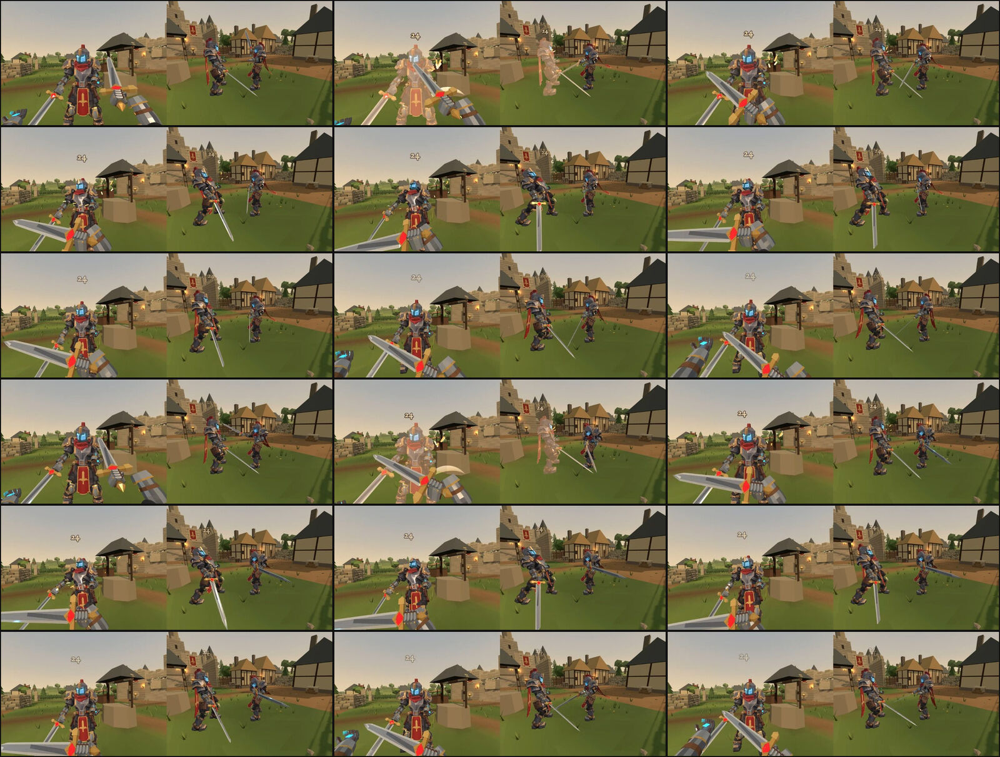
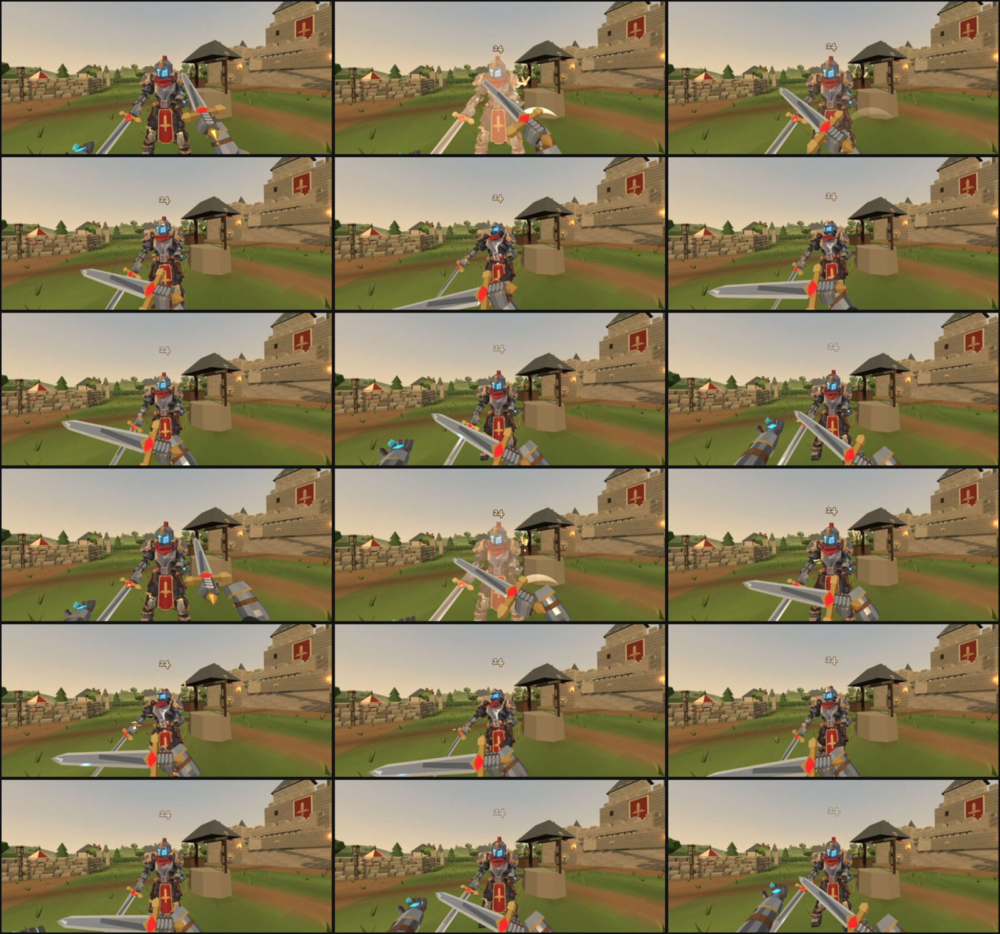

# Ordinary sword correction and the two Sword Techniques

Draft, for review. Nothing here is merged or deployed, and the canonical `spellblade.glb` / `spellblade-fp.glb` are byte-for-byte unchanged.

## What this is

1. **The first ordinary cut (the forehand) is a committed cut in both views.** First person: its follow-through was authored about a blade that is not the one shown, so the cut stalled just after contact and the blade then fell to the left on a still wrist. Third person: the canonical clip never turned the body and let the sword hang point-down after the cut. Both are corrected; timing, damage, recovery, the hitbox and Guard windows are untouched.
2. **Rigid Riposte and Whirl Like the Wind are playable**: one authoritative action in the room, chosen in the Armory's Sword Technique slot, on X (desktop) or the TECHNIQUE touch button, animated in first and third person from the same clips the server's blade is sampled from.
3. **Argon's candidate is reconciled, not adopted.** Its skeleton is identical to the canonical one, so its animation is usable; its geometry is not taken. A small animation-only sidecar carries the clips that were accepted.

## The first cut: what was wrong, measured

Tools: `scripts/fp-sword-audit.mjs` (first-person path through the real chain rules), `scripts/sword-loop-audit.mjs` and `scripts/lib/glbPose.mjs` (forward kinematics over the shipped GLB).

### First person (`client/game/fpSlash.mjs`)

| After the contact at 0.40 s | Before | After |
| --- | --- | --- |
| Blade turn rate at 0.40 / 0.47 / 0.50 s | 689 / 68 / 84 °/s (stalls) | 754 / 366 / 295 °/s |
| 0.53 to 0.63 s | speeds up again to 462 °/s while the wrist moves under 0.4 m/s; the point drops 26° | 153 falling to 60 °/s; the hand still travelling |
| 0.63 to 0.90 s | rebounds to level, then dips to −19° | held at −12 to −15°, under 45 °/s |
| Drawn blade vs server blade, on screen | mean 5.7° | mean 5.2° |
| At contact | ≤ 1.4° | ≤ 1.4° |

**Cause.** PR #430 turns each strike's keys about the fist so the drawn blade passes through the server's blade at contact, and lets that turn go between 0.06 and 0.24 s after contact. The forehand needed the largest turn of the three (authored 54° left and 12° down at contact; aimed 30° left and 18° up, about 40° apart). Its follow-through keys were authored about the un-aimed blade, so letting the turn go was itself a 30° fall of the blade with the hand already stopped. That is procedural correction stacked on authored motion, released in the follow-through. The backhand and the heavy strike were traced the same way and do not have it (their rates fall steadily after contact with the hand moving at 2.5 m/s or more).

**Fix.** The forehand's approach, contact and follow-through are authored where the aimed blade is (so there is almost nothing to turn and nothing to let go), the hand carries on across to the left hip while the blade slows all the way to the low-left position the server's backhand starts from, and the loading of the backhand is a hold there, not a rebound and a second dip. No angle is clamped. The same keys serve the rising chain's second cut. `client/game/fpForehandFollowThrough.test.mjs` fails on the old path and passes on the new one.

### Third person (canonical `Slash_1`)

| | Canonical clip | Revised clip (sidecar) |
| --- | --- | --- |
| Pelvis and chest heading through the cut | constant (0° of turn) | chest turns about 40° with the cut; pelvis and legs as canonical |
| Blade elevation, contact to end of follow-through | −11° falling to −18° | −9° rising to −1° |
| Tip height at the end of the follow-through | 0.83 m | 1.11 m, hand at the left shoulder |
| Recovery to the stance | tip passes 0.06 m above the floor at −40° | tip never below 0.2 m; crosses the front level |
| Start, raise and end poses; both feet | — | identical to canonical |

In a tap the body rests at the end of the follow-through, which is where the sword visibly hung. The revised finish is also the better set-up for the returning cut (canonical `Slash_2` raises on the left).

The hips still do not turn in third person. Turning the pelvis moves both feet (the legs hang from it) and the clip has no foot IK to re-plant them, so that needs Blender: see the requests to Argon.

One consequence handled deliberately: a cut broken off into Guard now starts from a higher, further finish, so that blend is 0.30 s (was 0.22 s) to keep the blade from being whipped faster than the fastest authored cut. The test that guards this now measures the authored cut itself instead of a literal 1.1 m.

### Nothing else moved

`SWORD_STRIKE_TIMES`, `SWORD_CHAIN`, `MELEE_CONTACT`, `BLADE`, damage and Guard code are untouched by the cut correction. The server's blade for the ordinary chain is the same arc as before, and the drawn blade is closer to it than it was.

## Argon's contributions

Package: `~/Downloads/Castleward_Rigid_Riposte_And_Whirl_PR_Package.zip` (2026-11-11), also in the Drive folder download beside it. Not committed (34 MB of GLB and 26 MB of Blender sources); the build script takes its `spellblade.glb` by path and refuses any file but the reviewed one.

| Item | Decision | Why |
| --- | --- | --- |
| Skeleton, rest pose, inverse bind matrices, sockets (TP 66 joints, FP 41) | **Identical to canonical** | Compared numerically: same joint order and parents, rest transforms and IBMs within 1e-4, `socket_sword` / `socket_sorcery` identical. So clips transfer by bone name |
| 12 `Technique_*` third-person clips | **Accepted, revised** | Clips meet end to end exactly; no root tracks. On the canonical model they stand 5 to 7 cm into the floor, so the pelvis is raised by one constant per technique (Riposte 0.072 m, Whirl 0.053 m) |
| `Slash_1` (revised by Argon) | **Accepted in part, revised** | Upper body of the cut and finish only. Whole clip rejected: it starts from a different stance (tip 0.6 m from the canonical Idle), sinks the boots 9 cm, and its recovery drags the tip through the floor (−0.00 m) |
| `Slash_1_to_2` and the other link clips | **Rejected** | The hands pass through each other (3 cm apart), and `Slash_2_to_3` drives the tip 0.47 m under the floor. PR #430's links are kept |
| Revised `Idle`, `Run`, `Sprint`, `Slash_2/3`, `Sunder_Strike`, `AllNatural_*`, Mordhau, siege clips | **Not taken here** | Out of this PR's scope; `Idle` changes the stance every other clip returns to (feet 7 cm lower, pelvis 3 cm higher) and would need all 46 clips to move together |
| Geometry: `Breastplate` (3,169 → 5,742 triangles, 7 cm wider, 9 cm lower), `Greave.L/R` (3 cm longer), gauntlets, `TabardBack` (4,096 → 2,768 triangles, 10 cm further in), `TabardFront` (4,096 → 1,496), FP `Arm.R` (6.6 cm narrower) | **Rejected** | A model change is its own review; the tabards are thinned; more clips are not a reason to replace the model |
| Textures (`GameBody_BaseColor` 3.77 → 2.85 MB) | **Rejected** | Recompressed; canonical kept |
| 12 `FP_Technique_*` first-person clips | **Not used** | First person is drawn from the server's moment by the existing arm paths (as the ordinary chain and the Vortex are), so the view never turns with a spin and the blade is the server's |
| `sword_technique_contact_manifest.json` tracks | **Superseded** | Tracks are re-sampled from the clips actually shipped (`shared/src/swordTechniqueTracks.mjs`), so they cannot drift from what is drawn |
| Supplied code (`combat.mjs`, `InputController.mjs`, `armoryView.mjs`, …) | **Design reference only** | Competing copies of production modules; a four-element Disaster and other ids that are not ours |
| Balance numbers | **Used** | 24/20, 5.7 m, 16/13, 0.60 s, 25 Prowess, 10 s, opposite spin |
| Startup 0.22 s for the Riposte | **Revised to 0.32 s** | The authored Enter (0.10 s) and Interception (0.22 s) clips are played at their authored speed so the blade drawn is the blade swept |
| +5.0 m of climb per revolution | **Revised to 5 m/s (3 m a turn)** | Provisional; five turns at Argon's figure is 25 m |

### Assets

| File | Bytes | SHA-256 | Status |
| --- | ---: | --- | --- |
| `client/assets/characters/spellblade/spellblade.glb` | 11,724,088 | `b43e5c3fb0c60a0a722577e0fad266efb3eef0f260fd88698e81192f41d10e80` | canonical, unchanged |
| `client/assets/characters/spellblade/spellblade-fp.glb` | 7,369,504 | `def9bf62a8b3c16f2974030d28db1ff395cc67425272699f0dc4fea1afda3dcf` | canonical, unchanged |
| `client/assets/characters/spellblade/spellblade-motion.glb` | 316,588 | `fd67e1f2be80fe1f901b177522841e6a6f55c095bf2f5964c71e5d4b49a2a687` | **new**: animation only (no mesh, skin or image), 13 clips |
| Argon `spellblade.glb` (candidate) | 12,868,412 | `9dae42a815f4108afab4fdab95673293422283b677ea97f06ac0375ba50516a1` | build input, not committed |
| Argon `spellblade-fp.glb` (candidate) | 6,868,440 | `1b12af5551b449ff25c8b6f75c4d1a661f6edd271a18a97e31c5eb4d743be904` | reviewed, not used |

Sidecar clips: `Slash_1` (replaces the model's own by name), `Technique_RigidRiposte_{Enter, Interception, Thrust, Recovery, Parried, Air}`, `Technique_Whirl_{Enter, Revolution, GaleLift, Exit, Interrupted, AirRecovery}`. Bone mapping is by name onto the canonical 66 joints; `root` is never animated, and a Whirl's turn is carried by `pelvis` in the clip. The runtime does not turn the knight for a Whirl (it does for a Vortex), so the spin is applied once.

Rebuild: `node tools/assets/build-spellblade-motion.mjs --candidate <Argon spellblade.glb>` (`--check` verifies the committed files). The client loads the sidecar through `spellblade-motion.json`; without it the model plays its own clips and the techniques fall back to `Slash_3` / `Vortex_Spin`. `server/tests/spellblade-motion-sidecar.test.mjs` pins all of this, including that the server's track is the clip's blade.

**No change to the canonical GLB is needed by this PR**, so no shared asset branch was opened. If one is opened later (for Argon's Idle, hips or geometry), this sidecar should be rebuilt against it and the three PRs should take the model from that one branch.

## The rules, as implemented

One action state per knight (`player.techniqueState`), one button (`techniqueHeld`), one cooldown (`techniqueReadyAt`), in `shared/sim/swordTechnique.mjs`; damage, Guard, Steel, Stagger and Prowess go through the room's existing functions. Tuning is in `shared/src/swordTechniques.mjs`.

### Rigid Riposte

| | |
| --- | --- |
| Course | sword raised 0.10 s, held across the front 0.22 s, thrust 0.26 s, recovery 0.35 s |
| Damage | 24 when the lunge's line passes within 0.2 m of the body's axis, 20 otherwise; a knight beside the thrust is not met |
| Lunge | 5.7 m along the facing at the end of the brace; steering after that changes nothing; it stops at the first knight or solid the point meets, and the body collides with the world as a Dash does |
| Interception | from 0.06 s to the end of the brace the raised sword turns an enemy blade or spell that actually crosses it (see below) |
| Guard | a held Guard blocks it at 1.5× pressure and can break; a timed parry (or Chivalry's) turns it: the user is staggered 0.68 s and plays the Parried clip, the defender earns the usual parry Prowess |
| Steel | blunted through `steelBlunt`, as a Vortex cut is |
| In the air | needs the Dash ready and takes its cooldown; no second movement is started |
| Cooldown | 10 s from where it ends or is broken off (Practice: the yard's usual 0.3 s gate, the real cooldown still shown) |
| Prowess | none to the user, for the blow or for what the sword turns |

**Interception is geometry, not facing.** The server asks whether the attacker's blade, on its way from the start of its swing to the middle of the defender, crossed the sword as it lies in the clip at that moment. Measured in the room, the defender pressing 0.2 s before the cut's contact:

| Attacker | Forehand | Backhand | Overhead |
| --- | --- | --- | --- |
| Dead ahead, 1.9 m | **lands** | turned | turned |
| Ahead and to the right | turned | turned | lands |
| Ahead and to the left | lands | turned | lands |
| Behind | lands | lands | lands |

The braced sword lies centre-right and high, so a right-to-left forehand from dead ahead comes round its outside. That is what "it must really intersect" produces with this clip. If the brace should cover the commonest opener from the front, the clip has to sweep across the front; that is an asset request, not a number to change.

### Whirl Like the Wind

| | |
| --- | --- |
| Course | 0.20 s to bring the sword level, then 0.60 s a turn, 0.25 s to finish |
| Damage | 16 a turn to a knight met on the blade, 13 if only the last fifth (the point) reaches them; each knight once a turn (a per-turn victim set, swept in steps of at most 3.5 cm, so adjacent ticks cannot hit twice) |
| Turns | first free; while the button is held each further turn spends 25 Prowess at the moment it begins: five turns from a full meter, then it ends |
| Movement | at a run; no sprint or crouch; ordinary gravity (it does not fall slowly, as a Vortex does) |
| Interception | only where the blade is passing at that moment; from behind the blade's position a cut lands |
| World | rings off what it clips and carries on; a wall still hides a knight behind it |
| Stagger | a broken balance ends it; balance does not drain while it spins |
| Gale Garner carried | may begin in the air, and a held Jump climbs at 5 m/s; the spell is not cast and its cooldown is not touched. Without it, it must begin on the ground and carries on through a fall |
| Cooldown | 10 s from where it finishes or is interrupted |
| Prowess | none to the user |
| Direction | clockwise seen from above; a Blazing Vortex turns the other way |
| Practice | the yard refills the meter every tick, so a held Whirl goes on; that refill exists only in Practice (tested against a match room) |

### Controls and loadout

| | |
| --- | --- |
| Armory | Sword Technique slot: Longsword Alone (default), Rigid Riposte, Whirl Like the Wind. Setting `loadout.technique`; sent with the loadout to the solo host and the server; kept from match to match |
| Desktop | X. It is the existing `siegeWeapon` binding: on foot it is the technique, on a ballista it is weapon focus, on the flyer it fires. Rebinding it moves both. Press to begin, hold to keep a Whirl turning, Space to climb |
| Touch | TECHNIQUE button, shown only with a technique equipped and on foot, above the spell. Held, it steers the view like ATTACK and GUARD; sliding the same thumb onto JUMP holds Jump as well, so one thumb whirls, steers and climbs while the other moves. A second finger on JUMP also works |
| HUD | a tile beside Dash, only when a technique is equipped and on foot: cooldown, and TURN n / LUNGE while it runs |
| Bots | do not use techniques (none was asked for) |

## Verification

### Tests

`npm test` on Node 24: **3,007 of 3,008 pass.** The one failure, `aerial: Half Fire widens the wave…` in `server/tests/disaster-elements.test.mjs`, fails identically on `main` at `d225dfeb` (2,976 of 2,977 there). The suite has 31 more tests than `main` (the old fixture-only prototype tests are replaced):

- `server/tests/sword-technique.test.mjs` (21): damage and lunge distance, commitment, wall and body stops, interception from each side, a spell cut where the sword is, Guard and parry, Steel, the Dash rule, cooldowns, Stagger, the five-turn Prowess ladder, release, no Prowess in a crowd or on a guard, Gale lift without the spell, Practice against a match, spin direction, replication, loadout.
- `server/tests/spellblade-motion-sidecar.test.mjs` (5), `client/game/fpTechnique.test.mjs` (3), `client/game/fpForehandFollowThrough.test.mjs` (5, with the old path shown to fail), plus changed tests in `armoryView`, `InputController` and `swordChainPresentation`.

### Recordings

Real Chrome (headless, GPU), a real game server, real input events. Videos are on branch `evidence/swordsmanship-techniques-20261112`; sheets are in this folder. Each has a full-speed WebM, a quarter-speed copy and `timeline.json` (authoritative events and the clip played each frame). Phone runs are a landscape phone **emulated in desktop Chrome, not a real phone.**

See [RECORDINGS.md](RECORDINGS.md) for what each run measured. In short: every run rendered at 56 to 60 fps with no page errors; the Riposte did 24 on desktop, emulated phone and to a second client; the Whirl did 16 then 13 as the shove carried the dummy to the point's reach, and 16, 16, 13, 13 on a second client, who received the same events the actor did; with Gale Garner carried a held Jump (Space, or the thumb slid from TECHNIQUE onto JUMP) climbed about 12 m.

The first cut, `main` above and this branch below (stills from the recordings, 0.34 to 0.95 s after the press, first person left and third person right):

Techniques: [Riposte](desktop-riposte-sheet.jpg), [Riposte in the air](desktop-riposte-air-sheet.jpg), [Whirl](desktop-whirl-sheet.jpg), [Whirl with Gale Garner](desktop-whirl-gale-sheet.jpg); emulated phone [Riposte](phone-riposte-sheet.jpg), [Whirl](phone-whirl-sheet.jpg), [Whirl climbing](phone-whirl-gale-sheet.jpg); a second client's view of the [Riposte](remote-riposte-sheet.jpg), the [Whirl](remote-whirl-sheet.jpg) and the ordinary chain [before](before-remote-slash-chain-sheet.jpg) and [after](after-remote-slash-chain-sheet.jpg).

Armory to Practice to reload (`scripts/swordsmanship-armory-browser.mjs`, real clicks): the Whirl card is clicked, the setting and the solo host both read `whirl_like_the_wind`, the yard's knight carries it and its HUD tile shows, and after a reload it is still chosen ([Armory](armory-whirl-equipped.jpg), [HUD](practice-hud-technique-tile.jpg), [armory.json](armory.json)). Known cosmetic fault: the technique list has an empty band above its heading.

### Not verified

- A real phone. The touch layout, the slide-to-JUMP gesture and performance need one.
- Sound. The techniques reuse existing sword and Vortex recipes; none of it was heard.
- Balance in a real match, and bots facing a technique.
- The Whirl's third-person clip while running: the feet are the clip's planted turn, so they slide as a Vortex's do.

## Blockers and requests to Argon

1. **Hips in the third-person cuts.** `Slash_1/2/3` keep the pelvis fixed. Wanted: pelvis yaw leading the chest by a frame or two through each cut, with both feet re-planted by IK, starting and ending on the canonical Idle exactly (tip within 1 cm, feet within 1 mm).
2. **Technique clips authored on the canonical stance.** The candidate's are built on a stance 5 to 7 cm lower at the foot. Either re-export them on the canonical Idle, or deliver the new Idle with all 46 canonical clips re-posed to it, on one shared asset branch.
3. **Riposte brace coverage.** If the brace should turn a forehand from dead ahead, `Technique_RigidRiposte_Interception` needs the blade to travel from the right across to the left of the centre line at chest height (1.2 to 1.5 m) during its 0.22 s, with the tip no nearer than 0.4 m to an attacker at 1.9 m.
4. **`Technique_RigidRiposte_Parried`** starts 0.42 m (tip) from where the thrust is; it is blended in over 0.08 s. A version starting on the thrust's pose at 0.10 to 0.20 s would remove the blend.
5. **`Technique_Whirl_GaleLift`** is 0.14 m from `Revolution` at the same phase (pelvis 0.185 m higher). Same phase, same hands, only the legs changed, would let the two swap without a blend.
6. **Link clips**: `Slash_1_to_2` needs the hands kept at least 15 cm apart; `Slash_2_to_3` must keep the tip above the floor.
7. Geometry changes (cuirass, greaves, tabards, FP right arm) need their own review with side-by-sides against the concept; they are not part of this.

## Implemented and proposed

| | Status |
| --- | --- |
| Forehand follow-through, first person | Implemented, tested, recorded |
| Forehand cut and recovery, third person and remote view | Implemented through the sidecar, tested, recorded |
| Hips driving the third-person cuts | Proposed (needs Blender: request 1) |
| Rigid Riposte: rules, input, Armory, first and third person | Implemented, tested, recorded |
| Whirl Like the Wind: rules, input, Armory, first and third person | Implemented, tested, recorded |
| Gale lift | Implemented at a provisional 5 m/s (recorded: about 12 m gained over a four-turn Whirl in Practice) |
| Riposte brace covering a forehand from dead ahead | Proposed (request 3) |
| Technique combined with Spells & Chivalry | Not implemented: a technique cannot begin during any Ultimate |
| Physical shields | Not in the game; nothing to respect yet |
| Coreflagration against a technique blade | Not intercepted (its own parry rules stand) |
| Bots using techniques | Not implemented |
| Technique-specific sound and hit effects | Reuses existing ones; a thrust currently shows the sword's ordinary hit burst |
| Replacing the canonical GLB | Not done, not needed here |

## Decisions for the creator

1. The Riposte's startup is 0.32 s (authored clips at authored speed), not Argon's 0.22 s.
2. A forehand from dead ahead beats the brace (table above). Keep the honest geometry, or ask for a wider brace clip?
3. A held ordinary Guard blocks a Riposte at heavy cost. The design note had only a parry or a shield stopping it.
4. The Whirl's climb is 5 m/s with Gale Garner carried: about 12 m over four held turns in the recording. That is high; say the height you want and it is one number.
5. X is shared with the siege binding by context; it is one row in Controls.
