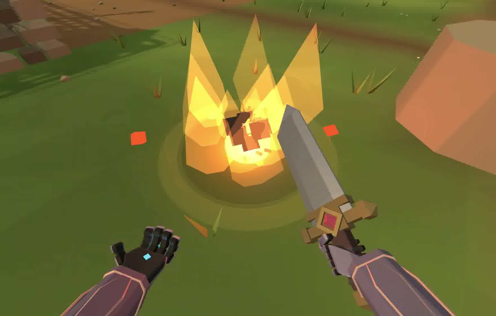

# Combat voices, Gale and Coreflagration

Coreflagration now erupts after a 0.6 second armed fuse. The second blast vents a tall angular flame plume and throws dark stone fragments, on top of the existing pressure front, light and ground mark. The initial outward flash and rocky flight/countdown asset remain. This is presentation only: 5 initial damage, 20 final damage, 6 burn over 3 seconds, 3 metre radius, parry rules and cooldown remain intact.

[Actual keyboard cast](core-eruption.mp4). [Previous ordinary final blast](../spells-room-flow/coreflagration.mp4) is historical footage from the merged baseline, with different framing. In the new capture, authority armed at 960.5751, set detonation to 961.1751, and emitted the final blast at the next tick, 961.1906. The configured fuse is exactly 0.6 seconds; this observed run resolves after 0.6155 seconds. [Actual events](core-events.json).

## Gale

Burst push is 25, previously 22. Its 0.14 second wind duration, damage, Guard mitigation, cooldown, projectile bending and terrain collision remain. Controlled shared simulation with identical initial positions, a target 3 metres away, 120 Hz steps and one second of movement after release measured 9.8447 → 11.7977 metres of displacement. Both dealt 5 damage at that distance. Guarded displacement changed 1.9859 → 2.4062 metres with zero damage. Balanced measured 8.4482 metres under the same conditions. These are controlled authority measurements, rather than claims about a human multiplayer balance session. [Measurements](burst-measurements.json).

Sustained distributes its damage over current exposure during the existing 1.25 seconds. Fractional dose accumulates per gust and target before whole health points are emitted. Leaving, Guard, Steel, occlusion and reentry affect that same budget. A full ideal exposure integrates 7.296 raw damage after the existing final wind fade, emitting at most 7 whole damage, below the requested cap of 8. Ordinary body exposure can be lower. Fully hardened Steel can reduce the remaining fraction below one whole point. Balanced and Burst retain their single contact damage.

A gust still grants its initial shove, stagger and displacement prowess once. Ongoing damage adds none of those and avoids repeated damage dialogue, sword flinch or armor clang. Actual interruption and death cancel Sustained wind and its local presentation. The final partial simulation interval is integrated before expiry.

[Actual touch cast excerpt](gale-touch.mp4) shows the downward selection and wind against a training dummy while advancing. [Authority facts](gale-touch-facts.json) record five separate 1 damage events, from 334.7006 through 335.5359, with ongoing=true and push=null; the initial shove occurs only in galeBlast. A stationary caster's earlier cast pushed the target out rapidly enough to accumulate less than one whole point. Sustained remains primarily a carry and positioning tool. No HUD, touch control, menu or CSS source was edited in this pass.

## Recorded voices

The former fixed contextual ordering and per speaker cooldown allowed different nearby knights to favor the same first eligible recording. Each listener now retains successful audible sentence history for 30 seconds, within an 18 metre source neighborhood. A different knight repeating that line receives 0.08 times its existing chance. Other genuinely eligible lines are tried first within the same priority slots. Authored rarities, cooldowns, the 12 second ordinary sentence gap, words, takes, contextual triggers and spatial hearing remain. Forced cries and earned scenes retain their positions. Muted or silent output and cancelled recordings that never started add no audible history.

The rare defeat chorus is one authoritative semantic event: at least two real nearby defeats within 0.7 seconds and 12 metres, a single 3 percent roll, or 8 percent when qualified by real Vortex facts, with a 150 second group cooldown. It excludes tutorial/Practice/Bot Duel and dummies. Speakers must still be dead in that same life. Important existing defeat scenes keep their own reaction. The recorded defeat line alone gets an explicitly registered simultaneous group exception; ordinary speech remains serialized and spatially placed. Each source is scaled by the audible group count to restrain combined gain.

[Actual recorded chorus](chorus.m4a) uses existing human takes through SoundEngine and VoiceBank. The browser harness generates two genuine isolated simulation defeats and selects the test event deterministically; it does not demonstrate the production odds occurring naturally. Actual buffers overlap for 1.6288 seconds, with starts 150 ms apart and gain 0.4 each. Captured output peak is 0.4403, with no clipping. [Source timing and death facts](chorus-facts.json). The reproducible developer harness is client/game/sound/voiceChorus.browser.html and is excluded from HTML5 packaging.

A separate real server test connects two WebSocket listeners and proves both receive the same Vortex qualified semantic event and unchanged kill credit. Deterministic tests cover probability, cooldown, distances, living/new life/dummy exclusions, speech priority, overlapping sources, audible history, silent output, cancelled delayed playback, dose subdivisions, Guard, Steel, allied protection, death, reentry and interruption.

## Verification and limits

Fresh verification passes: syntax for 532 modules, all 1,905 repository tests, all 21 HTML5/release tests and Smoke OK. The full suite used the existing test list with concurrency limited to 2; the initial unrestricted run during browser capture timed out in two existing Chivalry network tests, both of which passed independently and in the final complete run. HTML5 export keeps the developer chorus harness and all evidence files outside the playable package. Actual Solo keyboard and emulated touch input were used. The chorus audio was captured from real browser AudioBufferSources and inspected through its timing and decoded levels; no physical listening session or live multiuser chorus playtest is claimed. Physical phone behavior and network latency under a crowded match remain useful followup checks. Provisional Burst tuning still needs ordinary player feedback. No new recordings, synthetic voices, model changes, dependencies, merge, deployment or itch upload.
